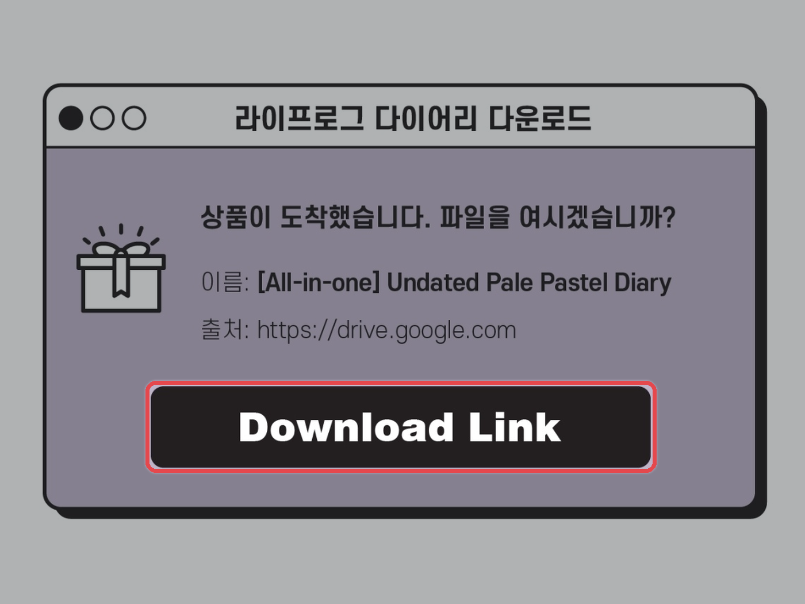
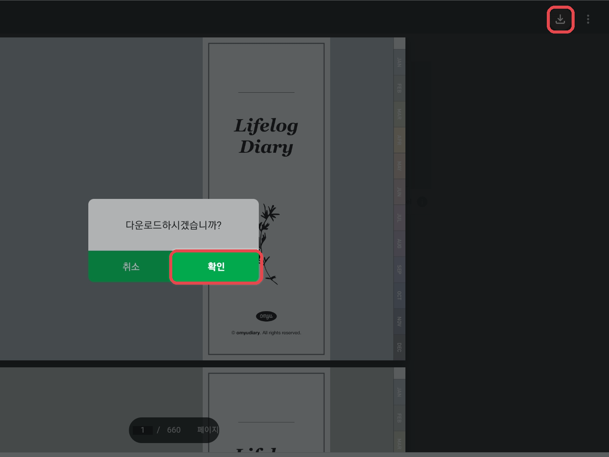
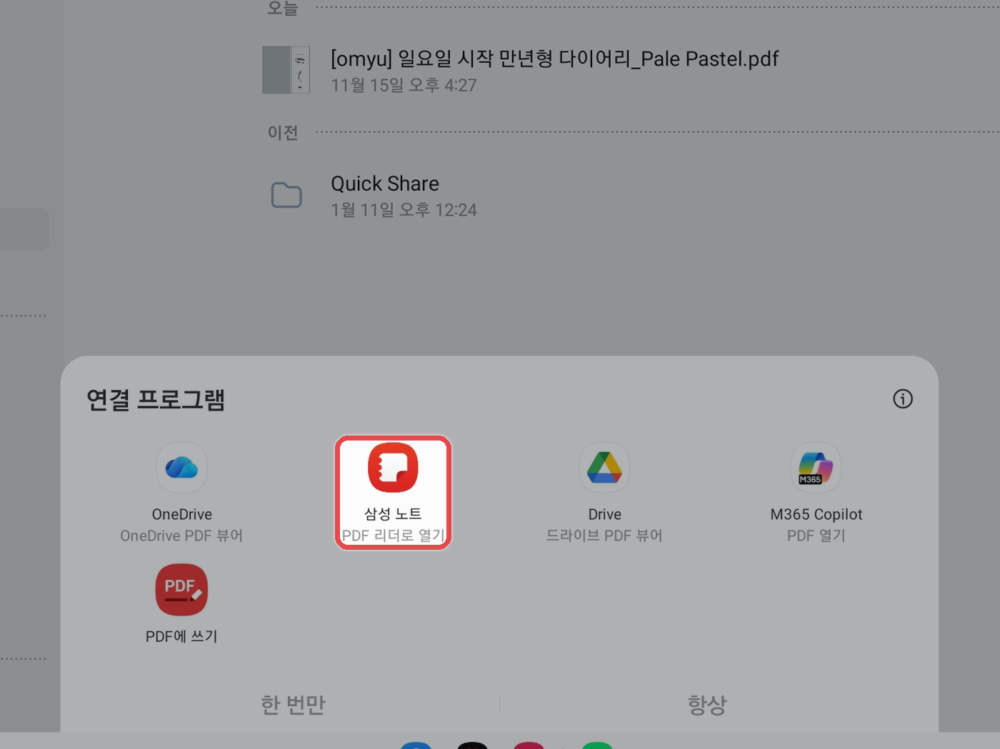
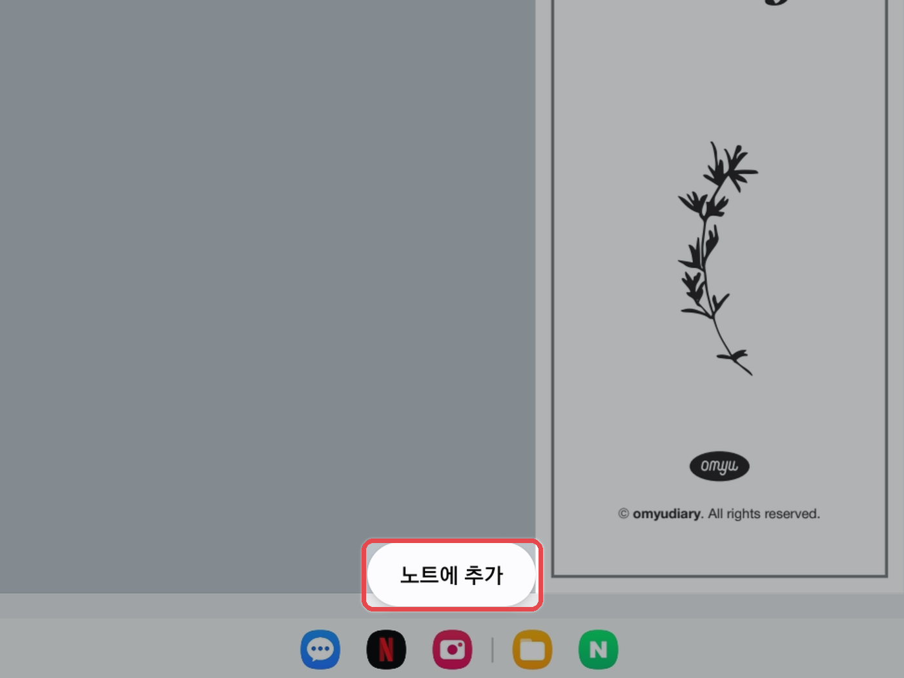

# 갤럭시탭



#### 메일의 다운로드 링크 열기

구매 후 받으신 메일을 열고 **\[Download Link]** 버튼을 눌러주세요.

<figure><figcaption></figcaption></figure>



#### 파일 다운로드

원하는 파일을 열고, 우측 상단의 **\[다운로드]** 버튼을 누른 후 **\[확인]**&#xC744; 눌러주세요.

<figure><figcaption></figcaption></figure>



#### 내 파일 앱에서 필기 앱으로 열기

내 파일 앱에서 **다운로드 완료한 파일**을 눌러주세요.\
(zip 파일은 한 번 클릭하면 자동으로 압축이 해제됩니다)\
**\[연결 프로그램]** 창이 뜨면 **\[삼성 노트]**&#xB97C; 눌러주세요.

<figure><figcaption></figcaption></figure>



#### 필기 앱으로 열기

**\[노트에 추가]**&#xB97C; 눌러주세요.

<figure><figcaption></figcaption></figure>




**압축을 풀지 않은 ZIP 파일은 필기 앱에서 열리지 않아요.** 꼭 압축을 푼 뒤 안에 있는 PDF 파일을 선택해 주세요.

