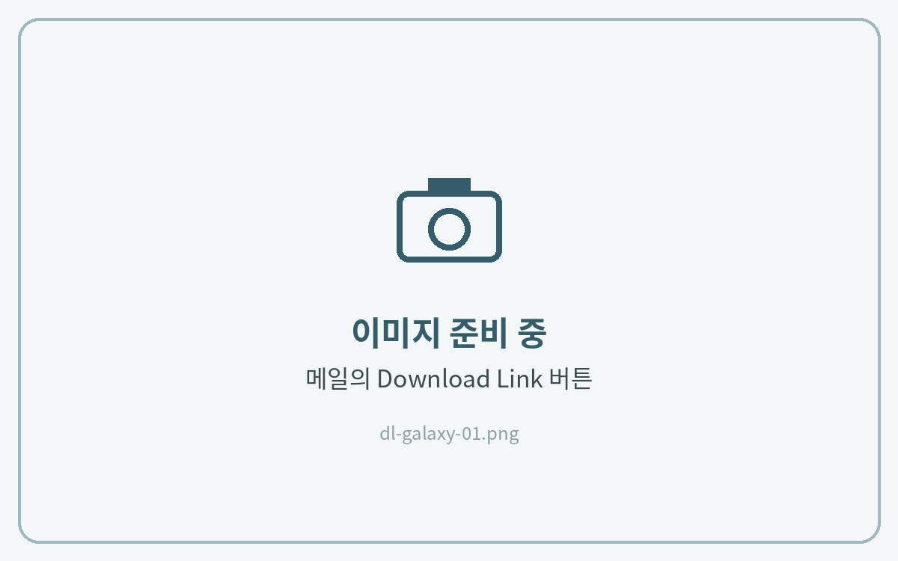
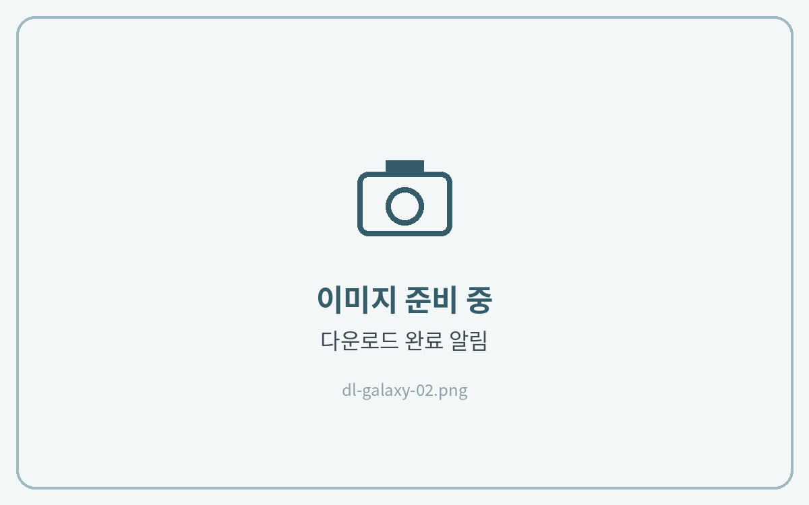
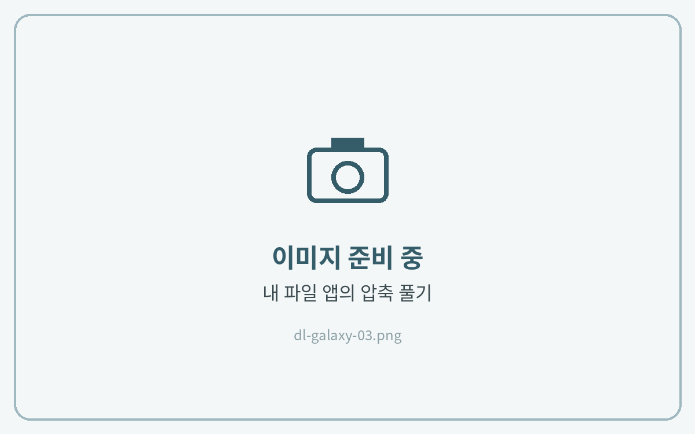
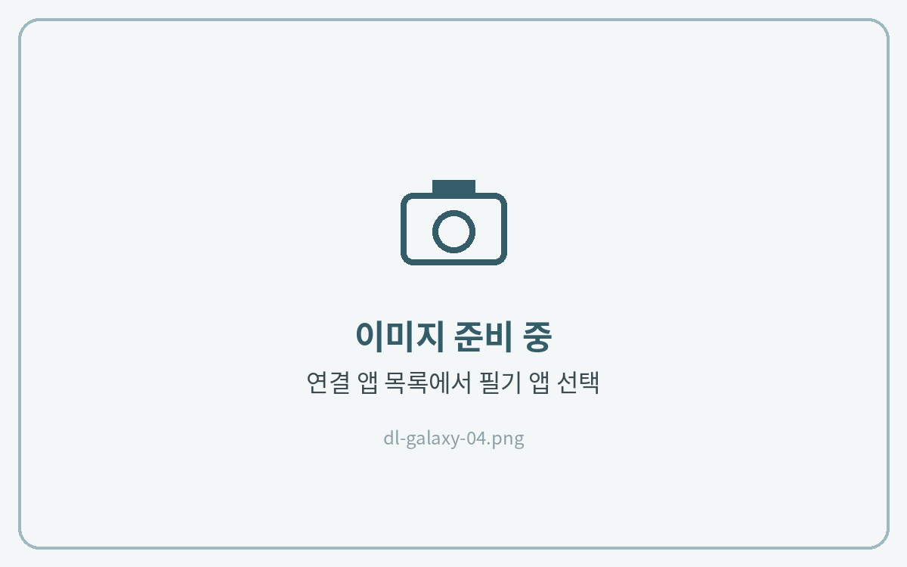

# 갤럭시탭



**메일의 다운로드 링크 열기**

구매 후 받으신 메일을 열고 **Download Link** 버튼을 눌러주세요. **크롬** 또는 **삼성 인터넷**에서 열어주세요.

<figure><figcaption></figcaption></figure>



**파일 다운로드**

**다운로드**를 누르고, 화면 위쪽에 완료 알림이 뜰 때까지 기다려 주세요.

<figure><figcaption></figcaption></figure>



**내 파일에서 압축 풀기**

**내 파일 → 다운로드** 폴더에서 ZIP 파일을 누르고 **압축 풀기**를 눌러주세요.

<figure><figcaption></figcaption></figure>



**필기 앱으로 열기**

압축을 푼 폴더에서 파일을 누르고 **연결 앱(다른 앱으로 열기)** 에서 필기 앱을 선택해 주세요. 또는 필기 앱 안에서 **가져오기**로 파일을 선택해도 돼요.

<figure><figcaption></figcaption></figure>





**압축을 풀지 않은 ZIP 파일은 필기 앱에서 열리지 않아요.** 꼭 압축을 푼 뒤 안에 있는 PDF 파일을 선택해 주세요.

