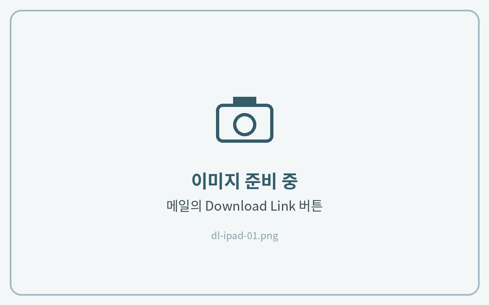
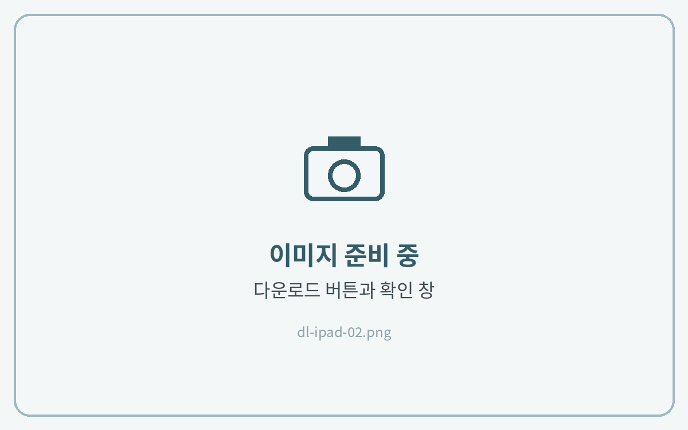
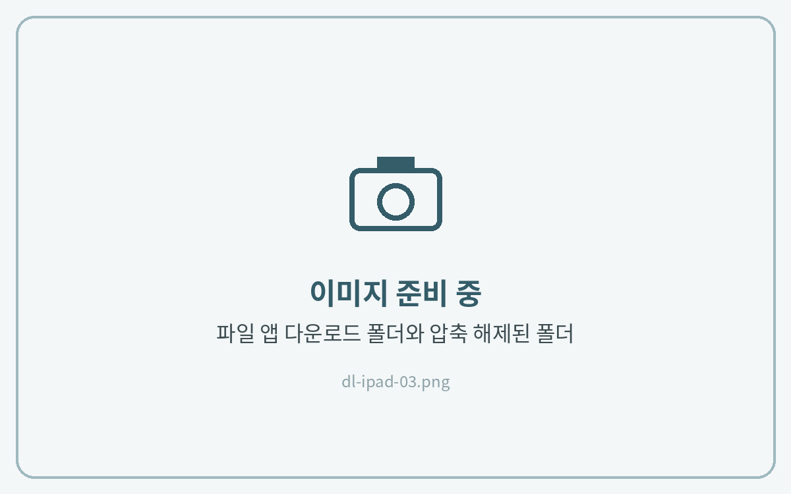
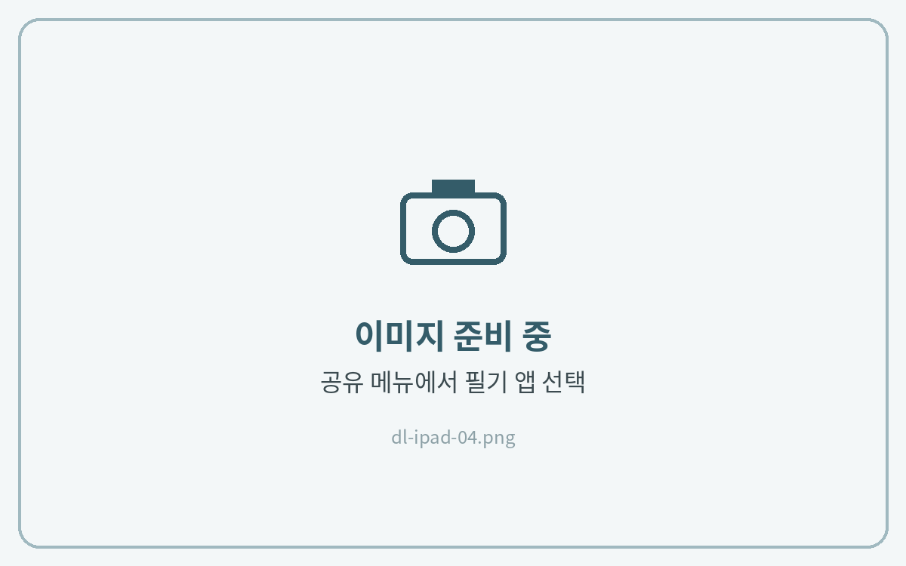

# 아이패드


아이패드에서는 꼭 **사파리(Safari)** 에서 다운로드해 주세요. 다른 앱에서 받으면 필기 앱에서 불러오기에 실패할 수 있어요.




**메일의 다운로드 링크 열기**

구매 후 받으신 메일을 열고 **Download Link** 버튼을 눌러주세요.

반드시 **사파리(Safari)** 에서 열어야 해요. 메일 앱에서 바로 열리면 오른쪽 위 **사파리로 열기**를 눌러주세요.

<figure><figcaption></figcaption></figure>



**파일 다운로드**

다운로드 페이지에서 **다운로드**를 누른 뒤, 확인 창에서 한 번 더 **다운로드**를 눌러주세요.

<figure><figcaption></figcaption></figure>



**파일 앱에서 압축 풀기**

주소창 옆 **다운로드(↓) 아이콘 → 다운로드 항목**을 누르면 파일 앱의 다운로드 폴더가 열려요.

**ZIP 파일을 한 번 탭**하면 같은 위치에 폴더로 압축이 풀려요.

<figure><figcaption></figcaption></figure>



**필기 앱으로 열기**

사용할 파일을 **길게 누르고 → 공유 → 필기 앱**을 선택해 주세요.

굿노트는 **새로운 문서로 불러오기**, 노타빌리티는 **새로운 노트로 가져오기**를 누르면 끝이에요.

<figure><figcaption></figcaption></figure>





**압축을 풀지 않은 ZIP 파일은 필기 앱에서 열리지 않아요.** 꼭 압축을 푼 뒤 안에 있는 PDF 파일을 선택해 주세요.

