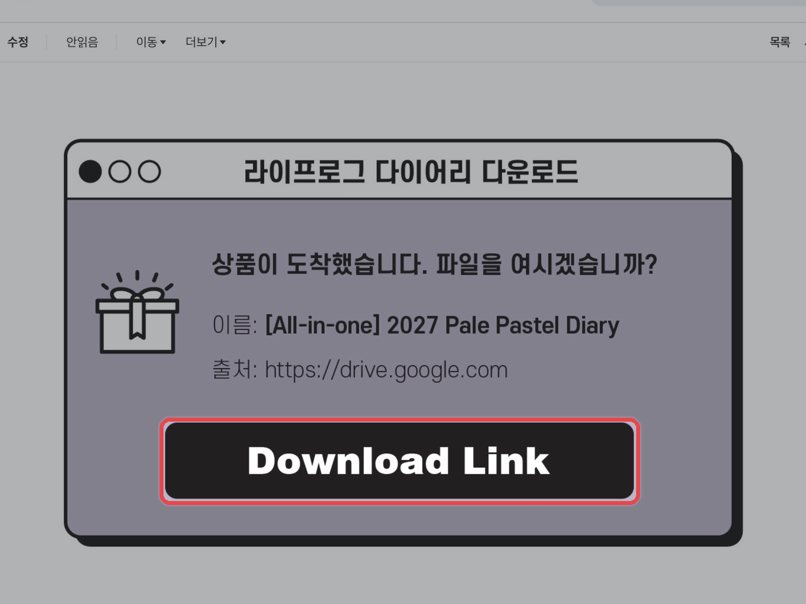
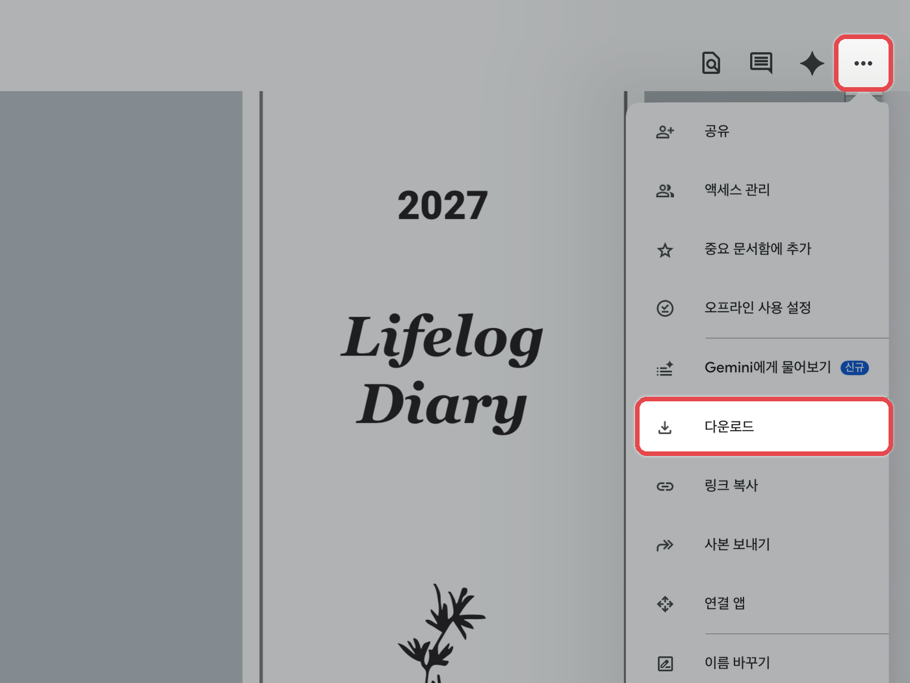
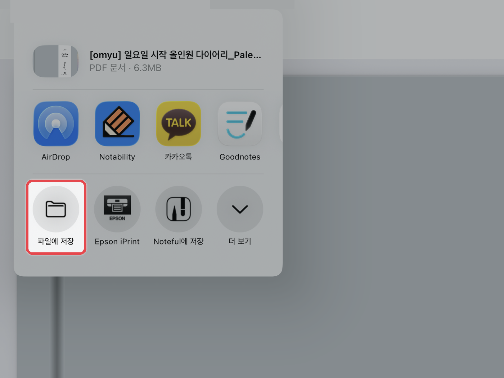
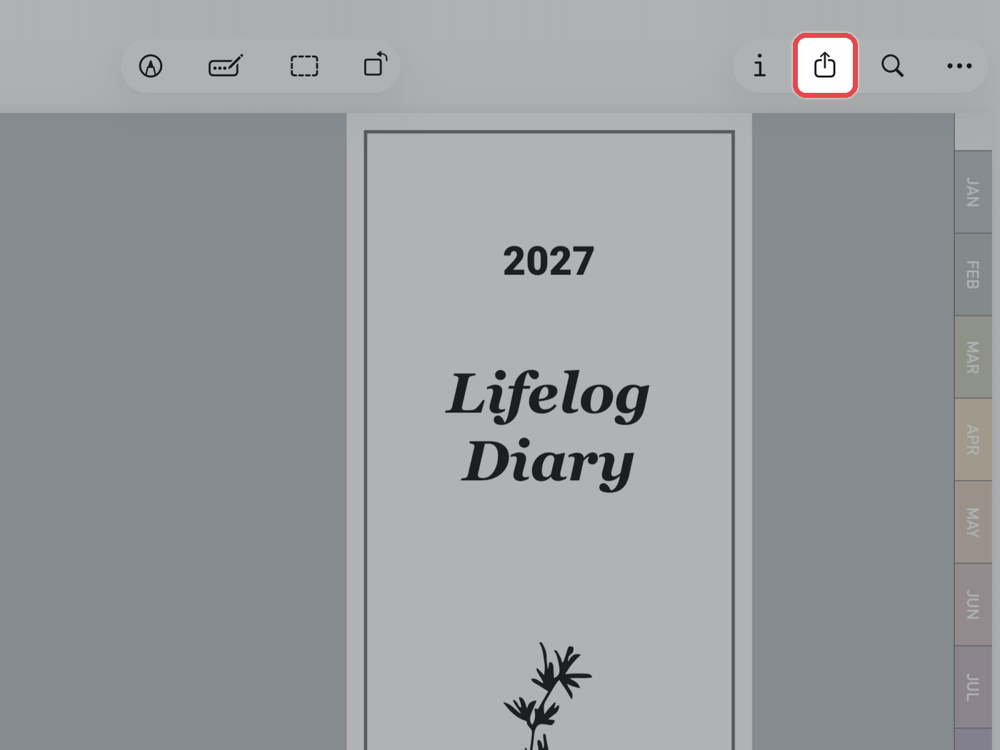
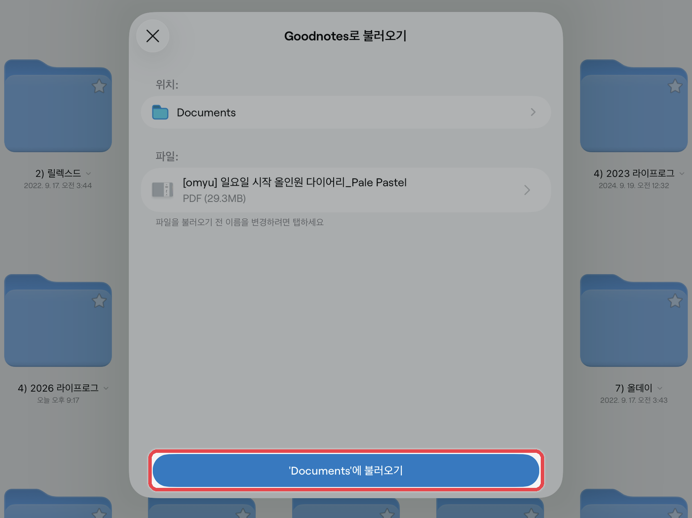

# 아이패드



**메일의 다운로드 링크 열기**

구매 후 받으신 메일을 열고 **\[Download Link]** 버튼을 눌러주세요.

<figure><figcaption></figcaption></figure>



**파일 다운로드**

원하는 파일을 누른 뒤, 우측 상단의 **\[...]** 더보기 버튼 → **\[다운로드]**&#xB97C; 눌러주세요.

<figure><figcaption></figcaption></figure>



**파일 앱에 저장**

팝업창이 열리면 **\[파일에 저장]**&#xC744; 눌러주세요.\
zip 파일이 아니라면 저장하지 않고 사용 중인 필기 앱으로 바로 열어도 돼요.

<figure><figcaption></figcaption></figure>



**파일 앱에서 필기 앱으로 열기**

파일 앱에서 **다운로드 완료한 파일**을 눌러주세요.\
(zip 파일은 한 번 클릭하면 자동으로 압축이 해제됩니다.)\
우측 상단의 **\[⬆️]** 공유 버튼을 누른 후, 사용 중인 **\[필기 앱 아이콘]**&#xC744; 눌러주세요.

<figure><figcaption></figcaption></figure>



**불러오기**

굿노트는 저장할 위치를 확인한 뒤 **\[‘폴더 이름’에 불러오기]**, 노타빌리티는 **\[새로운 노트로 가져오기]**&#xB97C; 누르면 끝이에요.

<figure><figcaption></figcaption></figure>




**압축을 풀지 않은 ZIP 파일은 필기 앱에서 열리지 않아요.** 꼭 압축을 푼 뒤 안에 있는 PDF 파일을 선택해 주세요.

