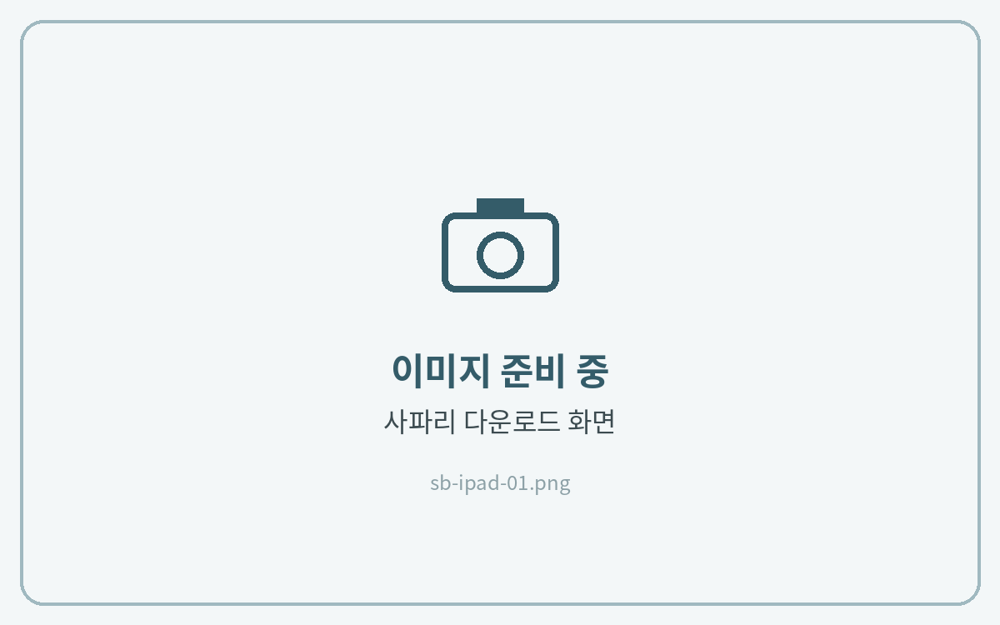
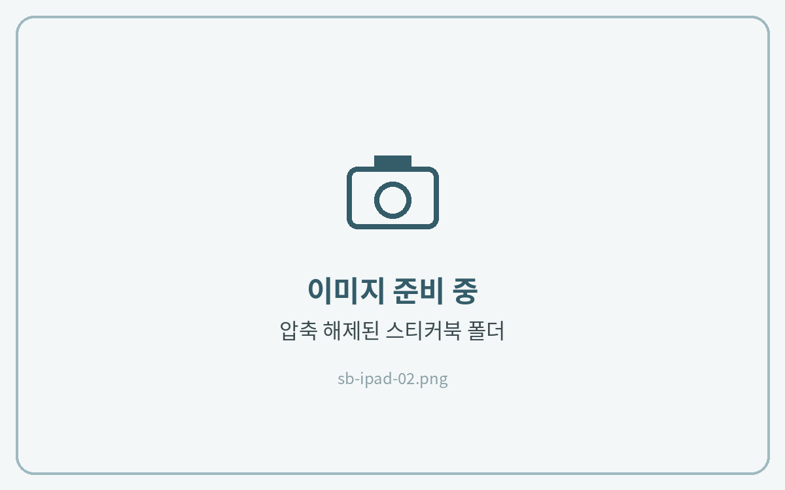
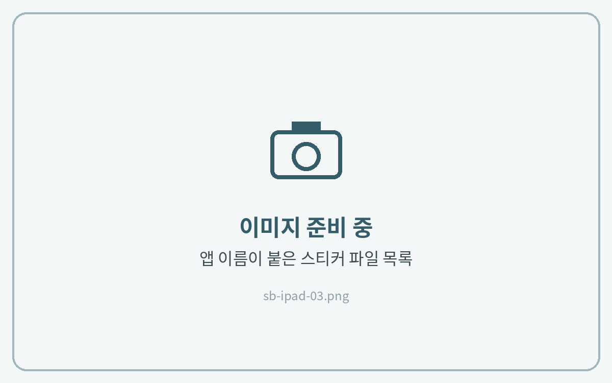
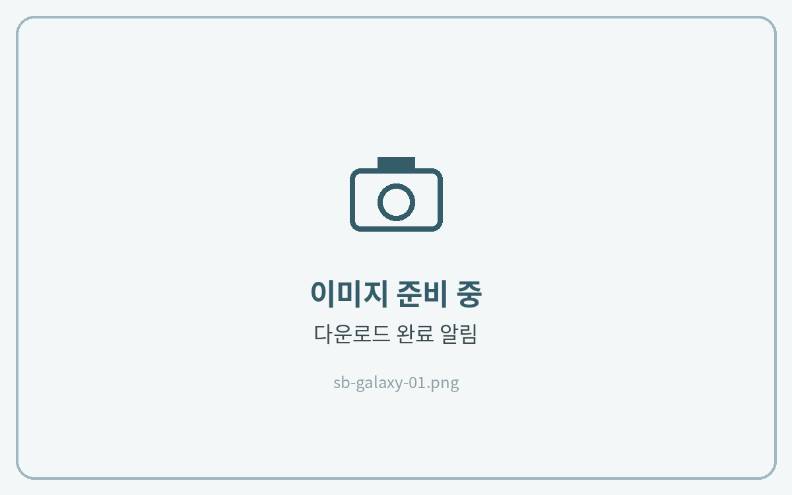
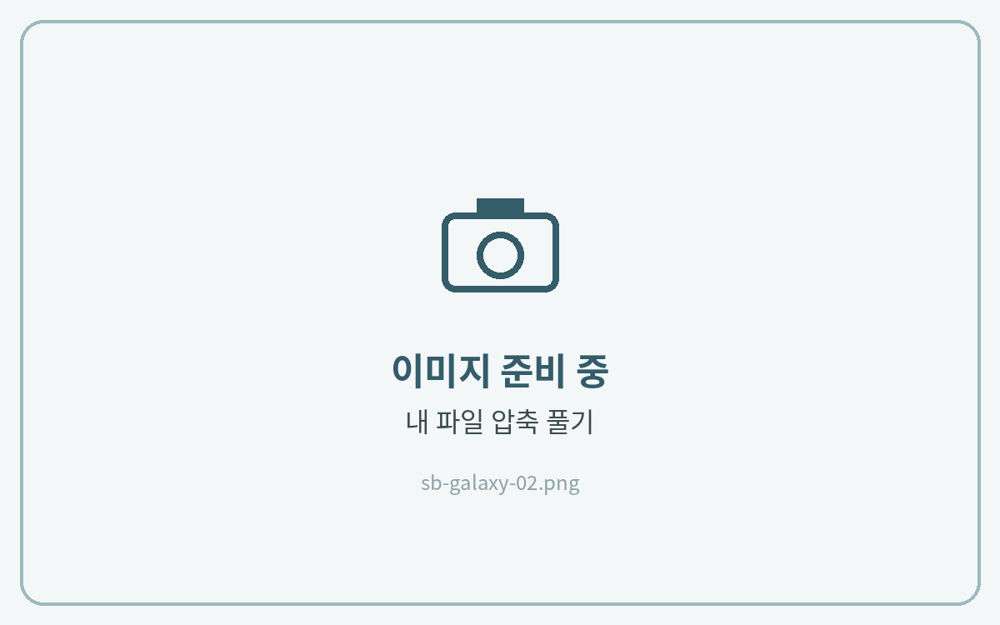
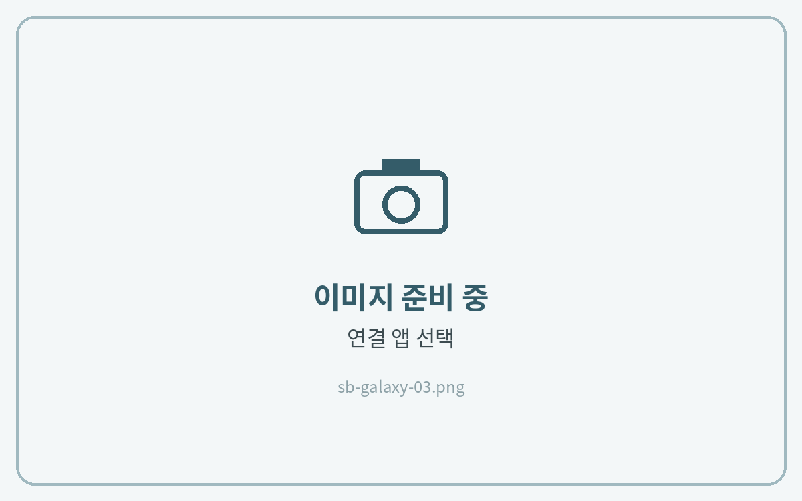

# 스티커북 다운로드

스티커북은 노트 파일과 같은 방법으로 다운로드해요. 다른 점은 **앱에 맞는 스티커 파일을 고르는 것**이에요.

## 파일 고르는 법

압축을 풀면 앱별로 파일이 나뉘어 있어요. 파일 이름 앞의 **\[앱 이름]** 을 확인하고 사용하시는 앱에 맞는 파일을 선택해 주세요.

## 스티커 파일 종류

| 종류          | 설명                                     | 이런 분께                                   |
| ----------- | -------------------------------------- | --------------------------------------- |
| **컷팅 스티커북** | 
스티커가 한 권의 노트 안에

모여 있는 파일
  | 
노트를 옆에 띄워 두고

복사·붙여넣기로 쓰실 분
 |
| **PNG 스티커** | 
스티커가 한 장씩

투명 배경 이미지로 된 파일
 | 사진·이미지로 불러와 쓰실 분                        |





**사파리에서 다운로드**

메일의 **Download Link**를 **사파리(Safari)** 에서 열고 다운로드해 주세요.

<figure><figcaption></figcaption></figure>



**압축 풀기**

파일 앱 **다운로드** 폴더에서 ZIP 파일을 탭해 압축을 풀어주세요.

<figure><figcaption></figcaption></figure>



**앱에 맞는 파일 선택**

**\[굿노트]**, **\[노타빌리티]** 처럼 사용하는 앱 이름이 붙은 파일을 길게 누르고 **공유 → 필기 앱**을 선택해 주세요. PNG 스티커는 **사진 앱에 저장**해 두면 필기 앱에서 바로 불러올 수 있어요. (파일 선택 → 공유 → **이미지 저장**)

<figure><figcaption></figcaption></figure>







**크롬에서 다운로드**

메일의 **Download Link**를 **크롬** 또는 **삼성 인터넷**에서 열고 다운로드해 주세요.

<figure><figcaption></figcaption></figure>



**압축 풀기**

**내 파일 → 다운로드** 폴더에서 ZIP 파일을 누르고 **압축 풀기**를 눌러주세요.

<figure><figcaption></figcaption></figure>



**앱에 맞는 파일 선택**

사용하는 앱 이름이 붙은 파일을 누르고 **연결 앱**에서 필기 앱을 선택해 주세요.\
PNG 스티커는 갤러리에서 바로 불러올 수 있어요.

<figure><figcaption></figcaption></figure>






스티커를 노트에 붙이는 방법은 각 앱 가이드의 **스티커 사용법**에서 확인해 주세요.

