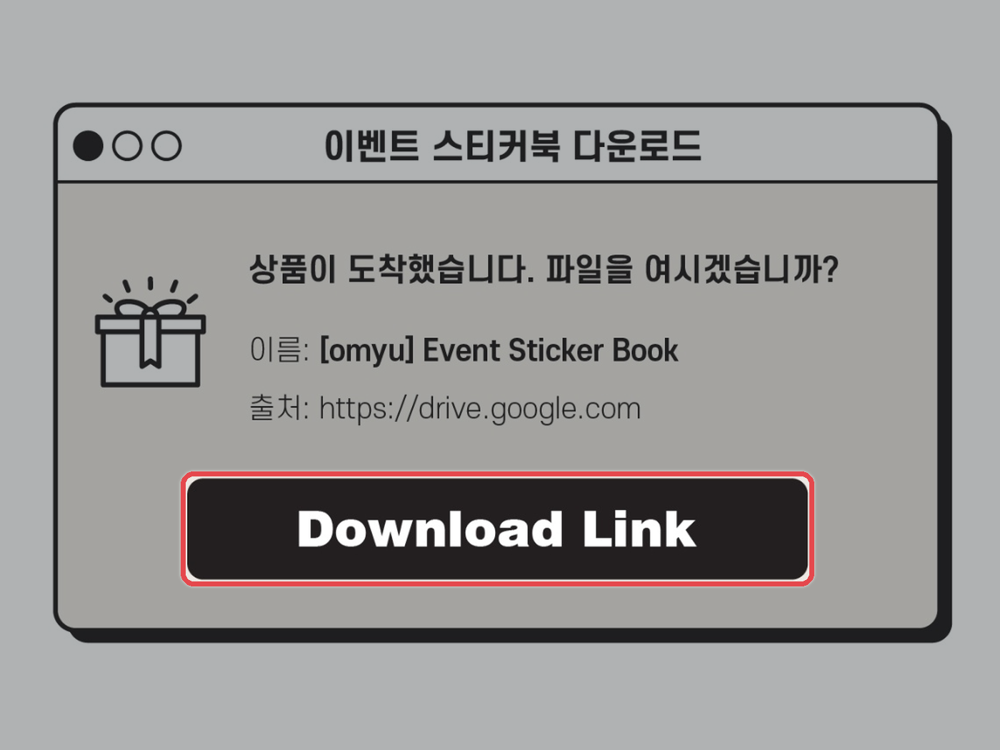
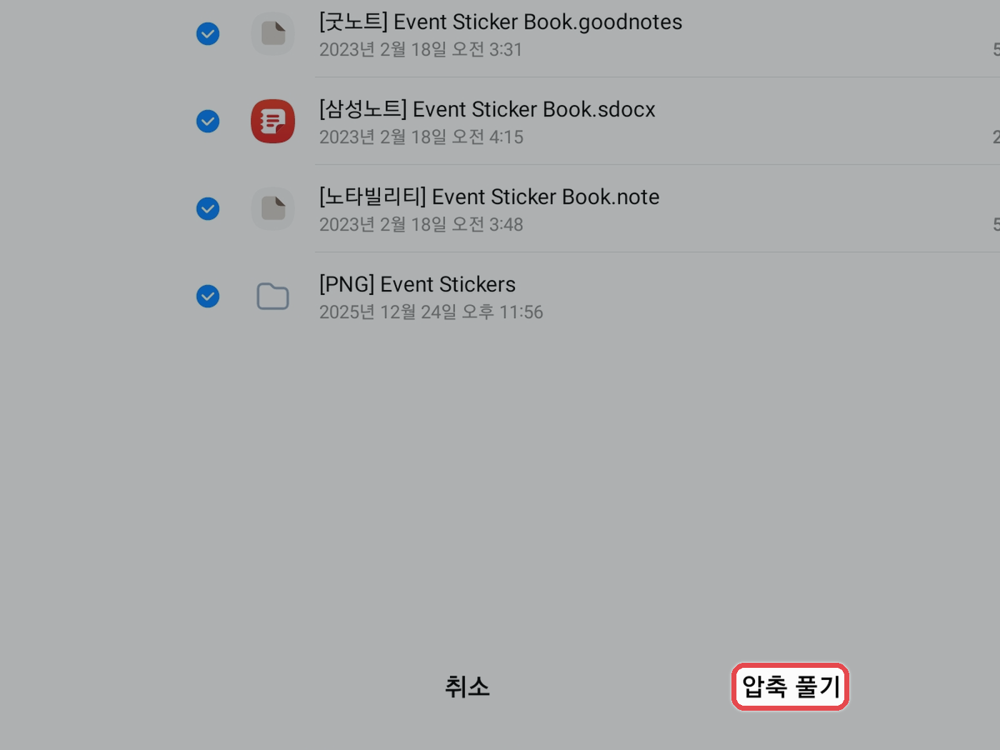
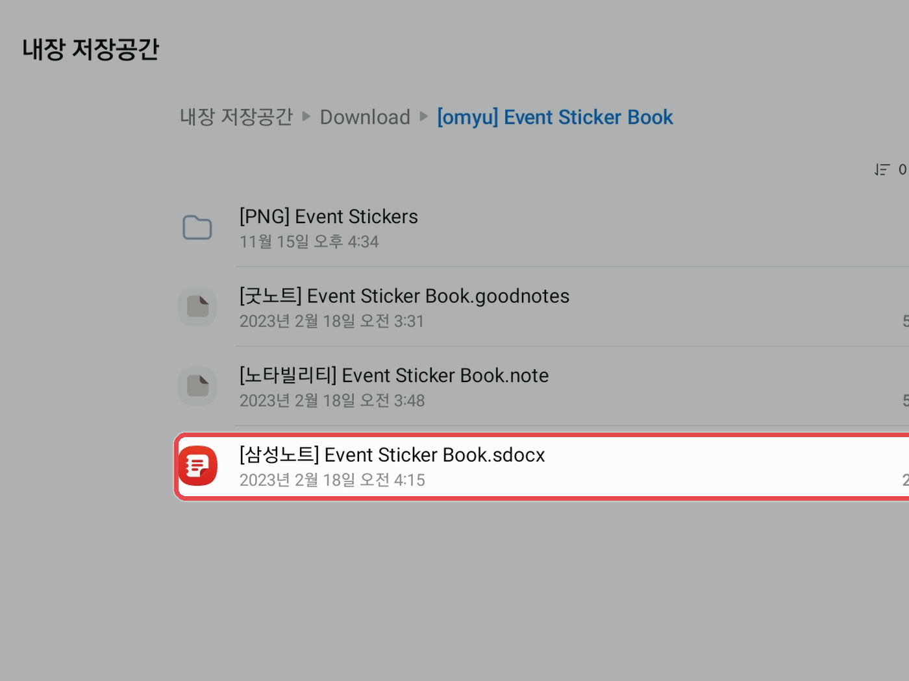

# 갤럭시탭



#### 다운로드 하기

파일 다운로드 방법과 동일하게 다운로드를 진행해 주세요.

<figure><figcaption></figcaption></figure>



#### 압축 풀기

내 파일 앱에서 다운로드 완료한 **zip 파일을 한 번 눌러 압축을 해제**해 주세요.

<figure><figcaption></figcaption></figure>



#### 필기 앱 파일 열기

폴더 안에서 사용 중인 **\[필기 앱 이름]**&#xC774; 적힌 파일을 눌러주세요.\
사용 중인 필기 앱이 없으면 **\[PNG]** 폴더를 사용해 주세요. (자세한 내용은 스티커 사용법 참고)

<figure><figcaption></figcaption></figure>




스티커를 노트에 붙이는 방법은 각 앱 가이드의 **스티커 사용법**에서 확인해 주세요.

