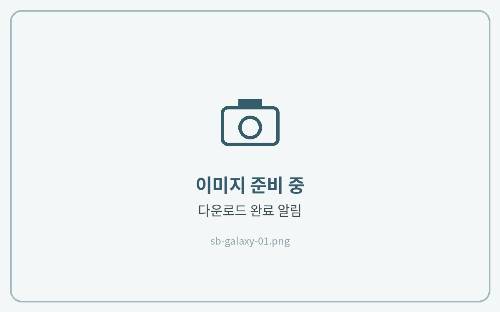
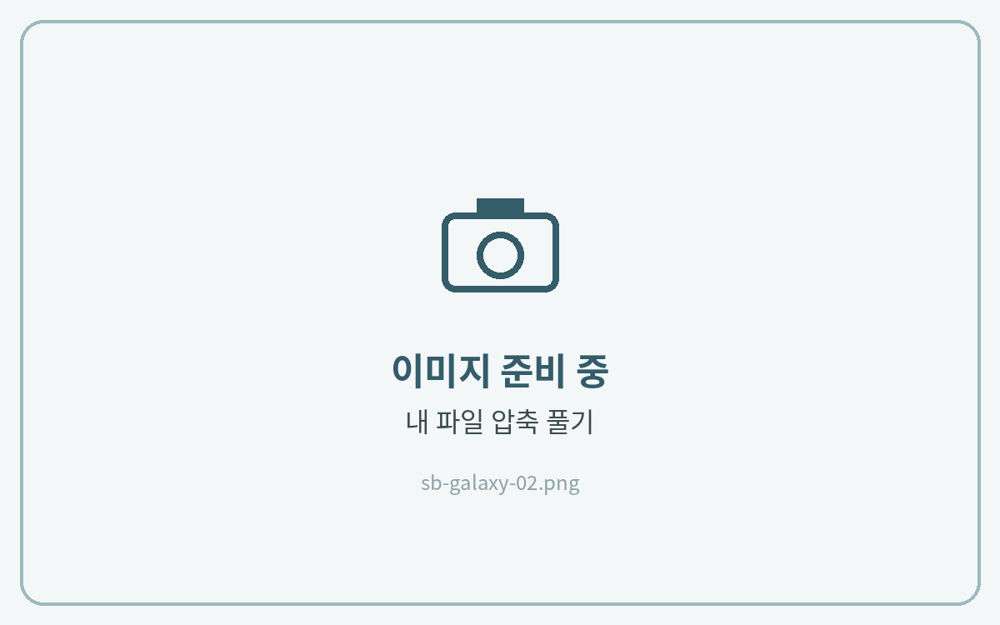
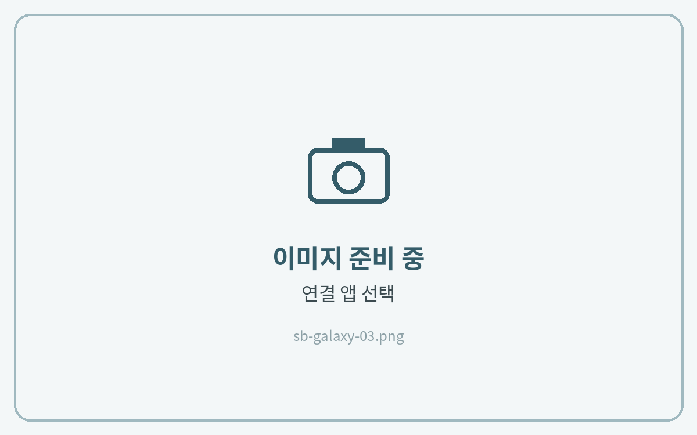

# 갤럭시탭



**크롬에서 다운로드**

메일의 **Download Link**를 **크롬** 또는 **삼성 인터넷**에서 열고 다운로드해 주세요.

<figure><figcaption></figcaption></figure>



**압축 풀기**

**내 파일 → 다운로드** 폴더에서 ZIP 파일을 누르고 **압축 풀기**를 눌러주세요.

<figure><figcaption></figcaption></figure>



**앱에 맞는 파일 선택**

사용하는 앱 이름이 붙은 파일을 누르고 **연결 앱**에서 필기 앱을 선택해 주세요. PNG 스티커는 갤러리에서 바로 불러올 수 있어요.

<figure><figcaption></figcaption></figure>





스티커를 노트에 붙이는 방법은 각 앱 가이드의 **스티커 사용법**에서 확인해 주세요.

