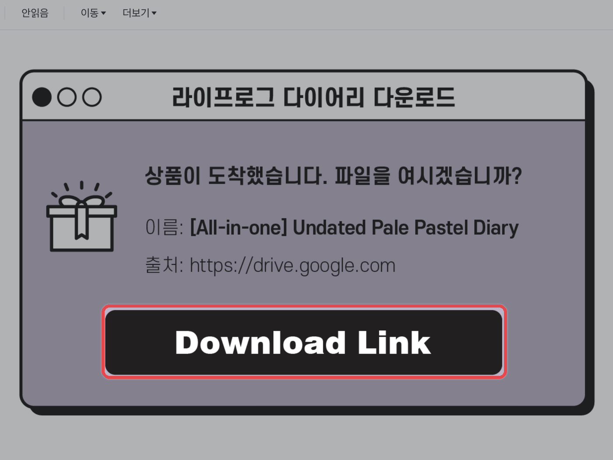
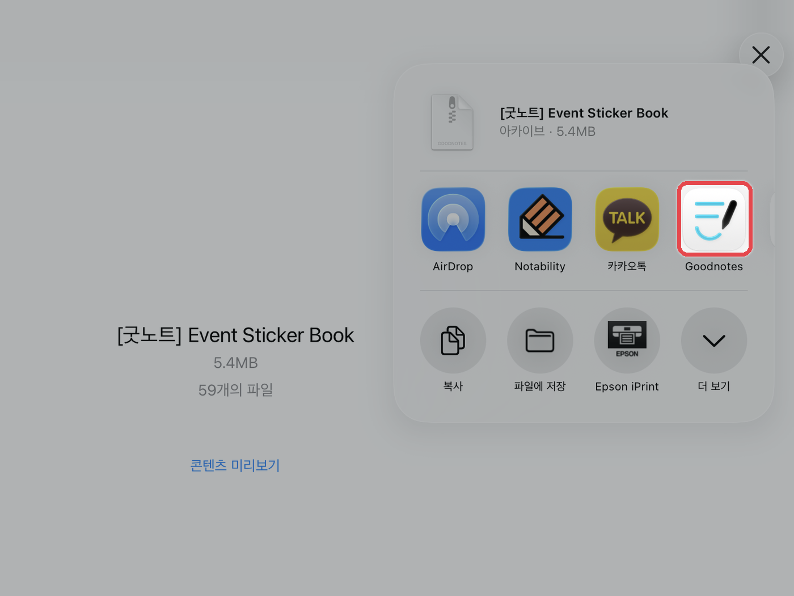
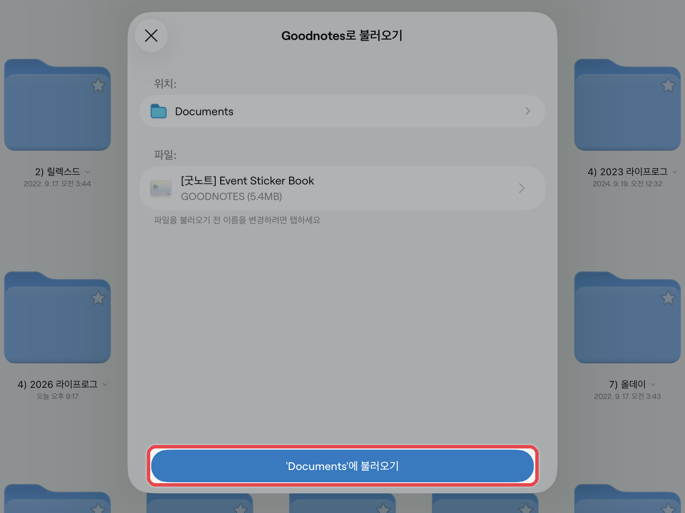

# 아이패드



**다운로드 하기**

파일 다운로드 방법과 동일하게 다운로드를 진행해 주세요.

<figure><figcaption></figcaption></figure>



**압축 풀기**

파일 앱에서 다운로드 완료한 **zip 파일을 한 번 눌러 압축을 해제**해 주세요.\
폴더 안에서 사용 중인 **\[필기 앱 이름]**&#xC744; 눌러주세요.\
우측 상단의 **\[⬆️]** 공유 버튼을 누른 후, 사용 중인 **\[필기 앱 아이콘]**&#xC744; 눌러주세요.\
사용 중인 필기 앱이 없으면 **\[PNG]** 폴더를 사용해 주세요. (자세한 내용은 스티커 사용법 참고)

<figure><figcaption></figcaption></figure>



**불러오기**

굿노트는 저장할 위치를 확인한 뒤 **\[‘폴더 이름’에 불러오기]**, 노타빌리티는 **\[새로운 노트로 가져오기]**&#xB97C; 누르면 끝이에요.

<figure><figcaption></figcaption></figure>




스티커를 노트에 붙이는 방법은 각 앱 가이드의 **스티커 사용법**에서 확인해 주세요.

