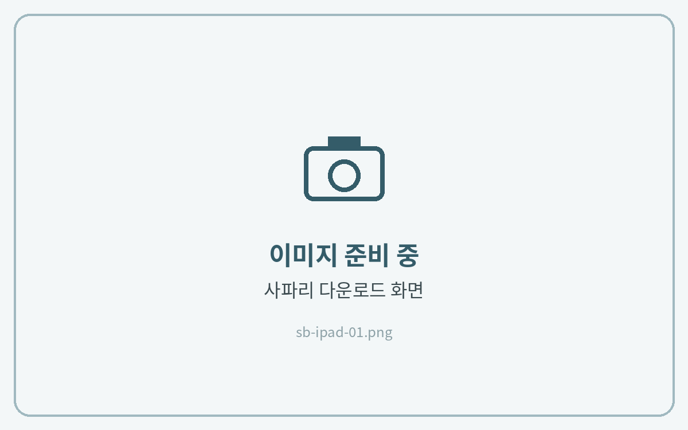
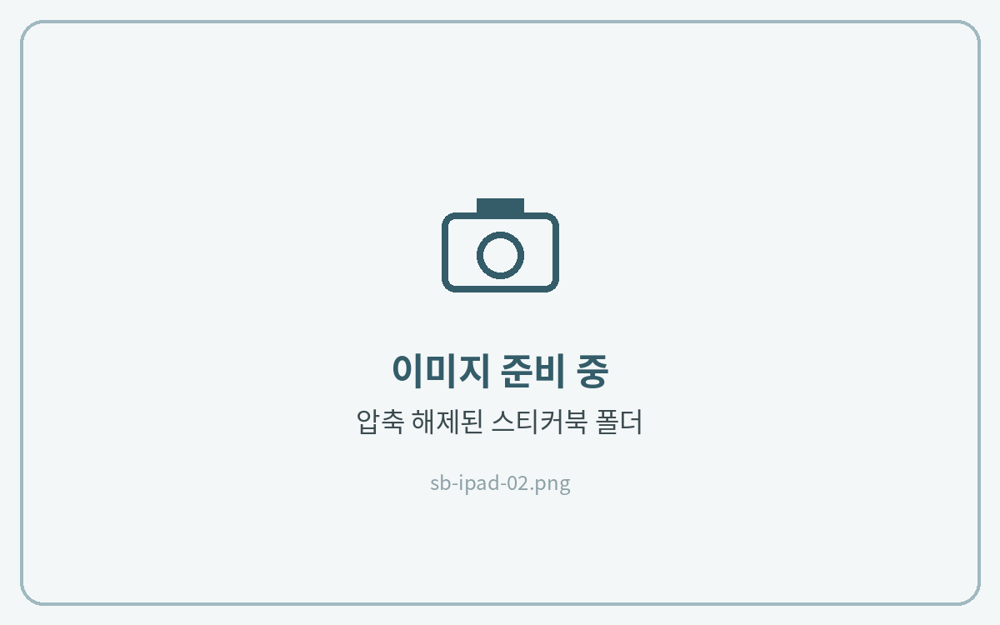
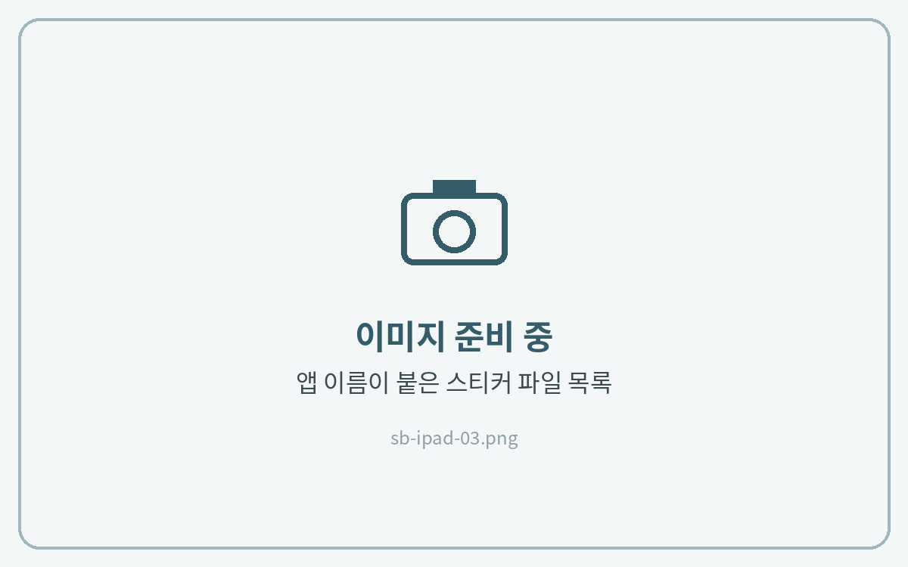

# 아이패드



### 사파리에서 다운로드

메일의 **Download Link**를 **사파리(Safari)** 에서 열고 다운로드해 주세요.



### 압축 풀기

파일 앱 **다운로드** 폴더에서 ZIP 파일을 탭해 압축을 풀어주세요.



### 앱에 맞는 파일 선택

**[굿노트]**, **[노타빌리티]** 처럼 사용하는 앱 이름이 붙은 파일을 길게 누르고 **공유 → 필기 앱**을 선택해 주세요.

PNG 스티커는 **사진 앱에 저장**해 두면 필기 앱에서 바로 불러올 수 있어요. (파일 선택 → 공유 → **이미지 저장**)





스티커를 노트에 붙이는 방법은 각 앱 가이드의 **스티커 사용법**에서 확인해 주세요.

