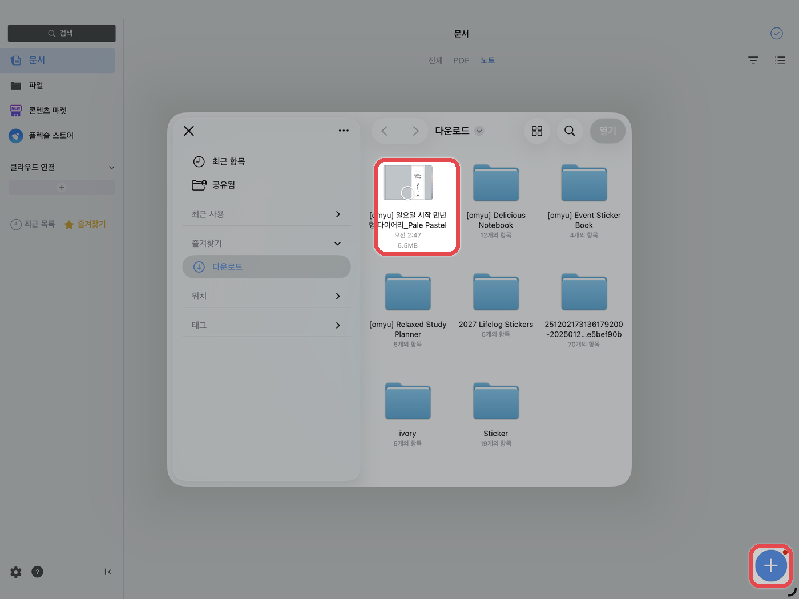
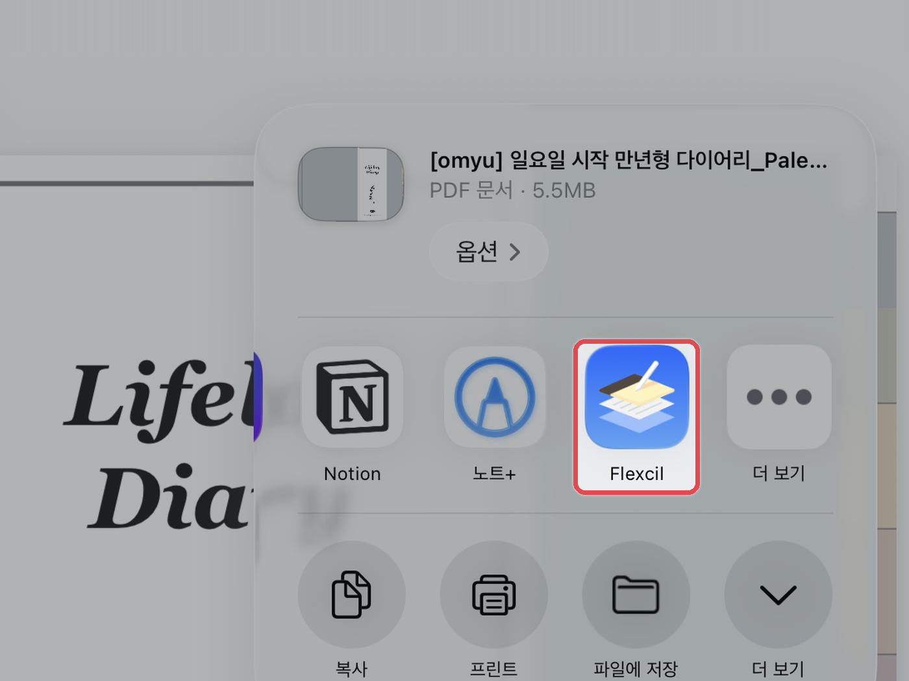

# 📚 플랙슬 (Flexcil)

**지원 기기** · 아이패드 · 갤럭시탭

플랙슬은 PDF 읽기와 필기를 함께 하기 좋은 앱입니다.\
하이퍼링크는 **제스처 모드**나 **읽기 전용 모드**에서 이동하며, 아이패드와 갤럭시탭 모두 같은 방법으로 사용합니다.

## 노트 불러오기



**플랙슬에서 불러오기**

문서 화면 하단의 **\[+]** 버튼 → **\[파일]**&#xC744; 누른 후, 다운로드 받은 PDF 파일을 선택해 주세요.

<figure><figcaption></figcaption></figure>



**파일 앱에서 바로 보내기**

파일 앱에서 PDF 파일을 누르고, 우측 상단의 **\[⬆️]** 공유 버튼 → **\[플랙슬 아이콘]**&#xC744; 눌러주세요.\
**\[새로운 문서로 불러오기]**&#xB97C; 누르면 끝이에요.

<figure><figcaption></figcaption></figure>



## 기능별 가이드

<table data-view="cards"><thead><tr><th></th><th></th><th data-hidden data-card-target data-type="content-ref"></th></tr></thead><tbody><tr><td><h4>하이퍼링크 사용법</h4></td><td>목차와 탭을 눌러 원하는 페이지로 이동합니다</td><td><a href="hyperlink.md">hyperlink.md</a></td></tr><tr><td><h4>스티커 사용법</h4></td><td>PNG 스티커를 붙이고 잘라 쓰는 방법입니다</td><td><a href="sticker.md">sticker.md</a></td></tr><tr><td><h4>표지 변경하는 법</h4></td><td>원하는 표지로 변경하는 방법입니다</td><td><a href="cover.md">cover.md</a></td></tr><tr><td><h4>페이지 추가하는 법</h4></td><td>필요한 속지를 복사해 추가합니다</td><td><a href="add-page.md">add-page.md</a></td></tr><tr><td><h4>노트팔레트 사용하는 법</h4></td><td>원하는 속지를 바인더에 추가합니다</td><td><a href="note-palette.md">note-palette.md</a></td></tr></tbody></table>
