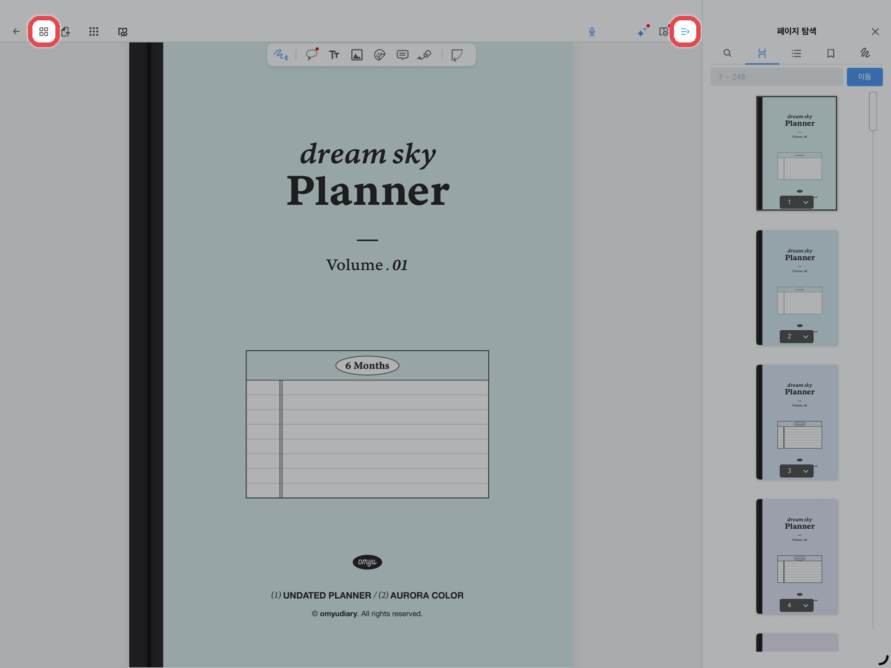
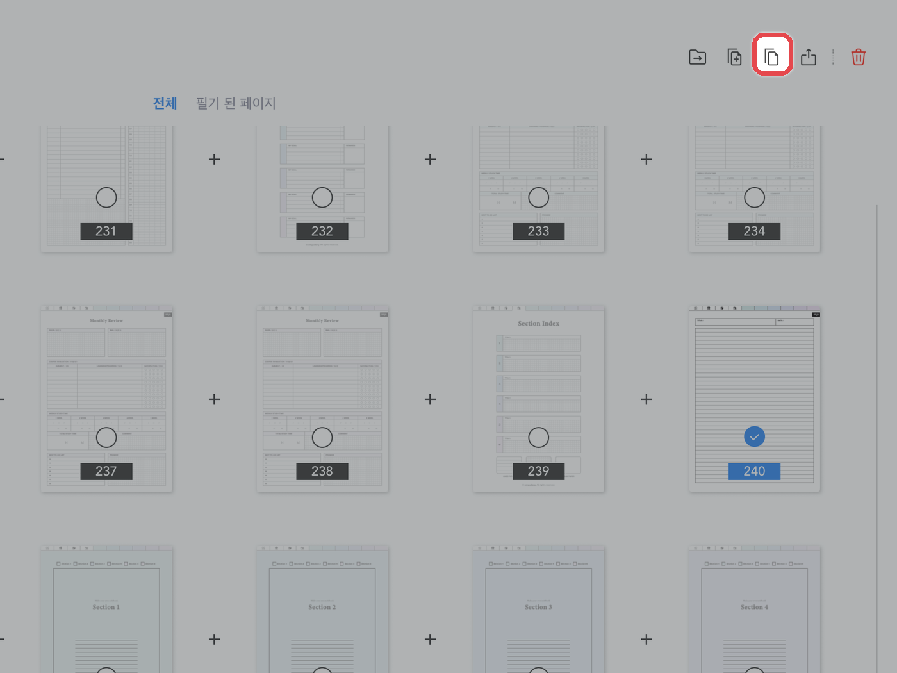
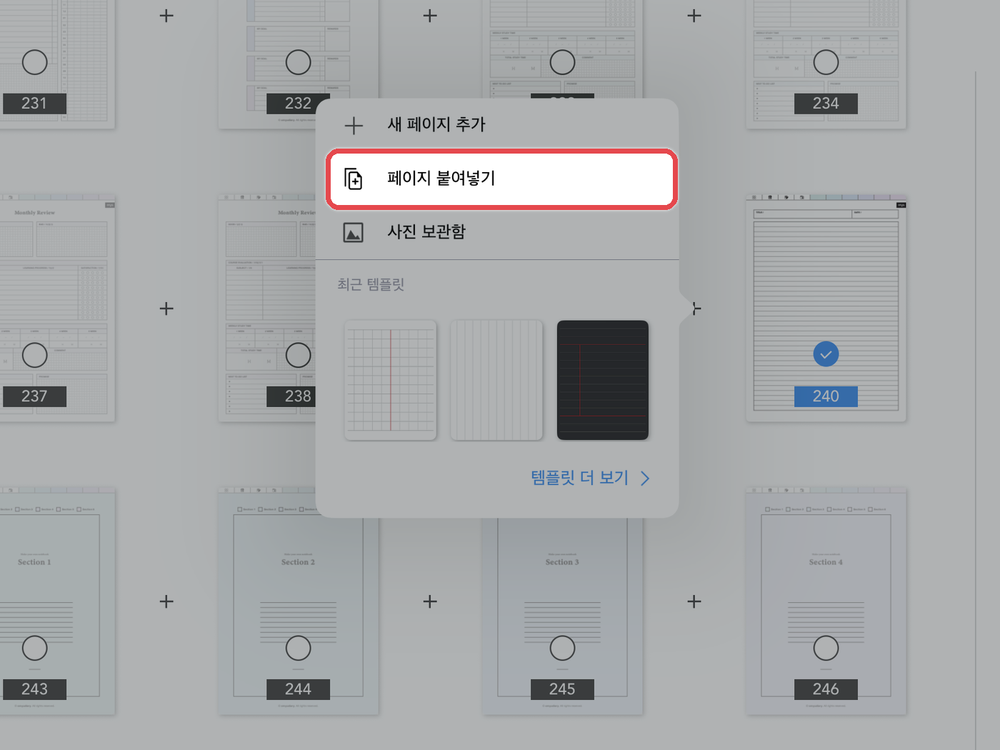

# 페이지 추가하는 법



**페이지 목록 열기**

왼쪽 위 **\[목록(사각형 4개 모양)]** 아이콘을 눌러주세요.\
오른쪽 위의 **\[목록]** 아이콘 → **\[페이지 탐색]**&#xC744; 사용해도 비슷해요.

<figure><figcaption></figcaption></figure>



**페이지 복사**

추가할 페이지를 선택하고 상단의 **\[복사]** 아이콘을 눌러주세요.

<figure><figcaption></figcaption></figure>



**붙여넣기**

넣고 싶은 위치에 있는 **\[+]** 버튼을 누르고 **\[페이지 붙여넣기]**&#xB97C; 눌러주세요.

<figure><figcaption></figcaption></figure>


