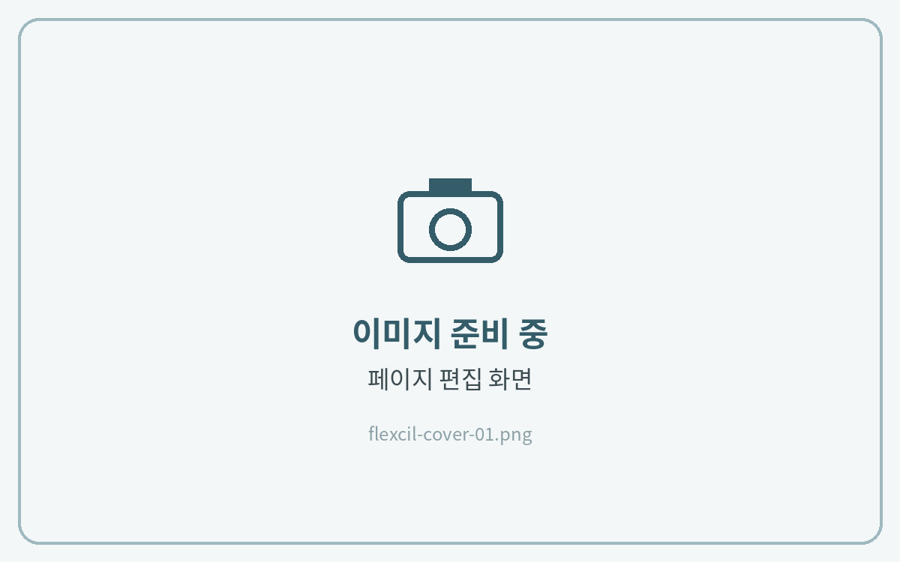
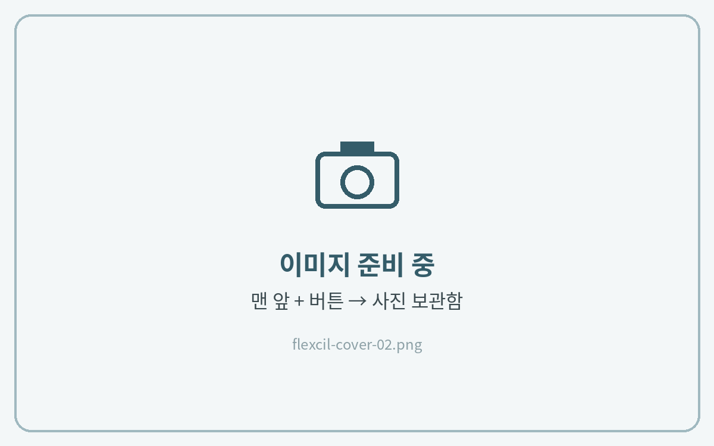

# 표지 변경하는 법

플랙슬에서는 **문서의 첫 페이지가 표지**로 보입니다.\
표지 파일을 맨 앞에 추가한 뒤 기존 표지를 삭제합니다.



**페이지 편집 열기**

노트를 열고 **\[페이지 보기]** 아이콘을 눌러 페이지 편집 화면을 열어주세요.

<figure><figcaption></figcaption></figure>



**표지 파일 추가**

맨 앞 위치에서 **\[페이지 추가]** → **\[파일]**&#xC744; 선택하고, 다운로드해 둔 표지를 넣어주세요.

<figure><figcaption></figcaption></figure>



**기존 표지 삭제**

기존 표지를 선택하고 **\[삭제]**&#xB97C; 눌러주세요.

<figure><figcaption></figcaption></figure>


