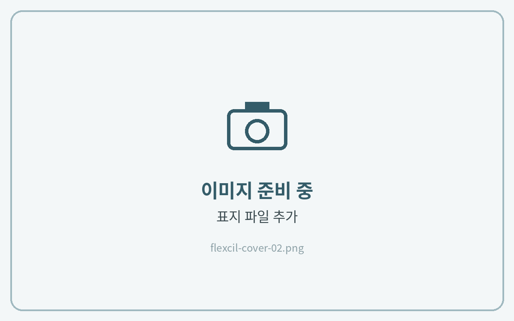
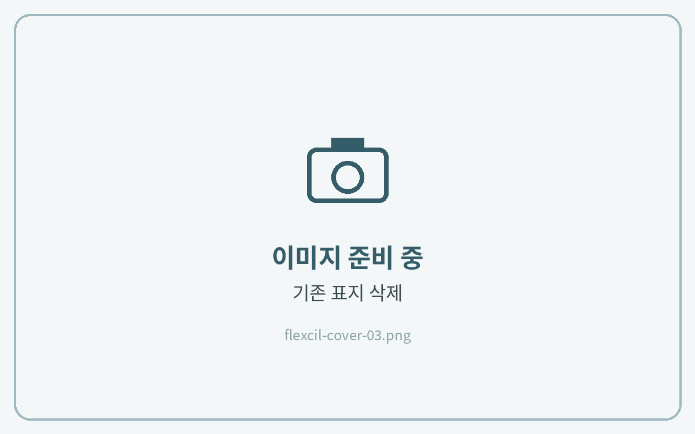

# 표지 변경하는 법

플랙슬에서는 **문서의 첫 페이지가 표지**로 보여요. 표지 파일을 맨 앞에 넣고 기존 표지를 지우면 돼요.



### 페이지 편집 열기

노트를 열고 **페이지 보기(썸네일)** 를 눌러 페이지 편집 화면을 열어주세요.



### 표지 파일 추가

맨 앞 위치에서 **페이지 추가 → 파일(PDF·이미지)** 을 선택해 다운로드해 둔 표지를 넣어 주세요.



### 기존 표지 삭제

기존 표지를 선택하고 **삭제**를 눌러주세요.



