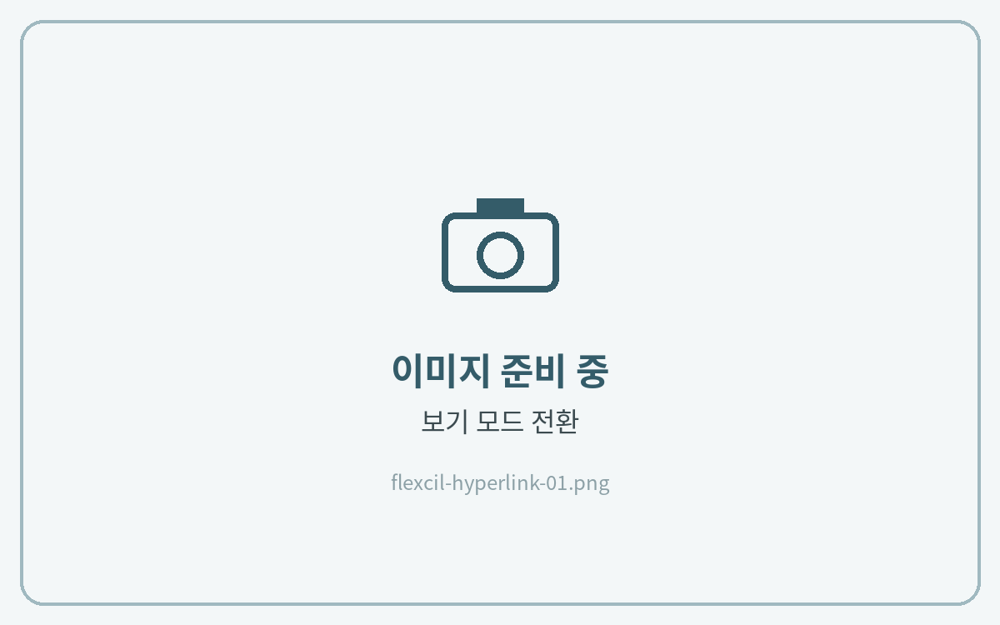
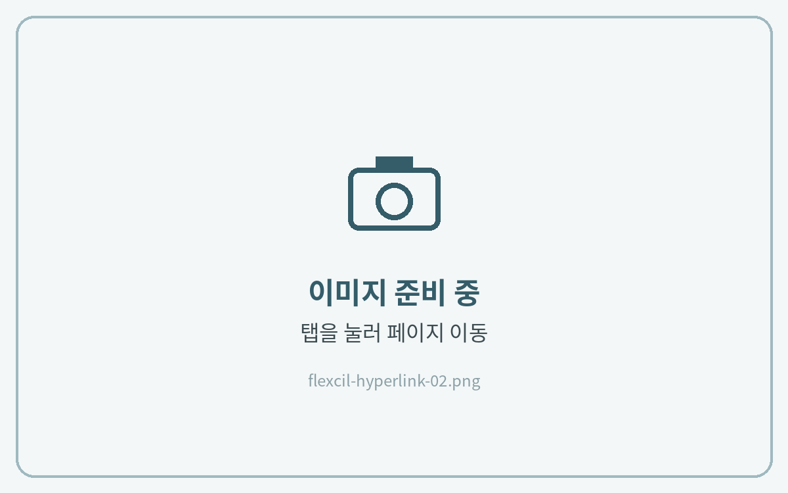
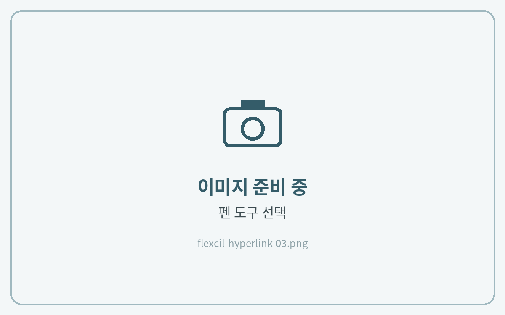

# 하이퍼링크 사용법

플랙슬은 **보기 모드**에서 링크를 눌러 이동합니다.



**보기 모드로 전환**

상단 도구 막대에서 **\[보기 모드]**&#xB85C; 전환해 주세요.

<figure><figcaption></figcaption></figure>



**링크를 눌러 이동**

하이퍼링크 버튼이 있는 곳을 누르면 해당 페이지로 이동해요.

<figure><figcaption></figcaption></figure>



**다시 필기하기**

필기할 때는 펜 도구를 다시 선택해 주세요.

<figure><figcaption></figcaption></figure>


