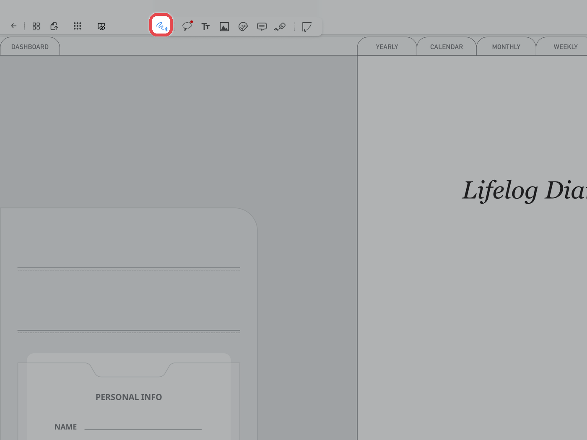
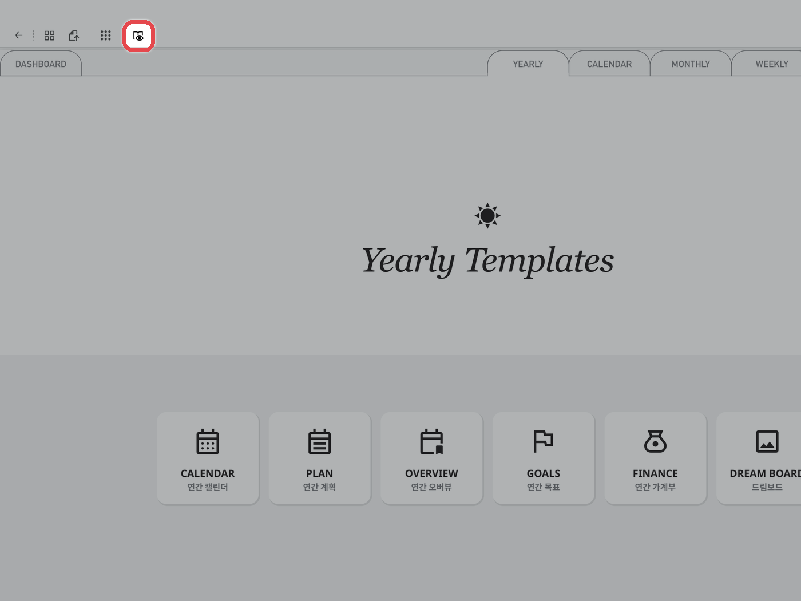

# 하이퍼링크 사용법

플랙슬은 **제스처 모드**에서 링크를 눌러 페이지를 이동합니다.\
**읽기 전용 모드**에서도 같은 방법으로 이동할 수 있습니다.



#### 제스처 모드 켜기

상단 도구 막대 맨 왼쪽의 **\[제스처 모드]** 아이콘을 눌러주세요.

<figure><figcaption></figcaption></figure>



#### 링크를 눌러 이동

하이퍼링크 버튼이 있는 곳을 누르면 해당 페이지로 이동해요.\
왼쪽 위 **\[읽기 전용 모드(책 모양)]** 아이콘을 눌러 **읽기 전용 모드**로 바꿔도 같은 방법으로 이동할 수 있어요.

<figure><figcaption></figcaption></figure>


