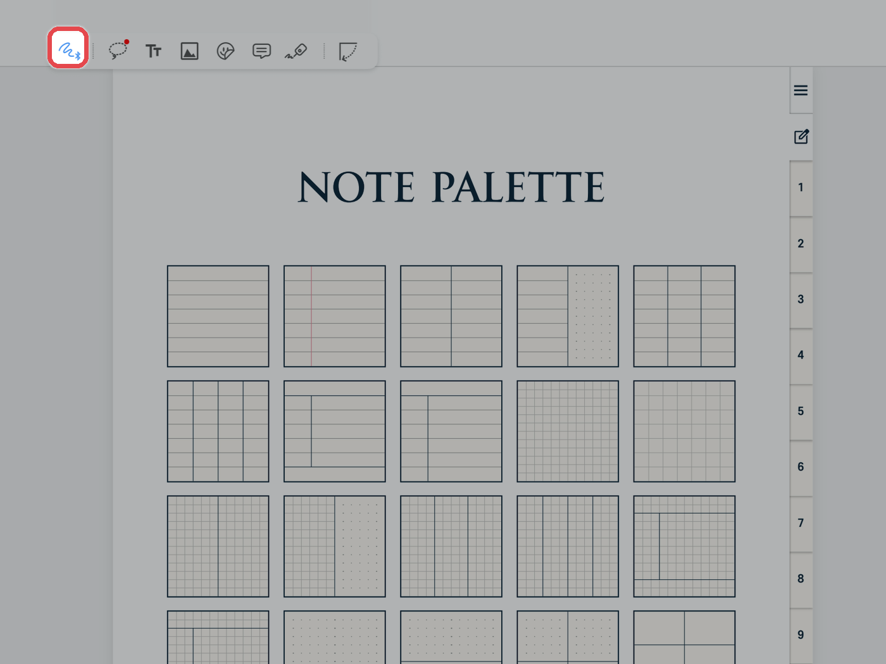
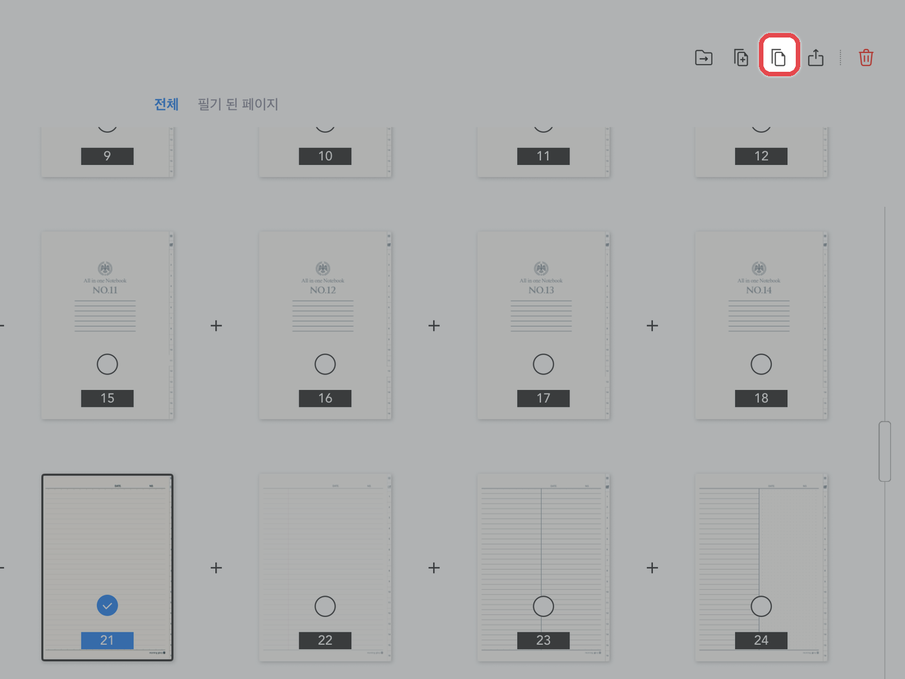
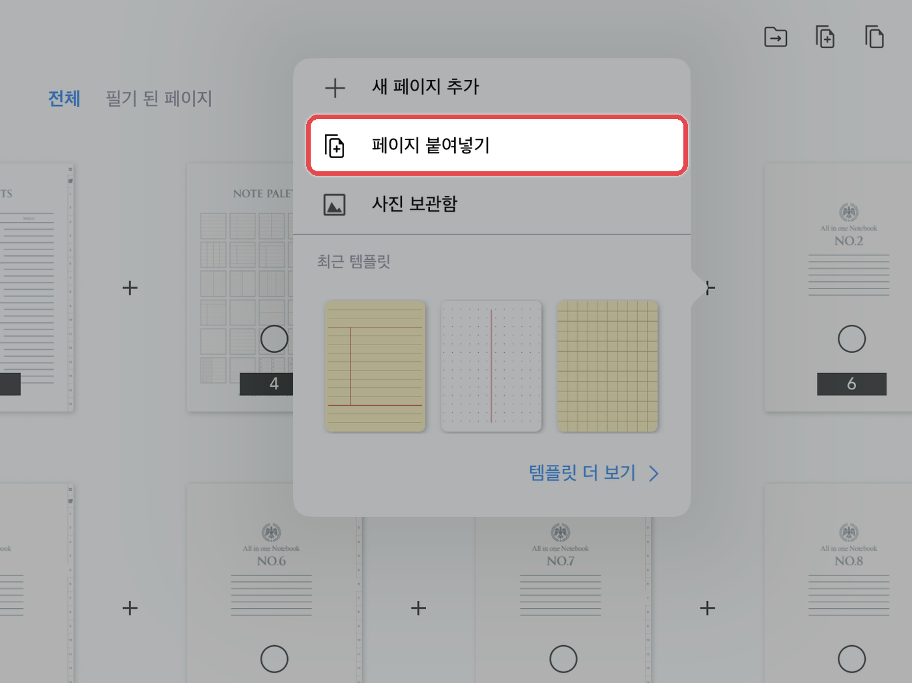

# 노트팔레트 사용하는 법


**노트팔레트(NOTE PALETTE)가 포함된 제품에만 해당됩니다.**\
예) 올라운드 노트 · 올데이 언어노트 · 유어컬러 언어노트 · 워크윗미 노트


**노트팔레트**는 여러 가지 속지를 한곳에 모아 둔 페이지입니다.\
필요한 속지를 골라 바인더(노트 본문)에 복사해 사용합니다.



#### 원하는 속지로 이동

**제스처 모드**에서 노트팔레트의 원하는 속지를 눌러 이동해 주세요.

<figure><figcaption></figcaption></figure>



#### 속지 복사

왼쪽 위 **\[목록(사각형 4개 모양)]** 아이콘을 누르고, 복사할 속지를 선택한 뒤 상단의 **\[복사]** 아이콘을 눌러주세요.

<figure><figcaption></figcaption></figure>



#### 바인더에 붙여넣기

바인더의 원하는 위치로 이동한 뒤, 그 위치에 있는 **\[+]** 버튼을 누르고 **\[페이지 붙여넣기]**&#xB97C; 눌러주세요.

<figure><figcaption></figcaption></figure>


