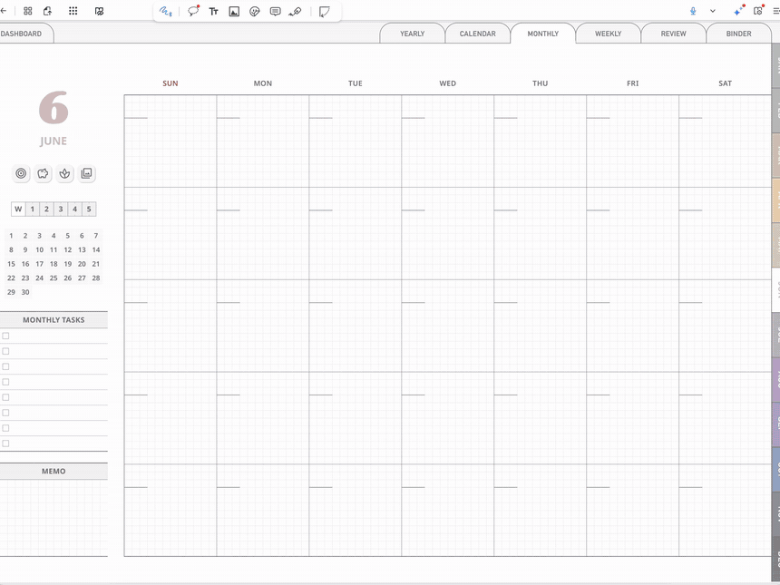
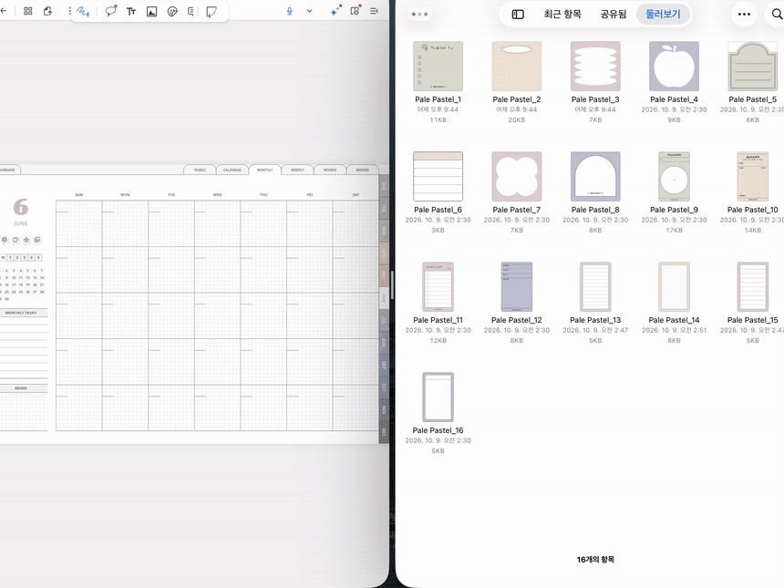
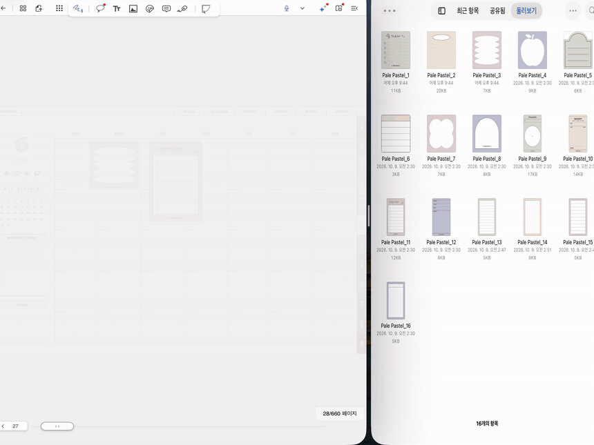
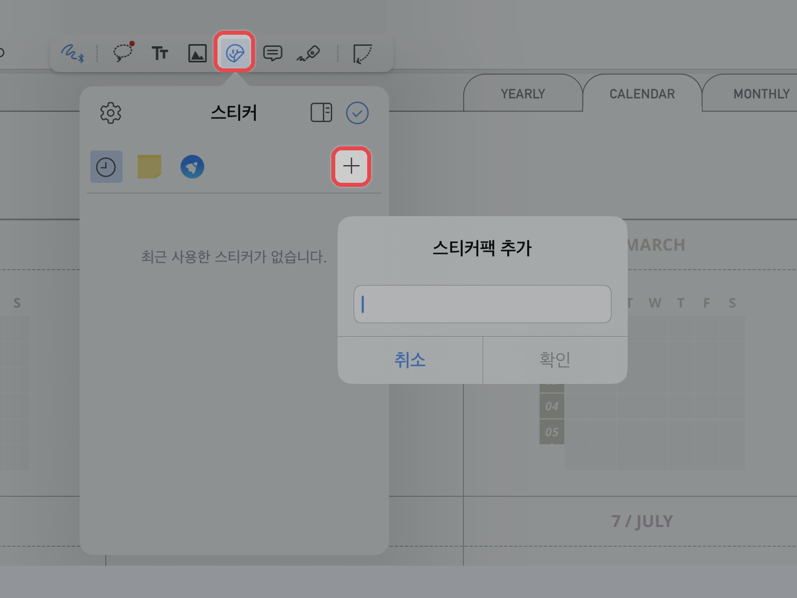
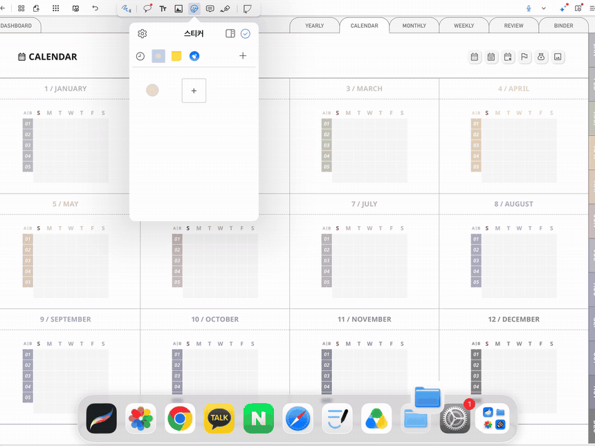
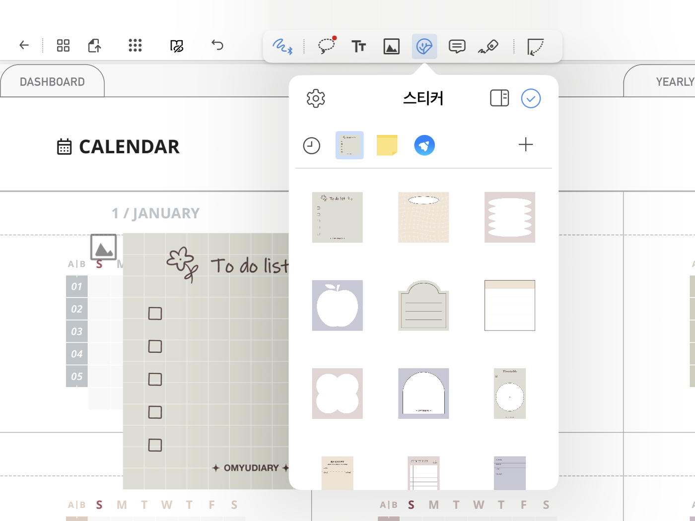
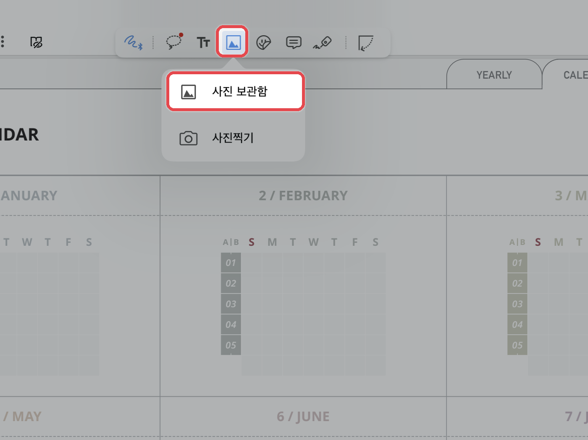
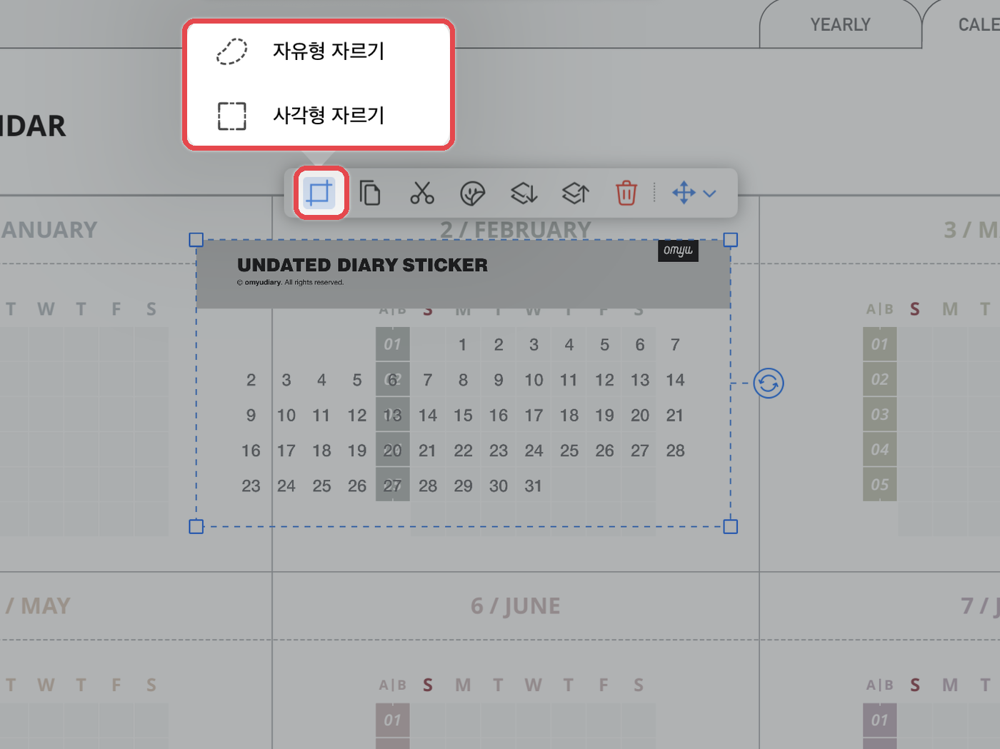
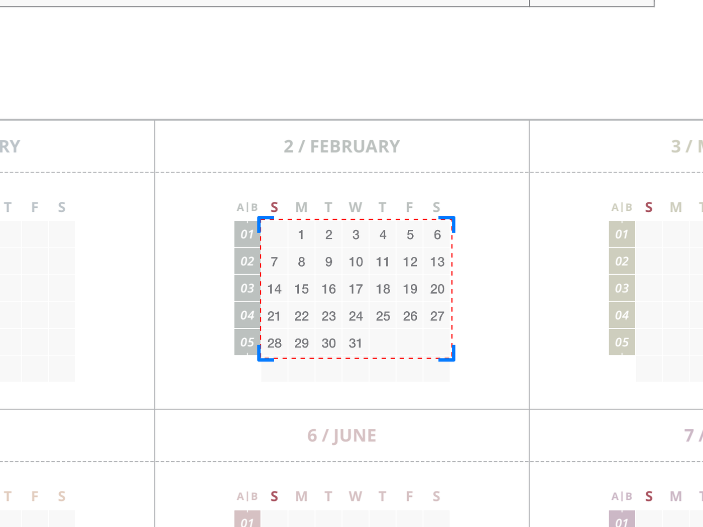

# 스티커 사용법

플랙슬에서 스티커를 사용하는 방법은 **3가지**입니다.\
아래 버튼을 누르면 원하는 방법으로 바로 이동할 수 있습니다.

<a href="sticker.md#split-view" class="button secondary">① 화면 분할로 사용</a> <a href="sticker.md#png" class="button secondary">② 플랙슬에 PNG 스티커 등록</a> <a href="sticker.md#png-cut" class="button secondary">③ PNG 잘라서 사용</a>

## 화면 분할(Split View) 사용하기 

파일 앱과 노트를 한 화면에 나란히 띄우면 PNG 스티커를 **드래그 한 번**으로 노트에 붙일 수 있습니다.\
스티커를 여러 개 붙일 때 특히 편리합니다.



**파일 앱과 플랙슬 열기**

플랙슬에서 스티커를 붙일 **노트(다이어리)**&#xB97C; 열고, 파일 앱과 플랙슬을 **화면 분할**로 나란히 열어주세요.



**파일 앱을 옆 창으로 열기**

화면 아래를 살짝 쓸어 올려 **독(Dock)**&#xC744; 열고, **\[파일]** 앱 아이콘을 **길게 누른 채** 화면 오른쪽 끝으로 끌어다 놓아주세요.\
파일 앱이 노트와 나란히 열리면, 다운로드한 PNG 스티커 폴더를 열어주세요.

<figure><figcaption></figcaption></figure>



**스티커 끌어다 놓기**

파일 앱에서 원하는 스티커를 **길게 누른 채** 노트 창으로 끌어다 놓으면 바로 붙어요.\
붙인 뒤에는 크기와 위치를 자유롭게 조절할 수 있어요.

<figure><figcaption></figcaption></figure>



**분할 화면 닫기**

다 붙였다면 가운데 구분선을 **파일 앱 쪽 화면 끝까지** 밀어주세요.\
노트만 전체 화면으로 돌아와요.

<figure><figcaption></figcaption></figure>



## 플랙슬에 PNG 스티커 등록하기 

자주 쓰는 스티커는 **스티커 도구**에 스티커팩으로 등록해 두면 어떤 노트에서든 바로 꺼내 쓸 수 있습니다.



**스티커팩 추가**

상단 도구 막대에서 **스티커(스마일 모양)** 도구를 누르고 **\[+]**&#xC744; 눌러 새로운 스티커팩을 추가해 주세요.

<figure><figcaption></figcaption></figure>



**스티커 추가**

파일 앱과 플랙슬을 **화면 분할**로 나란히 열어주세요.\
파일 앱에서 다운로드한 PNG 스티커를 **전체 선택**한 뒤, 새로 만든 스티커팩 안으로 끌어다 놓으면 한 번에 등록돼요.

<figure><figcaption></figcaption></figure>



**노트에 붙이기**

스티커 도구에서 스티커를 누르면 노트에 붙어요. 크기와 위치를 조절해 사용하세요.

<figure><figcaption></figcaption></figure>



## PNG 잘라서 사용하기 

PNG 이미지를 노트에 넣고 필요한 부분만 잘라 스티커처럼 사용할 수 있습니다.



**이미지 넣기**

상단 도구 막대의 **\[사진]** 아이콘 → **\[사진 보관함]**&#xC744; 누르고, 원하는 이미지를 선택해 주세요.

<figure><figcaption></figcaption></figure>



**자르기 방식 선택**

이미지를 누르고 **\[자르기]** 아이콘 → **\[자유형 자르기]** 또는 **\[사각형 자르기]**&#xB97C; 선택해 주세요.

<figure><figcaption></figcaption></figure>



**원하는 크기로 자르기**

원하는 크기에 맞게 잘라주세요. 잘라낸 이미지는 크기와 위치를 자유롭게 조절할 수 있어요.

<figure><figcaption></figcaption></figure>


