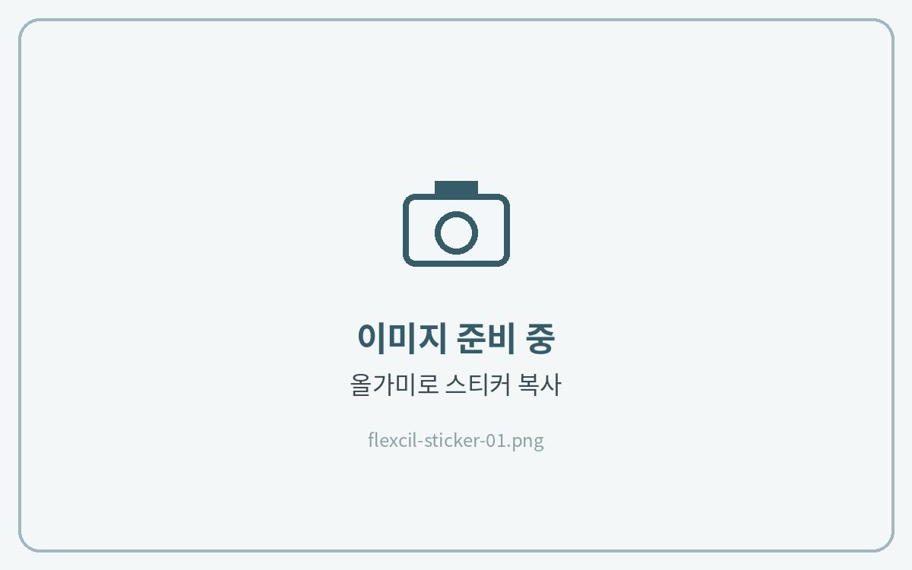
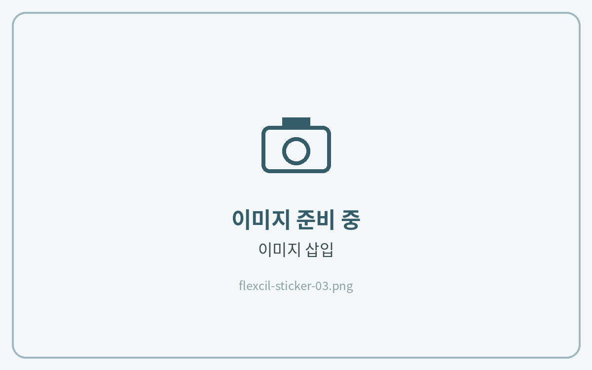
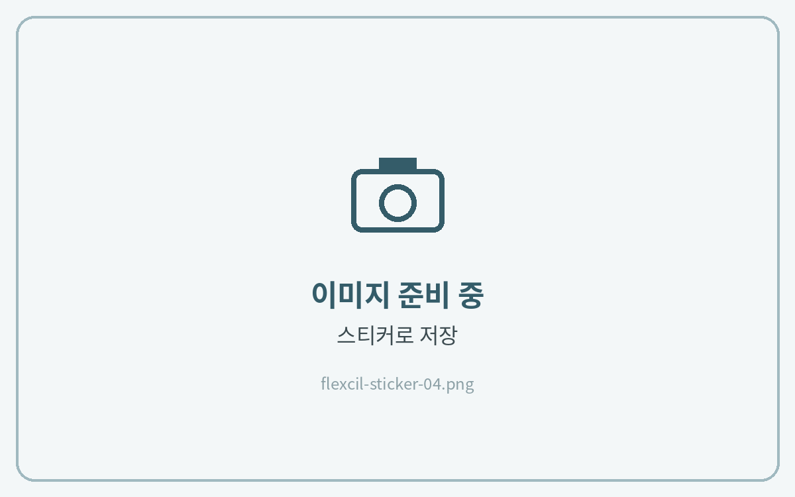
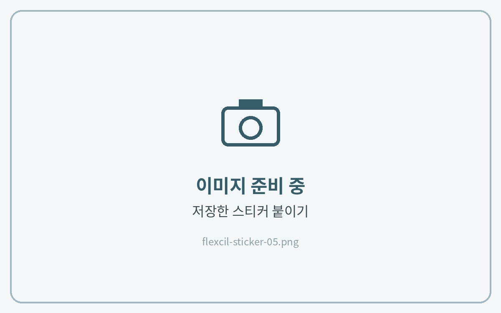

# 스티커 사용법

## 컷팅 스티커



**스티커 복사**

**올가미 도구**로 스티커를 선택하고 **복사**를 눌러주세요.

<figure><figcaption></figcaption></figure>



**노트에 붙여넣기**

노트의 빈 곳을 길게 누르고 **붙여넣기**를 눌러주세요.

<figure><figcaption></figcaption></figure>




## 스티커로 저장해 두기

플랙슬은 자주 쓰는 이미지를 **스티커로 저장**해 두고 언제든 꺼내 쓸 수 있어요.



**이미지 불러오기**

**이미지 삽입**으로 PNG 스티커를 노트에 불러와 주세요.

<figure><figcaption></figcaption></figure>



**스티커로 저장**

이미지를 선택하고 메뉴에서 **스티커로 저장**을 눌러주세요.

<figure><figcaption></figcaption></figure>



**스티커 붙이기**

도구 막대의 **스티커**에서 저장한 스티커를 눌러 붙여 주세요.

<figure><figcaption></figcaption></figure>



