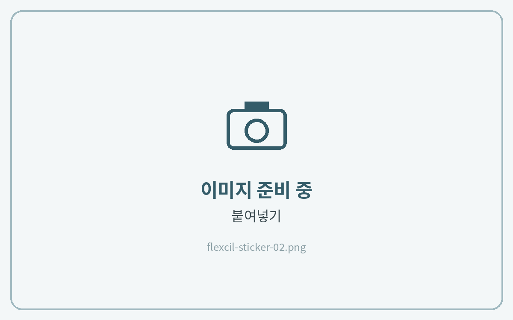

# 스티커 사용법

## 컷팅 스티커북



**스티커 복사**

**\[올가미 도구]**&#xB85C; 스티커를 선택하고 **\[복사]**&#xB97C; 눌러주세요.

<figure><figcaption></figcaption></figure>



**노트에 붙여넣기**

노트의 원하는 곳을 길게 누르고 **\[붙여넣기]**&#xB97C; 눌러주세요.

<figure><figcaption></figcaption></figure>



## PNG 스티커



**이미지 삽입**

도구 막대의 **\[사진]** 아이콘 → **\[사진 보관함]**&#xC744; 누르고, 저장해 둔 PNG 스티커를 선택해 주세요.

<figure><figcaption></figcaption></figure>



**필요한 부분만 자르기**

이미지를 누르고 **\[자르기]** 아이콘 → **\[자유형 자르기]** → **\[자동 자르기]**&#xB97C; 눌러주세요.\
원하는 부분을 한 번 누르면 깔끔하게 잘라낼 수 있어요.

<figure><figcaption></figcaption></figure>



**크기 조절**

모서리를 드래그해 크기와 위치를 맞추면 완성이에요.

<figure><figcaption></figcaption></figure>


