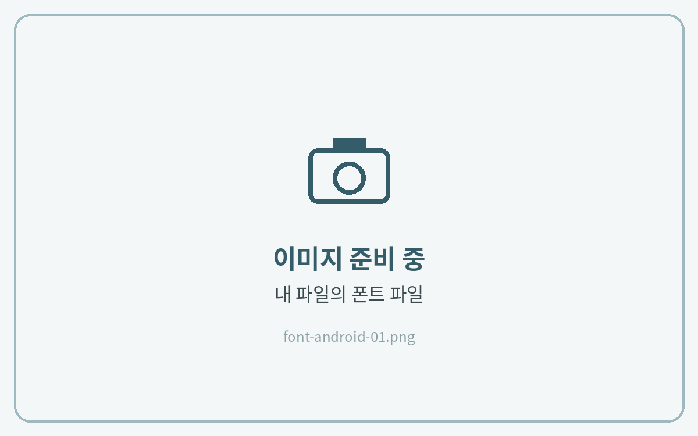
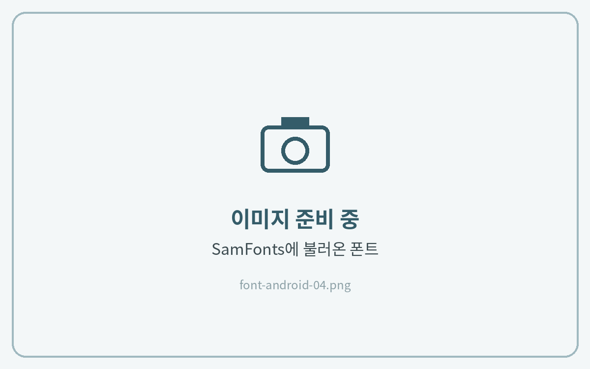
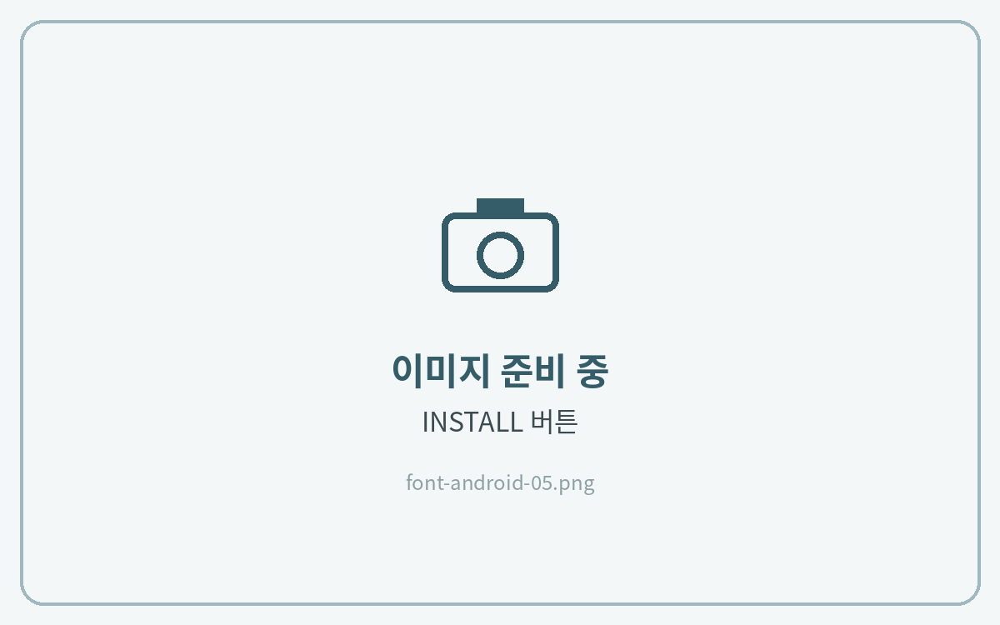
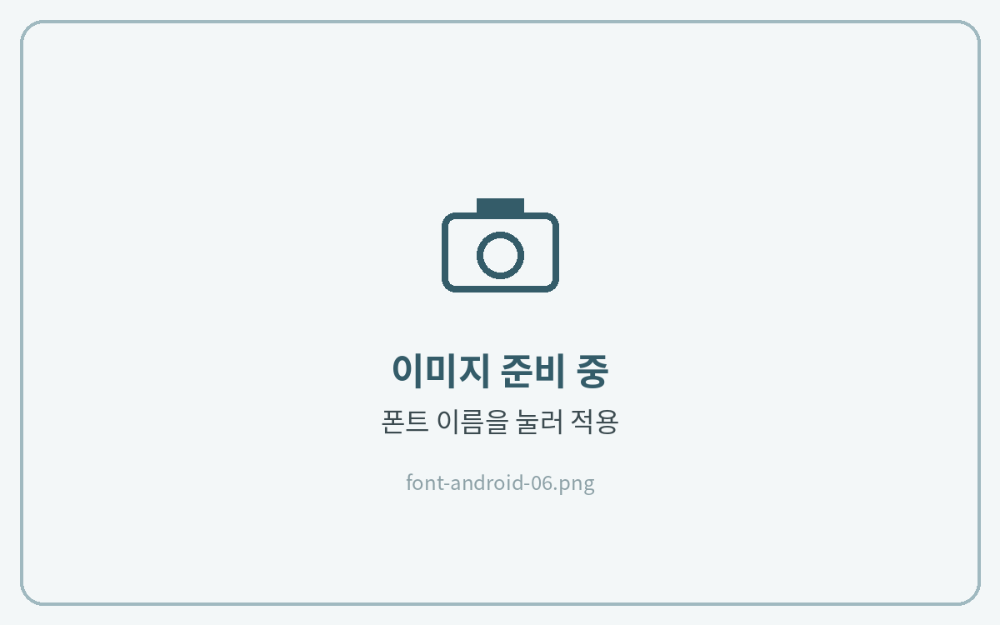

# Android (갤럭시폰, 갤럭시탭)

갤럭시 기기에는 TTF·OTF 폰트 파일을 바로 설치하는 기능이 없습니다. 그래서 무료 앱 **SamFonts**를 이용해 설치해요.


**설치 전에 꼭 확인해 주세요**

* SamFonts는 삼성 공식 앱이 아닌 **외부 개발자의 무료 앱**이에요. Play 스토어가 아닌 GitHub에서 받아 설치해요.
* **One UI 8 이상** 갤럭시 기기에서 쓸 수 있어요. (설정 → 휴대전화 정보 → 소프트웨어 정보에서 확인)
* 삼성의 소프트웨어 업데이트에 따라 방법이 바뀌거나 동작하지 않을 수 있어요.




**폰트 파일 준비**

다운로드한 ZIP 파일을 **내 파일 → 다운로드**에서 압축 풀어 주세요. **TTF 또는 OTF 파일**이 보이면 준비 완료예요.

<figure><figcaption></figcaption></figure>



**SamFonts 설치**

[SamFonts 릴리스 페이지](https://github.com/fahadalijaved/SamFonts/releases)에서 최신 버전의 **app 으로 시작하는 APK 파일**을 받아 설치해 주세요.\
설치 중 "출처를 알 수 없는 앱" 같은 경고가 나오면 **설정에서 허용** 후 설치를 마무리해 주세요.

<figure><figcaption></figcaption></figure>



**권한 허용**

SamFonts를 처음 실행하면 **KNOX 동의** 창이 나와요. 동의해 주세요.\
제목 아래 세 가지 방식(root · uid 1000 · normal) 중 **normal**을 선택하고, 접근 요청 창에서 **바로 적용**을 눌러주세요.

<figure><figcaption></figcaption></figure>



**폰트 불러오기**

SamFonts에서 1단계에서 준비한 **TTF·OTF 파일**을 불러와 주세요.\
폰트 이름에 공백 경고가 뜨면 이름에서 **-** 나 **\_** 같은 기호를 지워 주세요.

<figure><figcaption></figcaption></figure>



**설치**

폰트 옆 **INSTALL**을 눌러주세요. 경고 창이 나와도 그대로 진행해 설치를 마무리하면 돼요.

<figure><figcaption></figcaption></figure>



**SamFonts 안에서 적용**

SamFonts 앱 안에서 **설치한 폰트 이름을 눌러** 적용해 주세요.

<figure><figcaption></figcaption></figure>




**설정 앱에서 폰트를 적용하지 마세요.**

설정 → 디스플레이 → 글꼴 크기 및 스타일에서 적용하면 설치한 폰트가 지워질 수 있어요.

적용은 꼭 **SamFonts 앱 안에서** 해 주세요.



**원래 글꼴로 돌아가려면** · 설정 → 디스플레이 → 글꼴 크기 및 스타일 → 글꼴 스타일에서 **기본**을 선택해 주세요.

폰트를 계속 쓰시는 동안에는 SamFonts 앱을 지우지 말아 주세요.

