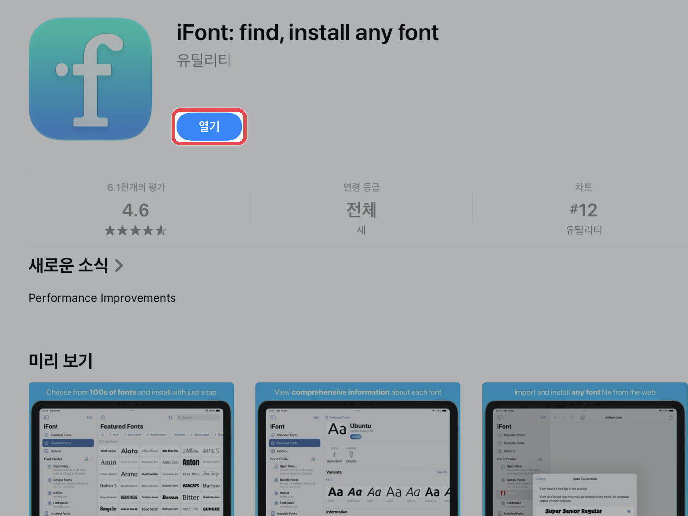
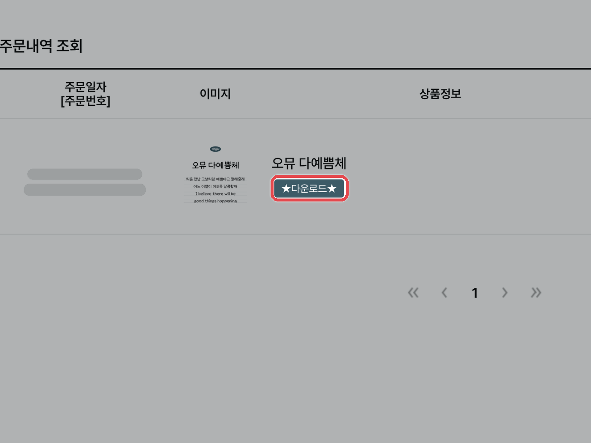
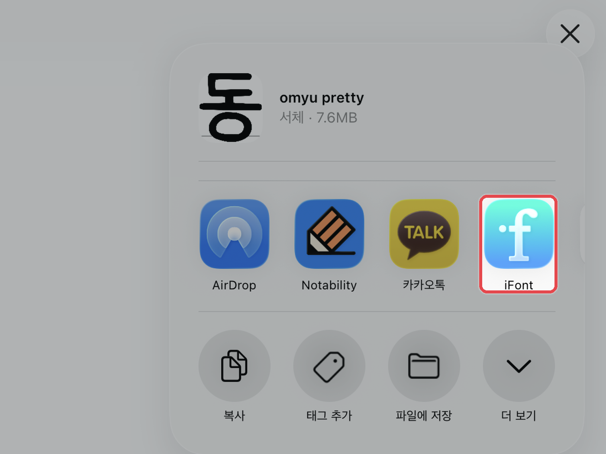
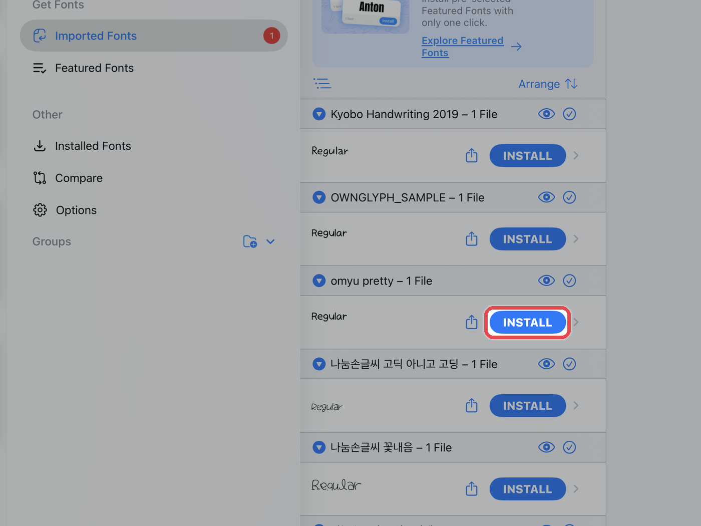
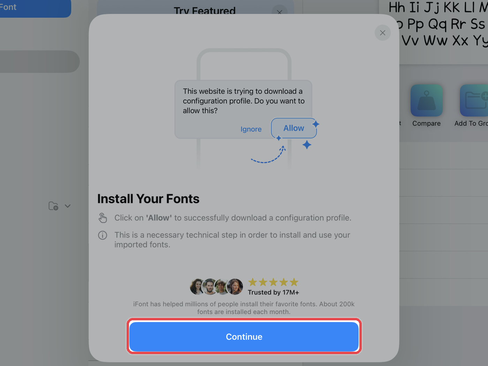
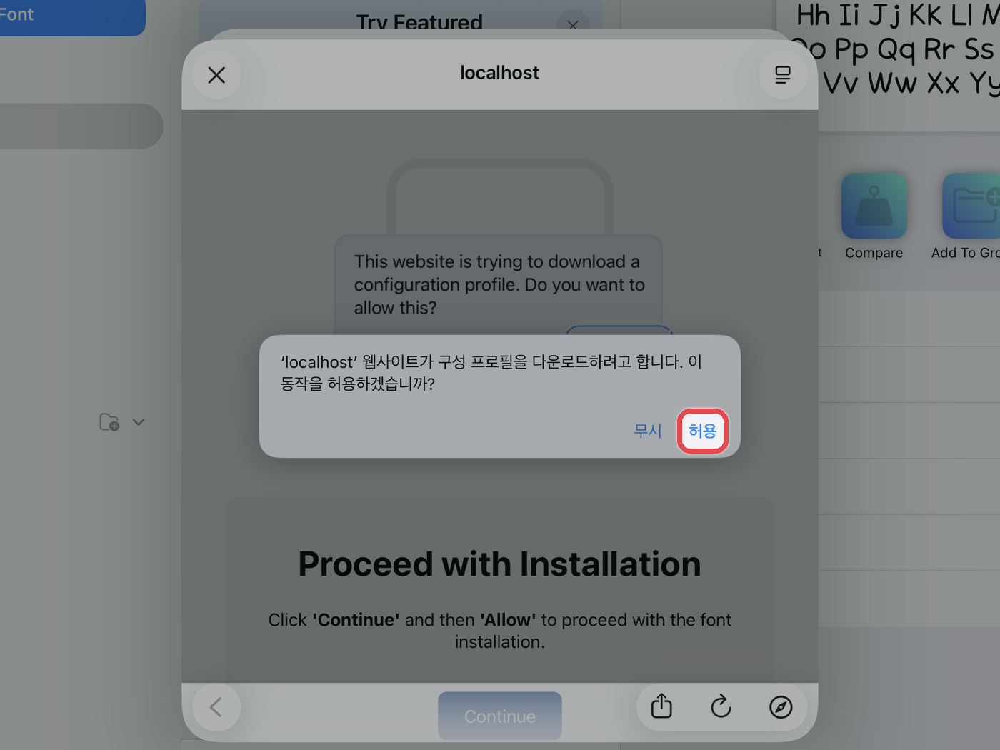
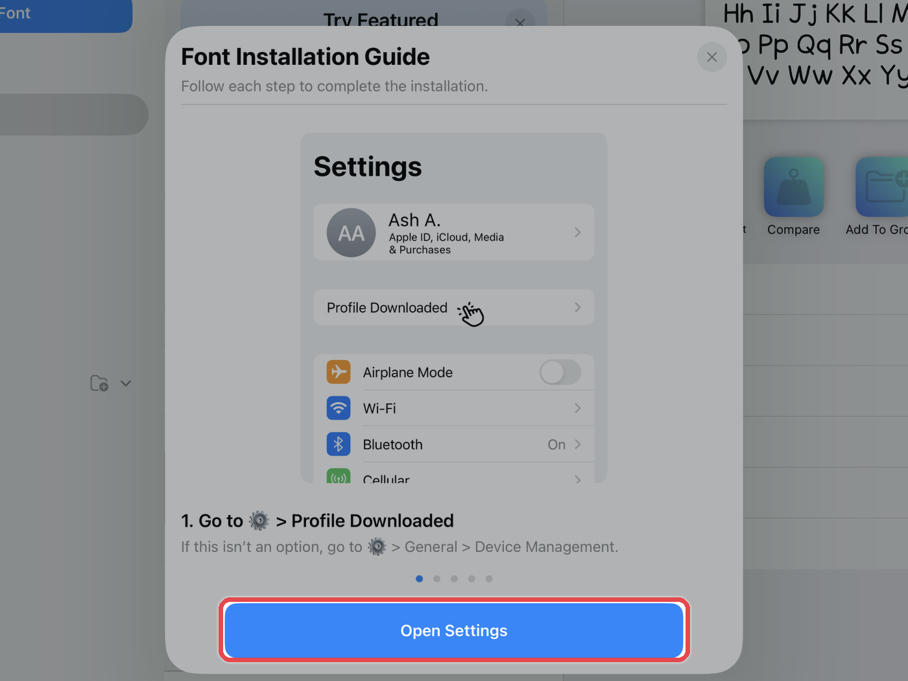
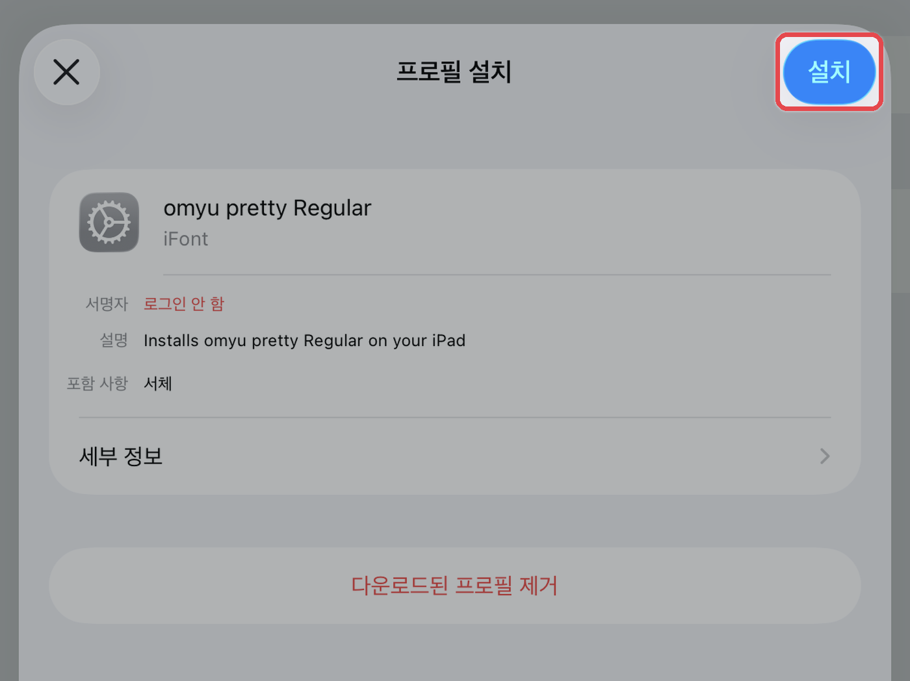
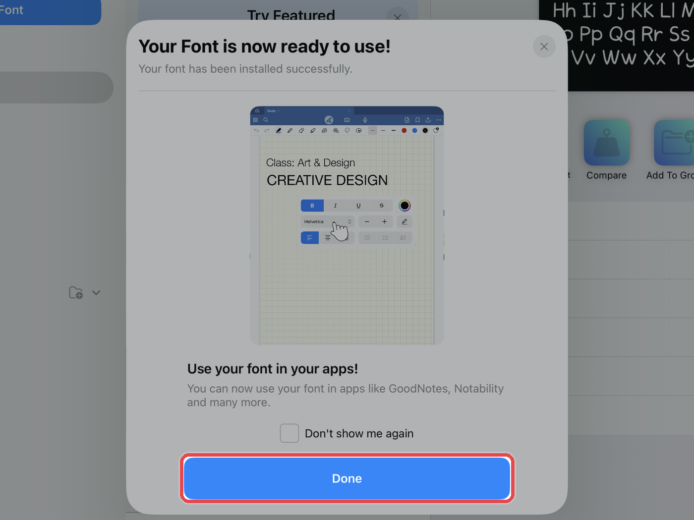

# 🍎 iOS (아이폰, 아이패드)

아이폰·아이패드는 폰트 파일을 바로 설치할 수 없어서, **폰트 설치 앱(iFont)** 을 거쳐 설치해야 합니다. 설치한 폰트는 굿노트·노타빌리티처럼 **글꼴 선택 메뉴가 있는 앱**에서 쓸 수 있습니다.



#### iFont 설치

App Store에서 **iFont** 앱을 설치해 주세요.

<figure><figcaption></figcaption></figure>



#### 폰트 파일 다운로드

오뮤다이어리 홈페이지의 **\[주문내역 조회]**&#xC5D0;서 구매한 폰트의 **\[다운로드]** 버튼을 눌러주세요.\
다운로드한 **TTF 또는 OTF 파일**&#xC744; 확인해 주세요.

<figure><figcaption></figcaption></figure>



#### iFont로 보내기

파일 앱에서 폰트 파일을 누르고, 우측 상단의 **\[⬆️]** 공유 버튼 → **\[iFont 아이콘]**&#xC744; 눌러주세요.

<figure><figcaption></figcaption></figure>



#### INSTALL 누르기

iFont의 **Imported Fonts** 목록에서 불러온 폰트 옆 **\[INSTALL]**&#xC744; 눌러주세요.

<figure><figcaption></figcaption></figure>



#### 설치 안내 확인

설치 안내 창이 나오면 **\[Continue]**&#xB97C; 눌러주세요.

<figure><figcaption></figcaption></figure>



#### 프로파일 다운로드 허용

구성 프로파일을 다운로드할지 묻는 창이 나오면 **\[허용]**&#xC744; 눌러주세요.

<figure><figcaption></figcaption></figure>



#### 설정 앱으로 이동

설치 가이드 창에서 **\[Open Settings]**&#xB97C; 눌러 설정 앱으로 이동해 주세요.

<figure><figcaption></figcaption></figure>



#### 설정에서 프로파일 설치

설정의 **\[프로파일이 다운로드됨]**&#xC744; 누르거나, **설정 → 일반 → VPN 및 기기 관리**에서 받은 폰트 프로파일을 열어주세요.\
오른쪽 위 **\[설치]**&#xB97C; 누르고 기기 암호를 입력한 뒤, 한 번 더 **\[설치]**&#xB97C; 눌러주세요.

<figure><figcaption></figcaption></figure>



#### 설치 완료

iFont로 돌아와 완료 안내가 나오면 **\[Done]**&#xC744; 눌러주세요.\
이제 굿노트·노타빌리티 같은 필기 앱의 **텍스트 도구 → 글꼴** 목록에서 폰트를 선택할 수 있어요.

<figure><figcaption></figcaption></figure>




앱에 폰트가 보이지 않으면 필기 앱을 **완전히 종료 후 다시 실행**하거나 기기를 재시동해 주세요.



**폰트 삭제** · 설정 → 일반 → VPN 및 기기 관리에서 폰트 프로파일을 누르고 **프로파일 제거**를 눌러주세요.

시스템 전체 글꼴(메뉴·메시지 등)은 바뀌지 않아요. 글꼴 선택 메뉴가 있는 앱에서만 쓸 수 있어요.

