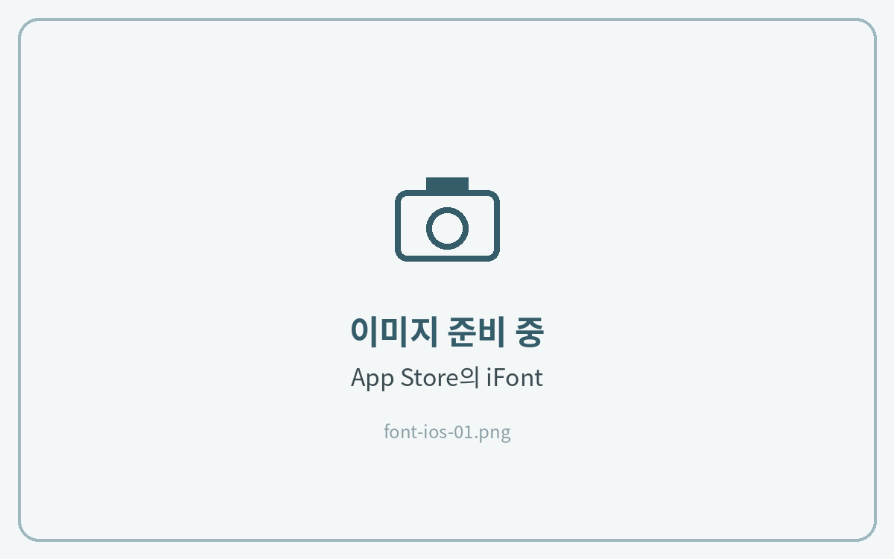
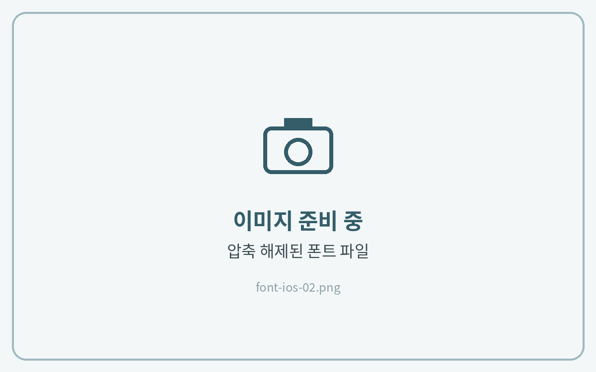
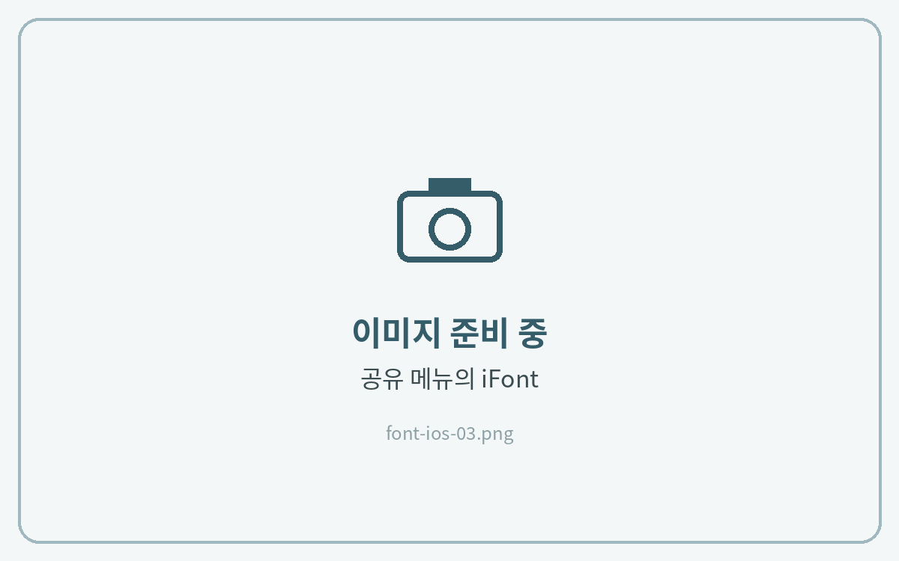
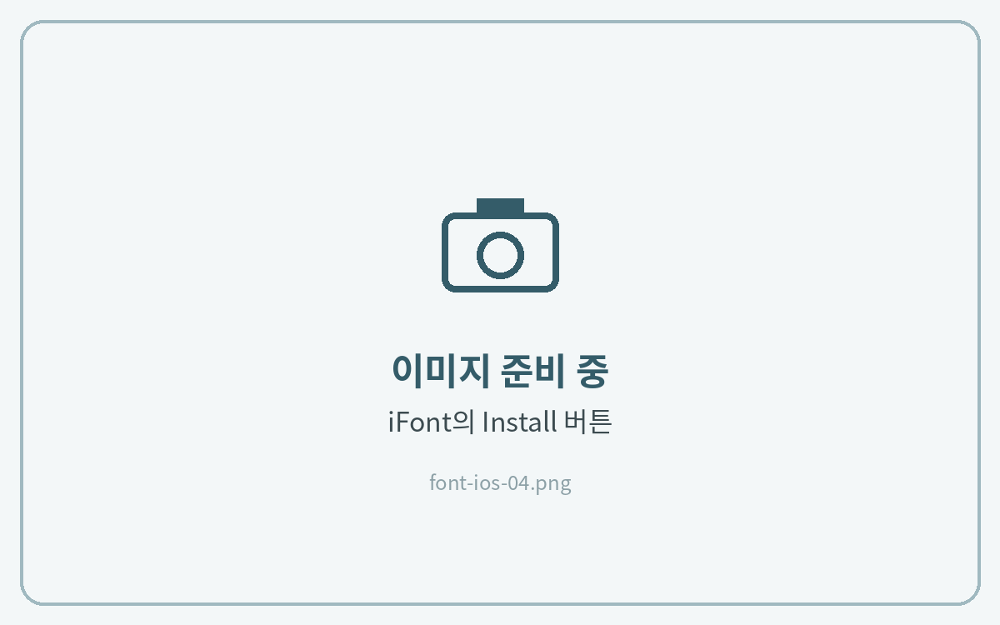
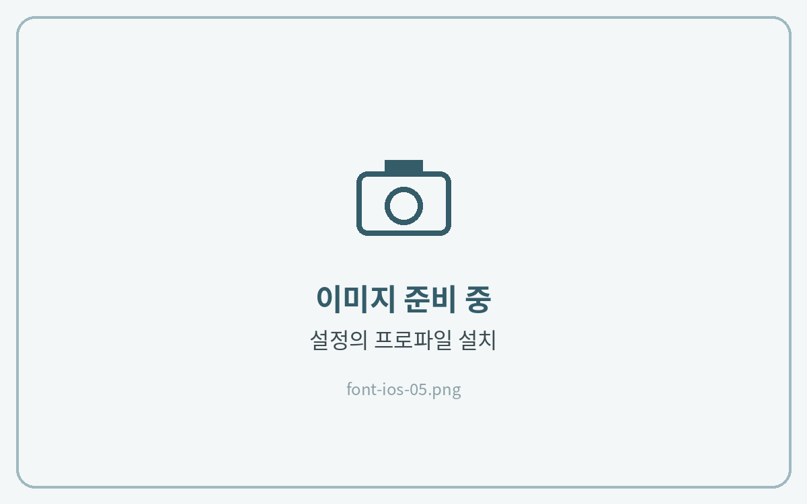
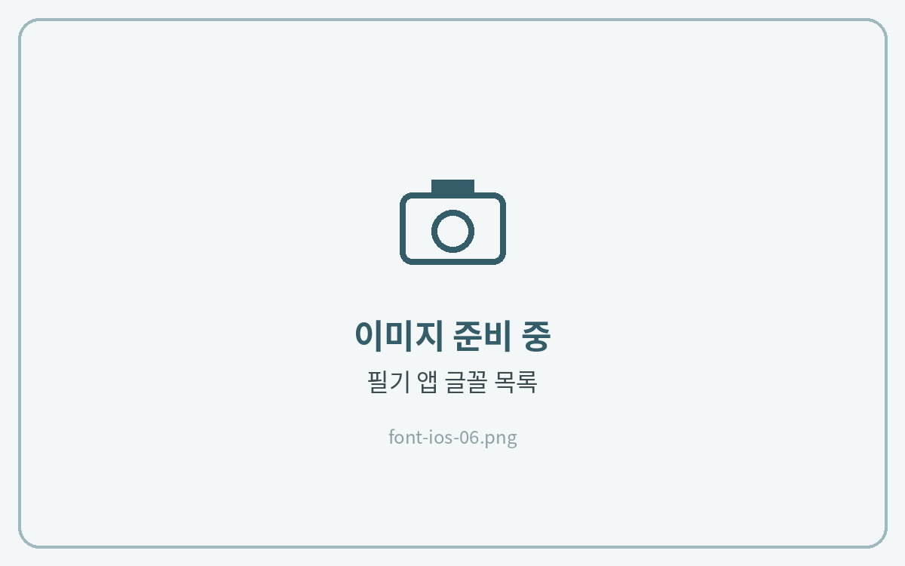

# iOS (아이폰, 아이패드)

아이폰·아이패드는 폰트 파일을 바로 설치할 수 없어서, **폰트 설치 앱(iFont)** 을 거쳐 설치해야 합니다. 설치한 폰트는 굿노트·노타빌리티처럼 **글꼴 선택 메뉴가 있는 앱**에서 쓸 수 있습니다.



**iFont 설치**

App Store에서 **iFont** 앱을 설치해 주세요.

<figure><figcaption></figcaption></figure>



**폰트 파일 준비**

다운로드한 ZIP 파일을 파일 앱에서 탭해 압축을 풀고, **TTF 또는 OTF 파일**을 확인해 주세요.

<figure><figcaption></figcaption></figure>



**iFont로 보내기**

폰트 파일을 길게 누르고 **공유 → iFont**를 선택해 주세요.

<figure><figcaption></figcaption></figure>



**설치 프로파일 받기**

iFont의 **Imported Fonts** 목록에서 폰트 옆 **Install**을 누르고, 프로파일 다운로드를 **허용**해 주세요.

<figure><figcaption></figcaption></figure>



**설정에서 설치 완료**

**설정 → 일반 → VPN 및 기기 관리**에서 받은 폰트 프로파일을 누르고 **설치**를 눌러주세요.

<figure><figcaption></figcaption></figure>



**필기 앱에서 확인**

필기 앱의 **텍스트 도구 → 글꼴** 목록에서 오뮤다이어리 폰트를 선택하면 끝이에요.

<figure><figcaption></figcaption></figure>




앱에 폰트가 보이지 않으면 필기 앱을 **완전히 종료 후 다시 실행**하거나 기기를 재시동해 주세요.



**폰트 삭제** · 설정 → 일반 → VPN 및 기기 관리에서 폰트 프로파일을 누르고 **프로파일 제거**를 눌러주세요.

시스템 전체 글꼴(메뉴·메시지 등)은 바뀌지 않아요. 글꼴 선택 메뉴가 있는 앱에서만 쓸 수 있어요.

