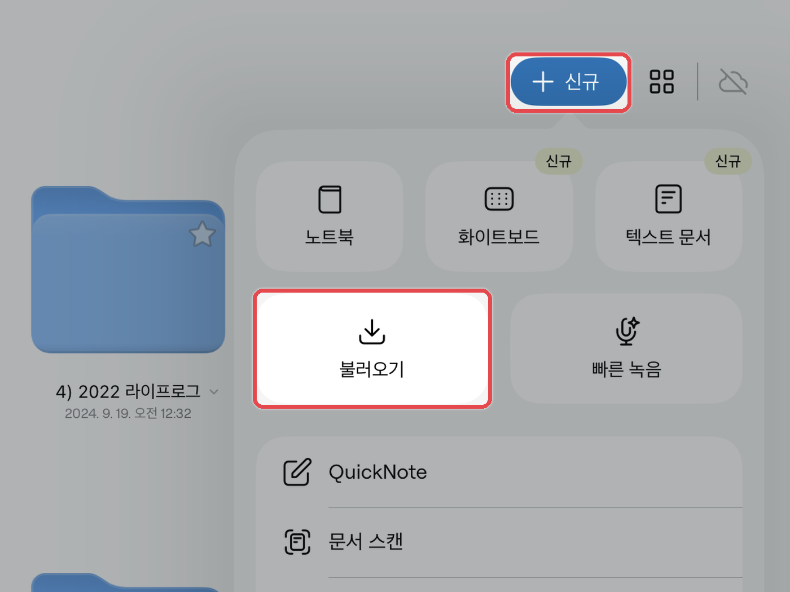
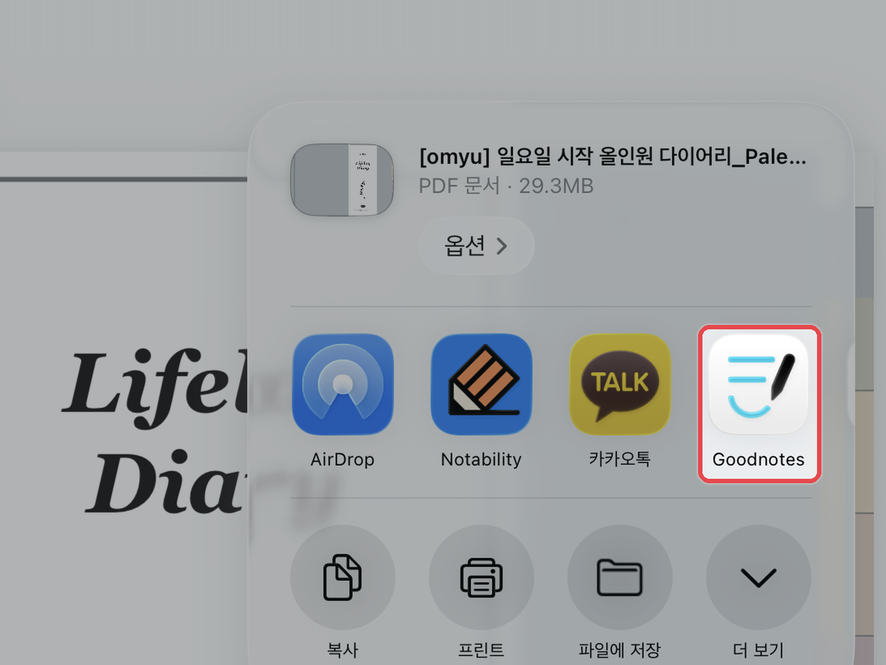

# 📝 굿노트 (Goodnotes)

**지원 기기** · 아이패드 · 아이폰 (Goodnotes 6 기준)

## 노트 불러오기



#### 문서 화면에서 불러오기

**\[문서]** 화면에서 **\[+ 신규]** → **\[불러오기]**&#xB97C; 누른 후, 다운로드 받은 PDF 파일을 선택해 주세요.

<figure><figcaption></figcaption></figure>



#### 파일 앱에서 바로 보내기

파일 앱에서 PDF 파일을 누르고, 우측 상단의 **\[⬆️]** 공유 버튼 → **\[굿노트 아이콘]**&#xC744; 눌러주세요.\
**\[새로운 문서로 불러오기]**&#xB97C; 누르면 끝이에요.

<figure><figcaption></figcaption></figure>



## 기능별 가이드

<table data-view="cards"><thead><tr><th></th><th></th><th data-hidden data-card-target data-type="content-ref"></th></tr></thead><tbody><tr><td><h4>하이퍼링크 사용법</h4></td><td></td><td><a href="hyperlink.md">hyperlink.md</a></td></tr><tr><td><h4>스티커 사용법</h4></td><td></td><td><a href="sticker.md">sticker.md</a></td></tr><tr><td><h4>표지 변경하는 법</h4></td><td></td><td><a href="cover.md">cover.md</a></td></tr><tr><td><h4>페이지 추가하는 법</h4></td><td></td><td><a href="add-page.md">add-page.md</a></td></tr><tr><td><h4>노트팔레트 사용법</h4></td><td></td><td><a href="note-palette.md">note-palette.md</a></td></tr><tr><td><h4>다운로드 불러오기 실패시</h4></td><td></td><td><a href="import-failed.md">import-failed.md</a></td></tr></tbody></table>
