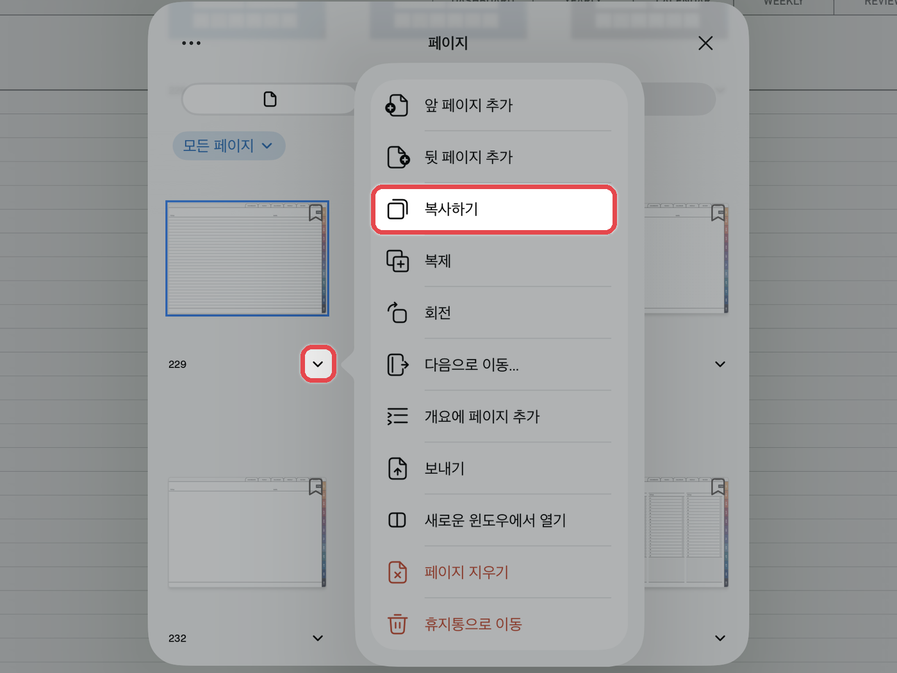
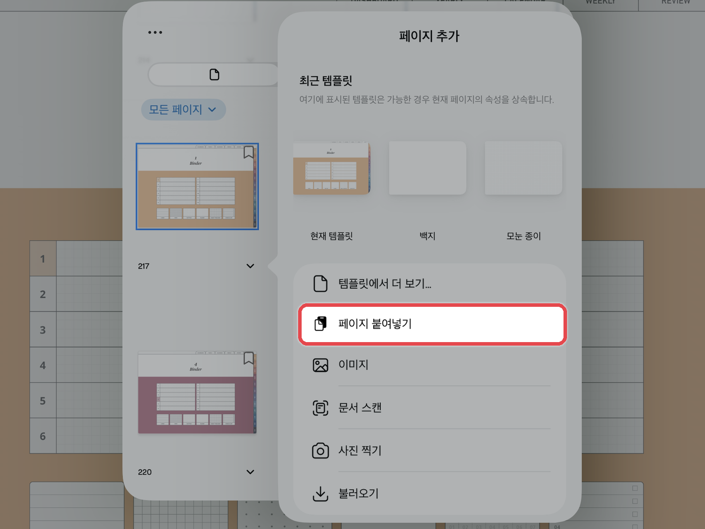
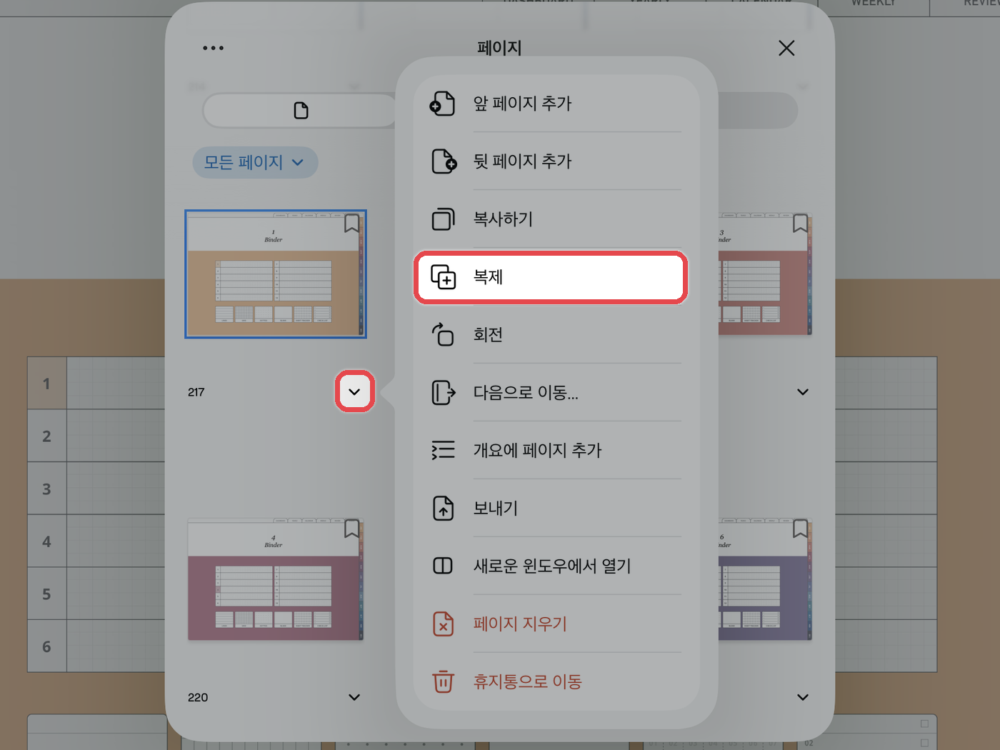

# 페이지 추가하는 법

## 방법 1 · 페이지 복사 후 붙여넣기



**속지 복사**

왼쪽 위 **사이드바**를 열고 **\[페이지]** 탭에서 추가하고 싶은 속지를 선택한 뒤 **\[복사하기]**&#xB97C; 눌러주세요.

<figure><figcaption></figcaption></figure>



**원하는 위치에 붙여넣기**

넣고 싶은 위치의 페이지를 연 뒤 **\[⌄]** 아래 화살표 버튼 → **\[뒷 페이지 추가]** → **\[페이지 붙여넣기]**&#xB97C; 눌러주세요.\
지금 보고 있는 페이지 바로 뒤에 복사한 속지가 추가돼요.

<figure><figcaption></figcaption></figure>



## 방법 2 · 페이지 복제



**복제하기**

사이드바의 페이지 목록에서 복제할 페이지 아래 **\[⌄]** 버튼을 누르고 **\[복제]**&#xB97C; 눌러주세요.\
바로 뒤에 같은 페이지가 추가돼요.

<figure><figcaption></figcaption></figure>




추가한 페이지는 사이드바의 페이지 목록에서 **길게 눌러 드래그**하면 원하는 위치로 옮길 수 있습니다.

