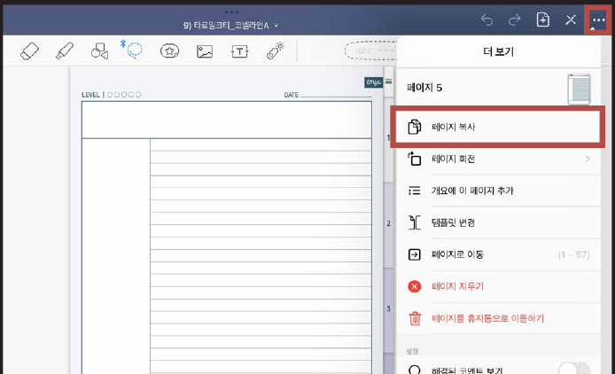
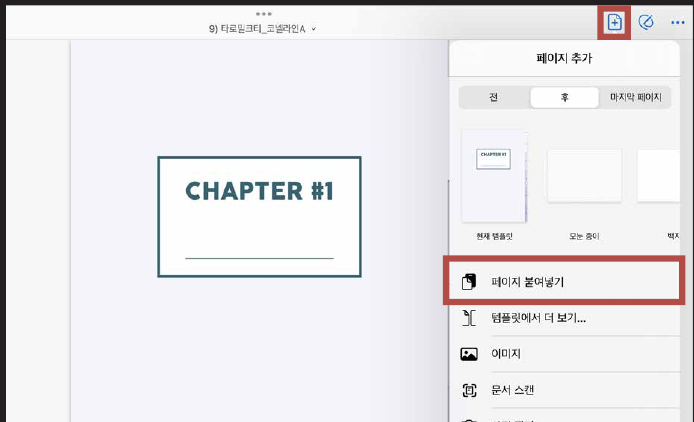
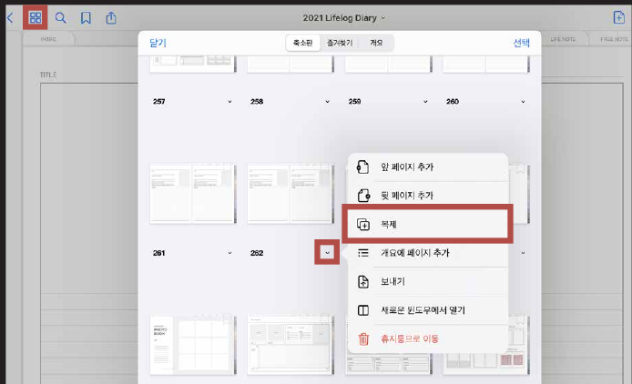
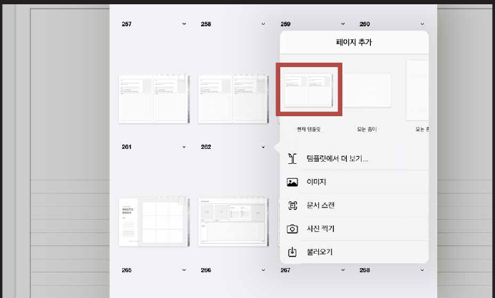

# 페이지 추가하는 법

## 첫 번째 방법

### STEP 01

상단의 **점 3개 버튼**을 누른 후 **페이지 복사**를 눌러주세요.

### STEP 02

상단의 플러스 아이콘을 누른 후 **페이지 붙여넣기**를 눌러주세요.

## 두 번째 방법

추가하고 싶은 페이지의 화살표를 누른 후 **복제**를 눌러주세요.

## 세 번째 방법

**앞 페이지 추가** 또는 **뒷 페이지 추가**를 누른 후 **현재 템플릿**을 눌러도 추가됩니다.
