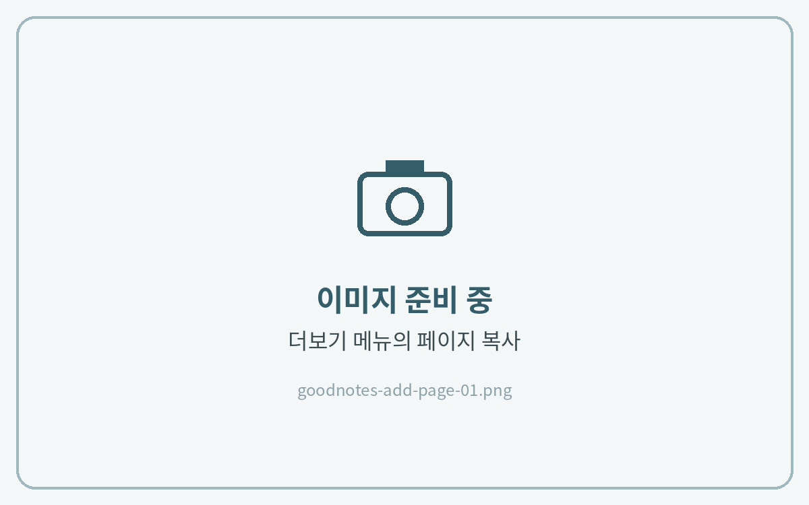
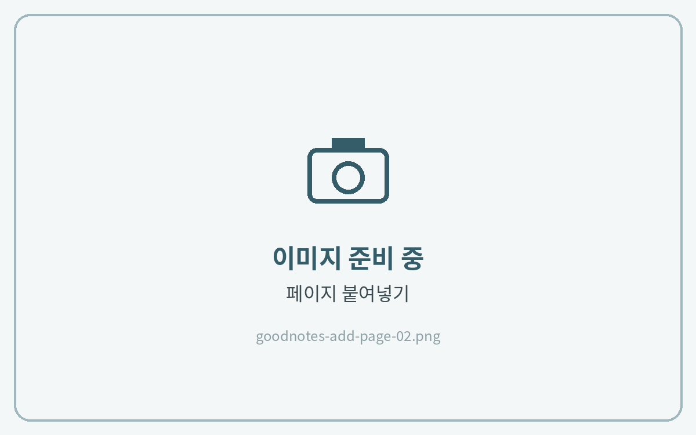
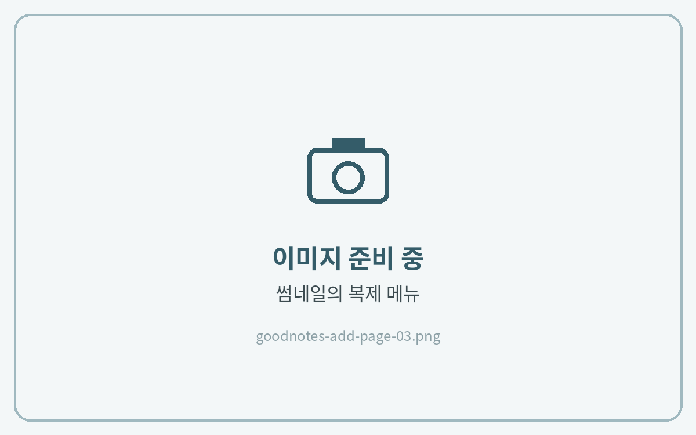

# 페이지 추가하는 법

## 방법 1 · 페이지 복사 → 붙여넣기



**페이지 복사**

추가하고 싶은 속지에서 오른쪽 위 **⋯ (더보기) → 페이지 복사**를 눌러주세요.

<figure><figcaption></figcaption></figure>



**붙여넣기**

넣고 싶은 위치에서 **페이지 추가(+) → 페이지 붙여넣기**를 눌러주세요.

<figure><figcaption></figcaption></figure>



## 방법 2 · 썸네일에서 복제



**복제하기**

**페이지 보기(썸네일)** 에서 페이지 아래 **화살표(⌄) → 복제**를 누르면 바로 뒤에 같은 페이지가 생겨요.

<figure><figcaption></figcaption></figure>




복제한 페이지는 썸네일에서 **길게 눌러 드래그**하면 원하는 위치로 옮길 수 있어요.

