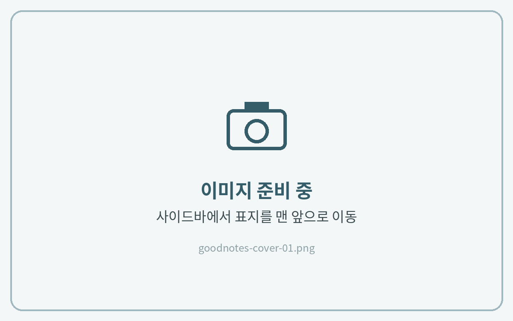

# 표지 변경하는 법

굿노트에서는 **문서의 첫 페이지가 표지**가 됩니다.\
새 표지를 맨 앞에 추가한 뒤 기존 표지를 삭제합니다.



**첫 페이지에서 페이지 추가**

표지(1페이지)를 연 상태에서 상단 오른쪽의 **\[페이지 추가(+)]** 아이콘을 누르고, 위치를 **\[이전]**&#xC73C;로 선택해 주세요.

<figure><figcaption></figcaption></figure>



**표지 파일 가져오기**

**\[가져오기]**&#xB97C; 누르고 다운로드해 둔 표지 파일을 선택해 주세요.\
표지가 이미지(PNG·JPG) 파일이라면 **\[이미지]**&#xB97C; 눌러 사진 앱에서 선택하면 돼요.

<figure><figcaption></figcaption></figure>



**기존 표지 삭제**

왼쪽 위 **사이드바**를 열고 **\[페이지]** 탭에서 기존 표지를 선택한 뒤 **\[삭제]**&#xB97C; 눌러주세요.

<figure><figcaption></figcaption></figure>




사이드바의 페이지 목록에서 원하는 페이지를 **맨 앞으로 드래그**해도 그 페이지가 표지가 됩니다.

