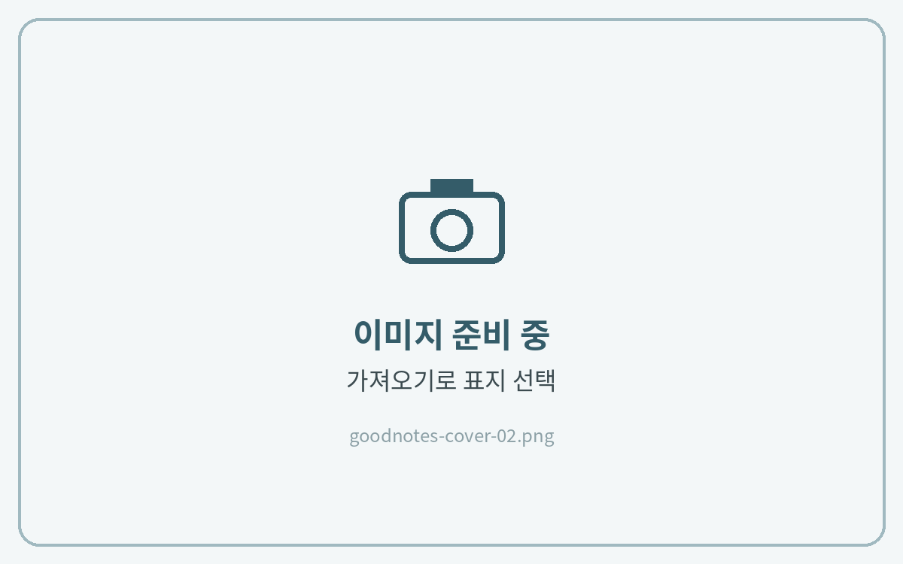
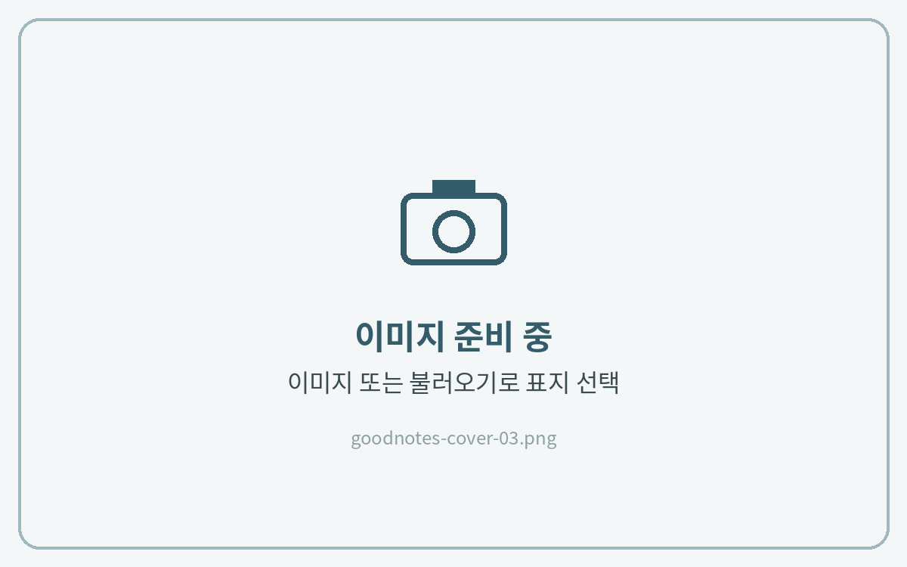
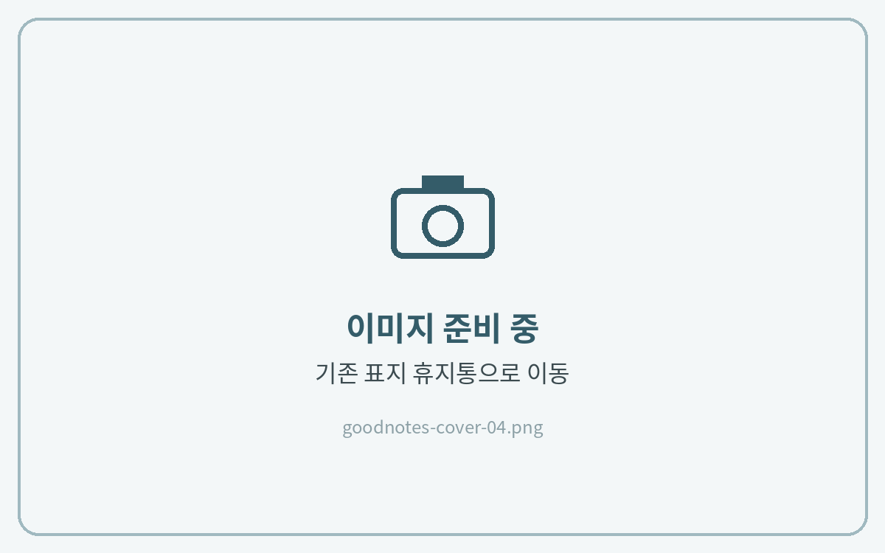

# 표지 변경하는 법

굿노트에서는 **문서의 첫 페이지가 표지**가 됩니다.\
노트 안에 있는 표지를 맨 앞으로 옮기거나, 다운로드한 표지 파일을 맨 앞에 추가해 변경합니다.

## 방법 1 · 노트 안의 표지로 바꾸기



**원하는 표지를 맨 앞으로 이동**

왼쪽 위 **사이드바**를 열고, 원하는 표지 페이지를 **길게 누른 채 맨 앞으로** 옮겨주세요.




## 방법 2 · 다운로드한 표지 파일로 바꾸기



**앞 페이지 추가**

표지(1페이지)를 연 상태에서 **\[⌄]** 아래 화살표 버튼을 누르고 **\[앞 페이지 추가]**&#xB97C; 눌러주세요.

<figure><figcaption></figcaption></figure>



**표지 파일 선택**

표지가 **이미지(PNG·JPG)** 파일이라면 **\[이미지]**&#xB97C; 눌러 사진 앱에서 선택해 주세요.\
**PDF** 파일이라면 **\[불러오기]**&#xB97C; 눌러 파일 앱에서 선택해 주세요.

<figure><figcaption></figcaption></figure>



**기존 표지 삭제**

사이드바에서 기존 표지를 선택한 뒤 **\[휴지통으로 이동]**&#xC744; 눌러주세요.

<figure><figcaption></figcaption></figure>


