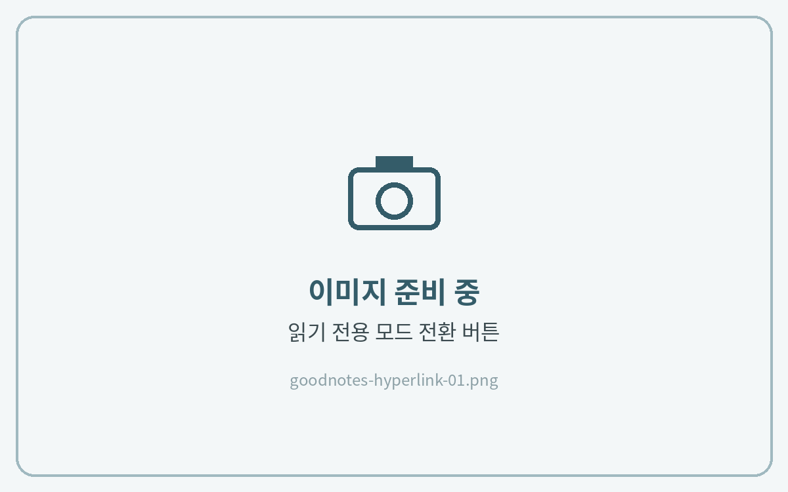
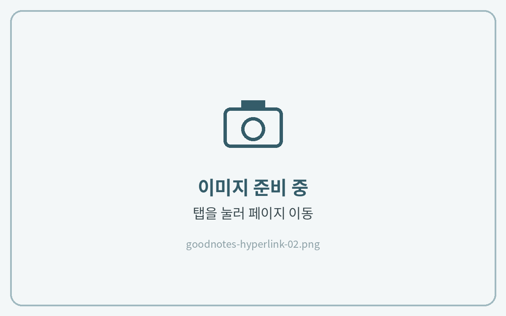
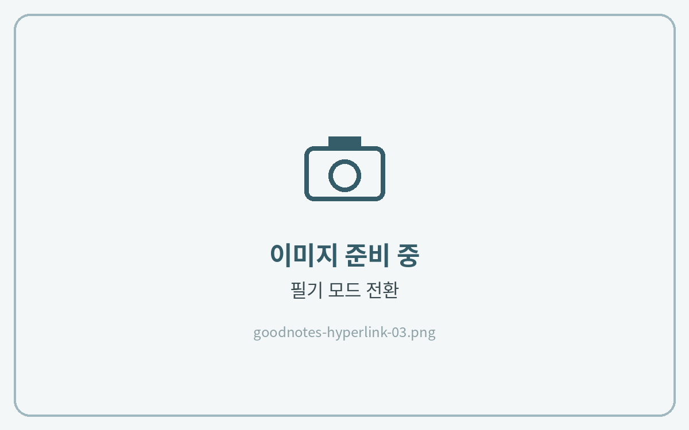

# 하이퍼링크 사용법

굿노트는 **필기 모드에서는 링크가 눌리지 않아요.** 페이지를 이동할 때는 읽기 전용 모드로 바꿔 주세요.



**읽기 전용 모드 켜기**

오른쪽 위 **연필 아이콘(✏️)** 을 눌러 **읽기 전용 모드**로 바꿔주세요. 도구 막대가 사라지면 켜진 상태예요.

<figure><figcaption></figcaption></figure>



**링크 눌러 이동**

월간·주간 탭이나 목차의 날짜를 누르면 해당 페이지로 바로 이동해요.

<figure><figcaption></figcaption></figure>



**다시 필기 모드로**

이동한 뒤 **연필 아이콘**을 다시 눌러 필기 모드로 돌아와 기록해 주세요.

<figure><figcaption></figcaption></figure>




**TIP · 모드를 바꾸지 않고 이동하기**

**올가미 도구**로 링크가 있는 곳을 길게 누르면 **링크 열기** 메뉴가 나타나요. 필기 중에 잠깐 이동할 때 편리해요.



페이지 넘김은 **보기 설정 → 스크롤 방향 → 가로**로 두면 종이 노트처럼 한 장씩 넘길 수 있어요.

