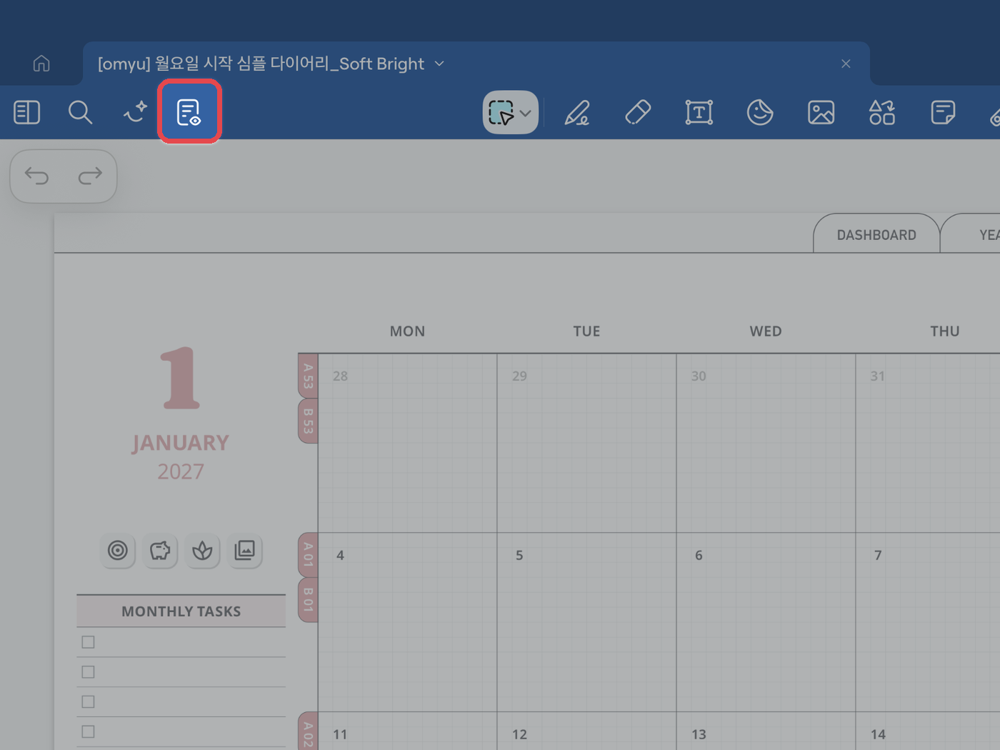
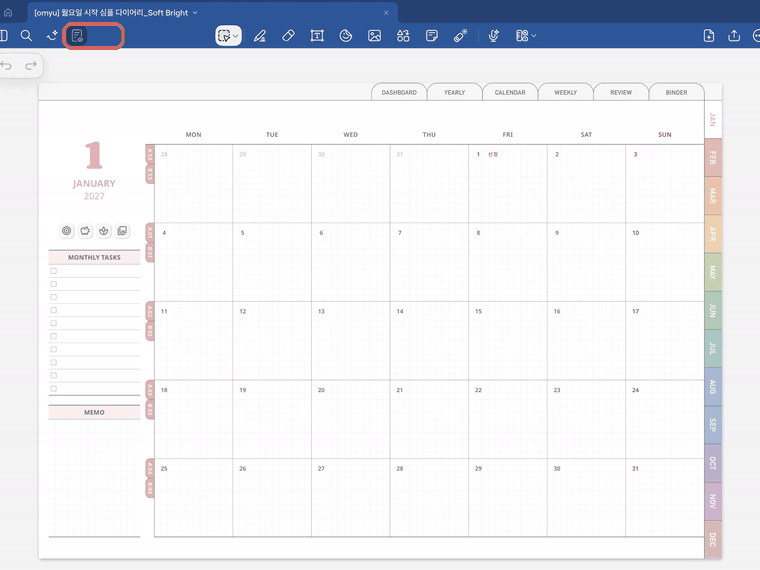
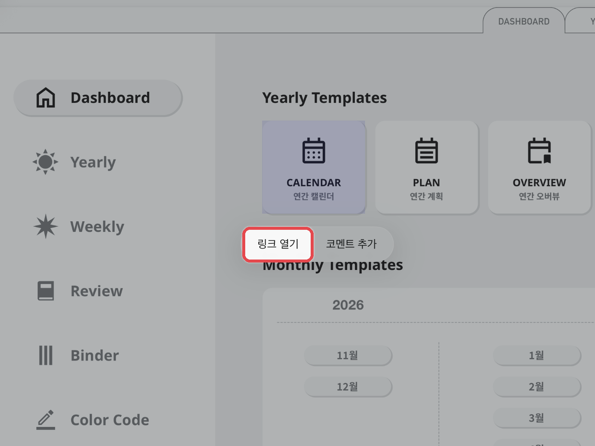

# 하이퍼링크 사용법

굿노트에서 하이퍼링크로 페이지를 이동하는 방법은 **3가지**입니다.\
**필기 모드에서는 링크가 바로 눌리지 않으니**, 아래 버튼을 눌러 편한 방법을 확인해 주시기 바랍니다.

<a href="hyperlink.md#read-only" class="button secondary">① 읽기 전용 모드로 이동</a> <a href="hyperlink.md#long-press" class="button secondary">② 링크를 꾹 눌러 이동</a> <a href="hyperlink.md#finger" class="button secondary">③ 손가락으로 눌러 이동</a>

## 읽기 전용 모드로 이동하기 



**읽기 전용 모드 켜기**

왼쪽 위 **\[노트 아이콘]**&#xC744; 눌러 **읽기 전용 모드**로 바꿔주세요.\
도구 막대가 사라지면 켜진 상태예요.

<figure><figcaption></figcaption></figure>



**링크를 눌러 이동**

하이퍼링크 버튼이 있는 곳을 누르면 해당 페이지로 이동해요.\
필기할 때는 왼쪽 위 **\[읽기 전용]**&#xC744; 한 번 더 눌러 꺼주세요.

<figure><figcaption></figcaption></figure>



## 링크를 꾹 눌러 이동하기 



**링크 열기**

**필기 모드**에서 하이퍼링크 버튼을 꾹 누르고, **\[링크 열기]**&#xB97C; 눌러주세요.

<figure><figcaption></figcaption></figure>



## 손가락으로 눌러 이동하기 



**손가락으로 누르기**

애플펜슬 대신 **손가락으로 하이퍼링크 버튼**&#xC744; 눌러주세요.\
모드를 바꾸지 않아도 바로 이동해요.


