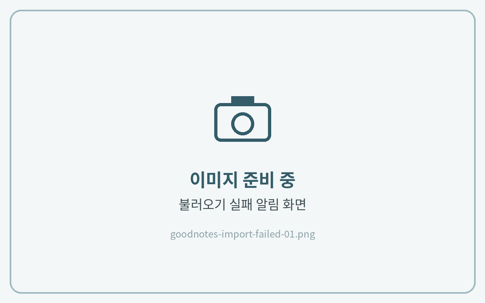

# 다운로드 불러오기 실패시

굿노트에서 **"불러오기 실패"** 알림이 뜬다면 대부분 아래 원인 중 하나예요. 위에서부터 차례로 확인해 주세요.

<figure><figcaption></figcaption></figure>

## 체크리스트

| 확인할 것 | 해결 방법 |
| --- | --- |
| **사파리가 아닌 앱에서 다운로드** (크롬, 네이버, 메일 미리보기 등) | 다운로드 링크를 **사파리**에서 다시 열어 받아 주세요. |
| **압축을 풀지 않음** | 파일 앱에서 ZIP 파일을 탭해 압축을 푼 뒤 PDF를 선택해 주세요. |
| **저장 공간 부족** | 설정 → 일반 → iPad 저장 공간에서 여유 공간을 확인해 주세요. |
| **굿노트 버전이 오래됨** | App Store에서 굿노트를 최신 버전으로 업데이트해 주세요. |


그래도 안 된다면 **다운로드 받은 파일을 모두 지우고** 사파리에서 처음부터 다시 받아 주세요. 해결되지 않으면 사용 중인 기기·굿노트 버전과 함께 문의 주세요.

