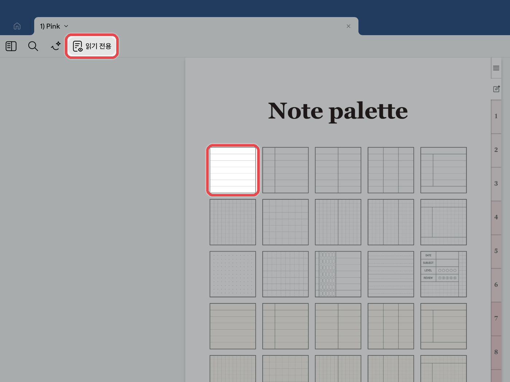
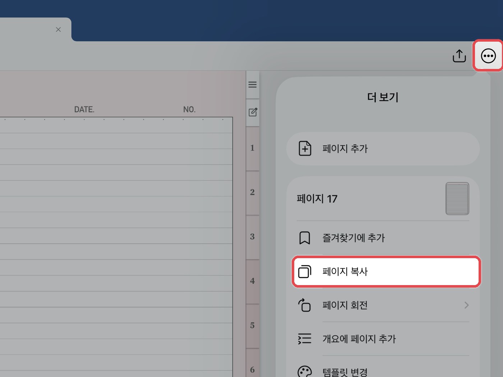
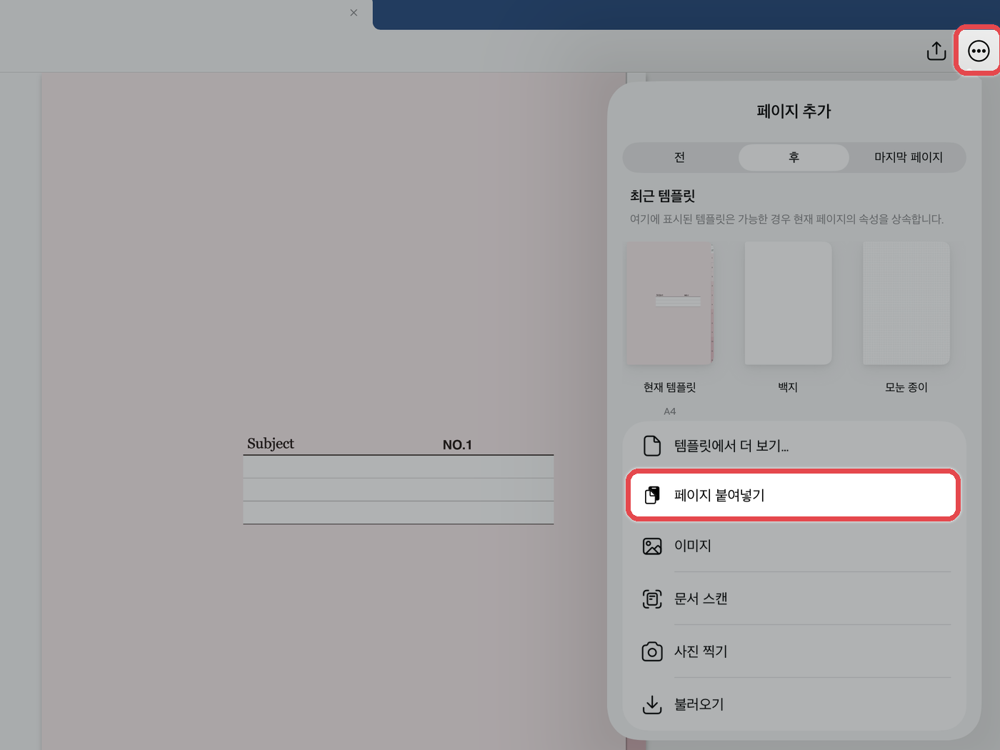

# 노트팔레트 사용법


**노트팔레트(NOTE PALETTE)가 포함된 제품에만 해당됩니다.**\
예) 올라운드 노트 · 올데이 언어노트 · 유어컬러 언어노트 · 워크윗미 노트


**노트팔레트**는 여러 가지 속지를 한곳에 모아 둔 곳입니다.\
필요한 속지를 골라 바인더(노트 본문)에 복사해 사용합니다.



#### 원하는 속지로 이동

**읽기 전용 모드**에서 노트팔레트의 원하는 속지를 눌러 이동해 주세요.

<figure><figcaption></figcaption></figure>



#### 속지 복사

오른쪽 위 **\[...]** 더보기 버튼을 누르고 **\[페이지 복사]**&#xB97C; 눌러주세요.

<figure><figcaption></figcaption></figure>



#### 바인더에 붙여넣기

원하는 바인더 위치로 이동한 뒤, 오른쪽 위 **\[...]** 더보기 버튼 → **\[페이지 추가]** → **\[페이지 붙여넣기]**&#xB97C; 눌러주세요.

<figure><figcaption></figcaption></figure>




**TIP** · [속지 추가하는 법](add-page.md)에서 다른 방법으로 속지를 붙여넣는 방법도 확인하실 수 있습니다.

