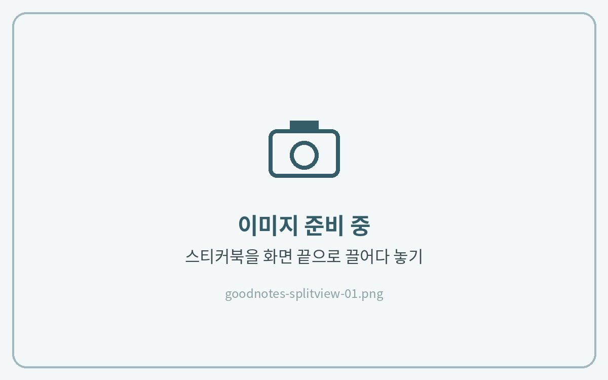
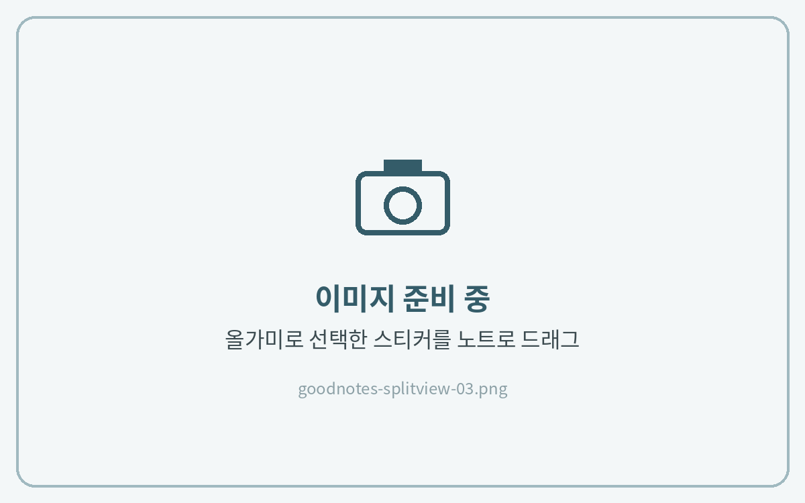

# 스티커 사용법

굿노트에서 스티커를 사용하는 방법은 **3가지**입니다.\
아래 버튼을 누르면 원하는 방법으로 바로 이동할 수 있습니다.

<a href="sticker.md#cutting" class="button secondary">① 컷팅 스티커북</a> <a href="sticker.md#split-view" class="button secondary">② 화면 분할로 사용</a> <a href="sticker.md#png" class="button secondary">③ 굿노트에 PNG 스티커 등록</a>

## 컷팅 스티커북 



**스티커 선택**

스티커북을 열고 **\[올가미 도구]**&#xB85C; 원하는 스티커를 클릭한 뒤, **\[...]** 더보기 버튼을 눌러 **\[복사하기]**&#xB97C; 눌러주세요.

<figure><figcaption></figcaption></figure>



**복사 → 붙여넣기**

원하는 영역으로 돌아가 빈 곳을 길게 누르고 **\[붙여넣기]**&#xB97C; 눌러주세요.

<figure><figcaption></figcaption></figure>




**스티커가 선택되지 않아요!**

올가미 도구 아이콘을 한 번 더 눌러 설정을 열고 **이미지** 항목을 켜 주시기 바랍니다.


## 화면 분할(Split View) 사용하기 

스티커북과 노트를 한 화면에 나란히 띄우면 복사·붙여넣기 없이 **드래그 한 번**으로 스티커를 옮길 수 있습니다.\
스티커를 여러 개 붙일 때 특히 편리합니다.



**스티커북과 노트 열기**

굿노트에서 **스티커북 파일**과 스티커를 붙일 **노트(다이어리)**&#xB97C; 열어주세요.



**스티커북을 새 창으로 열기**

상단 탭 바에 열린 **스티커북 탭을 길게 누른 채** 화면 왼쪽이나 오른쪽 끝으로 끌어다 놓아주세요.\
스티커북이 새 창으로 열리면서 노트와 나란히 보여요.

<figure><figcaption></figcaption></figure>



**스티커 끌어다 놓기**

스티커북 창에서 **\[올가미 도구]**&#xB85C; 원하는 스티커를 선택해 주세요.\
선택된 스티커를 **길게 누른 채** 노트 창으로 끌어다 놓으면 바로 붙어요.\
붙인 뒤에는 크기와 위치를 자유롭게 조절할 수 있어요.

<figure><figcaption></figcaption></figure>



**분할 화면 닫기**

다 붙였다면 가운데 구분선을 **스티커북 쪽 화면 끝까지** 밀어주세요.\
노트만 전체 화면으로 돌아와요.

<figure><figcaption></figcaption></figure>



## 굿노트에 PNG 스티커 등록하기 

자주 쓰는 스티커는 **그래픽 도구**에 컬렉션으로 등록해 두면 어떤 노트에서든 바로 꺼내 쓸 수 있습니다.



**그래픽 도구 열기**

상단 도구 막대에서 **그래픽(스마일 모양)** 도구를 누르고 아래쪽 끝에 있는 **\[+]**&#xC744; 눌러 새로운 컬렉션을 만들어 주세요.

<figure><figcaption></figcaption></figure>



**스티커 추가**

파일 앱과 굿노트를 **화면 분할**로 나란히 열어주세요.\
파일 앱에서 다운로드한 PNG 스티커를 **전체 선택**한 뒤, 새로 만든 컬렉션 안으로 끌어다 놓으면 한 번에 등록돼요.

<figure><figcaption></figcaption></figure>



**노트에 붙이기**

그래픽 도구에서 스티커를 누르면 노트에 붙어요. 크기와 위치를 조절해 사용하세요.

<figure><figcaption></figcaption></figure>


