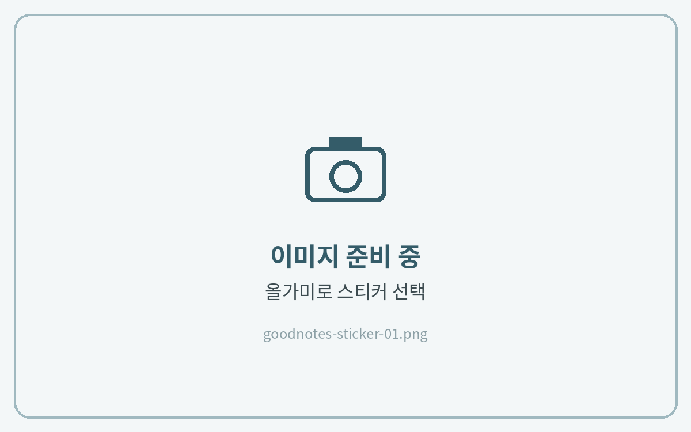
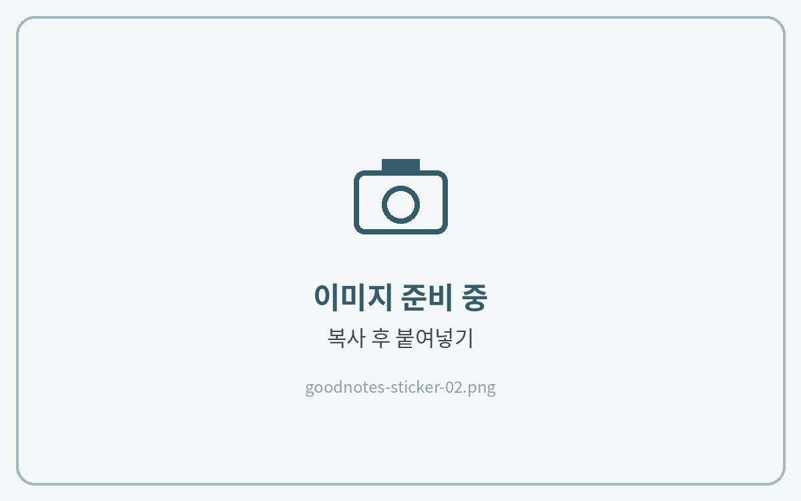
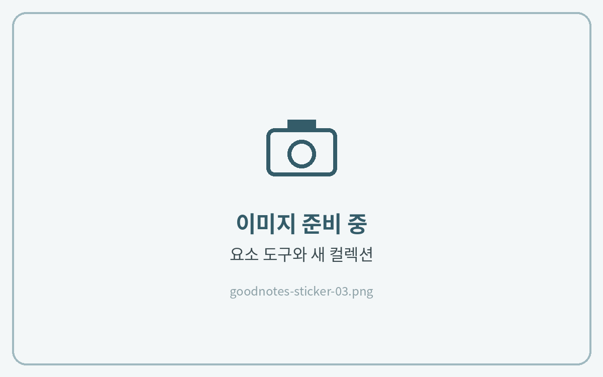
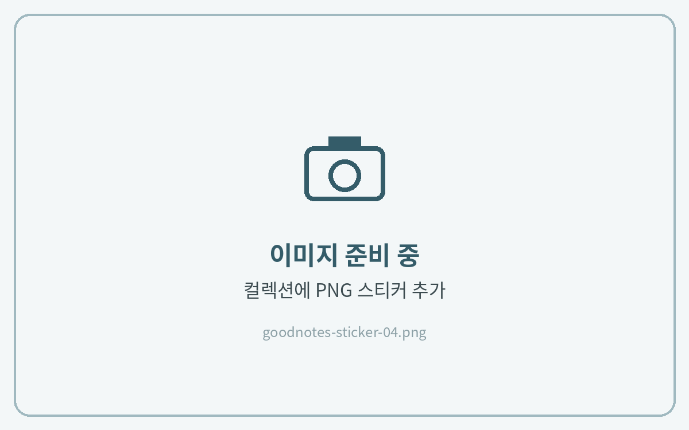
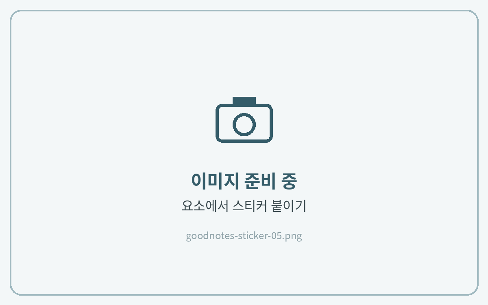

# 스티커 사용법

## 컷팅 스티커북



**스티커 선택**

스티커북을 열고 **올가미 도구**로 원하는 스티커 둘레를 그려 선택해 주세요.

<figure><figcaption></figcaption></figure>



**복사 → 붙여넣기**

선택 영역을 눌러 **복사**한 뒤, 노트로 돌아가 빈 곳을 길게 누르고 **붙여넣기**를 눌러주세요.

<figure><figcaption></figcaption></figure>




**스티커가 선택되지 않아요!**

올가미 도구를 한 번 더 눌러 설정을 열고 **이미지** 항목을 켜 주세요.



**TIP** · 화면 분할(Split View)로 스티커북과 노트를 나란히 띄우면 스티커를 **드래그**해서 바로 옮길 수 있어요.


## PNG 스티커 · 요소(Elements)에 등록하기

자주 쓰는 스티커는 **요소** 도구에 컬렉션으로 등록해 두면 어떤 노트에서든 바로 꺼내 쓸 수 있어요.



**요소 도구 열기**

상단 도구 막대에서 **요소(별 모양)** 도구를 누르고 아래쪽 **+** 를 눌러 새 컬렉션을 만들어 주세요.

<figure><figcaption></figcaption></figure>



**스티커 추가**

**사진 추가** 또는 **가져오기**로 PNG 스티커를 선택하고 **만들기**를 눌러주세요.

<figure><figcaption></figcaption></figure>



**노트에 붙이기**

요소 도구에서 스티커를 누르면 노트에 붙어요. 크기와 위치를 조절해 사용하세요.

<figure><figcaption></figcaption></figure>


