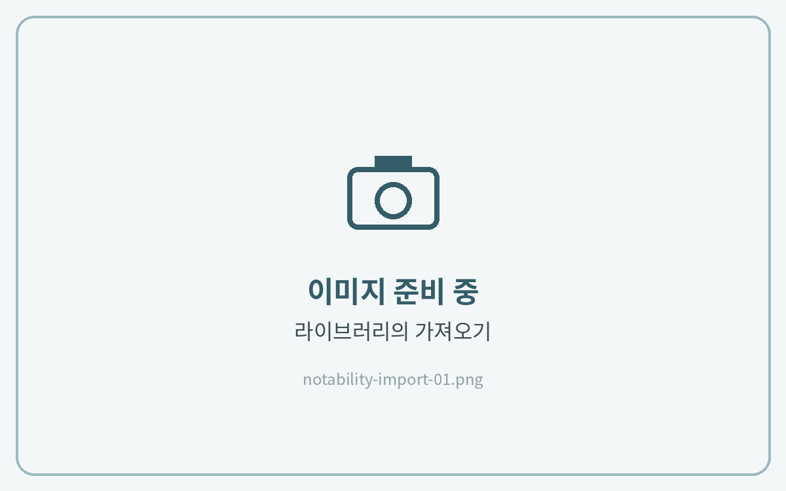
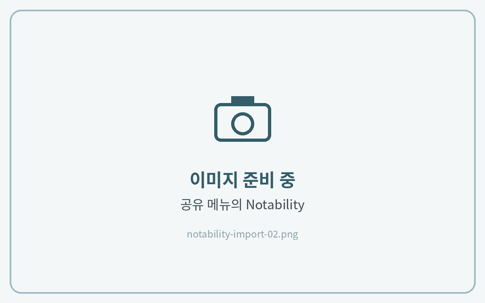

# 노타빌리티 (Notability)

**지원 기기** · 아이패드 · 아이폰 · 맥

노타빌리티는 **펜·형광펜·지우개·올가미 어떤 도구를 쓰고 있어도** 링크를 누르면 바로 이동해요. 모드를 바꿀 필요가 없어요.

## 노트 불러오기



**노타빌리티로 가져오기**

라이브러리 화면에서 **가져오기**를 누르고 압축을 푼 PDF를 선택해 주세요.

<figure><figcaption></figcaption></figure>



**또는 파일 앱에서 바로 보내기**

파일 앱에서 PDF를 길게 누르고 **공유 → Notability → 새로운 노트로 가져오기**를 선택해도 돼요.

<figure><figcaption></figcaption></figure>



## 기능별 가이드

<table data-view="cards"><thead><tr><th></th><th></th><th data-hidden data-card-target data-type="content-ref"></th></tr></thead><tbody><tr><td><strong>하이퍼링크 사용법</strong></td><td>목차·탭을 눌러 원하는 페이지로 이동해요</td><td><a href="hyperlink.md">hyperlink.md</a></td></tr><tr><td><strong>스티커 사용법</strong></td><td>컷팅 스티커와 PNG 스티커를 붙여요</td><td><a href="sticker.md">sticker.md</a></td></tr><tr><td><strong>표지 변경하는 법</strong></td><td>원하는 표지로 바꿔요</td><td><a href="cover.md">cover.md</a></td></tr><tr><td><strong>페이지 추가하는 법</strong></td><td>필요한 속지를 복사해서 늘려요</td><td><a href="add-page.md">add-page.md</a></td></tr><tr><td><strong>노트팔레트 사용하는 법</strong></td><td>원하는 속지를 바인더에 추가해요</td><td><a href="note-palette.md">note-palette.md</a></td></tr></tbody></table>
