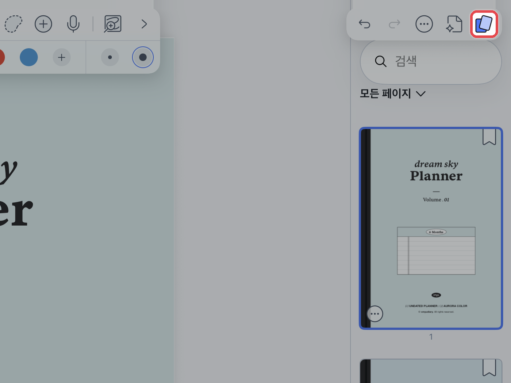
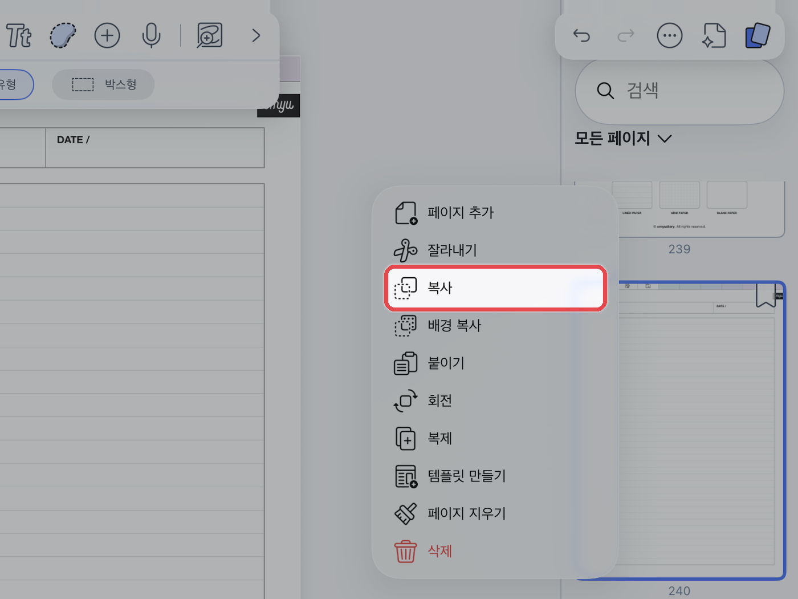
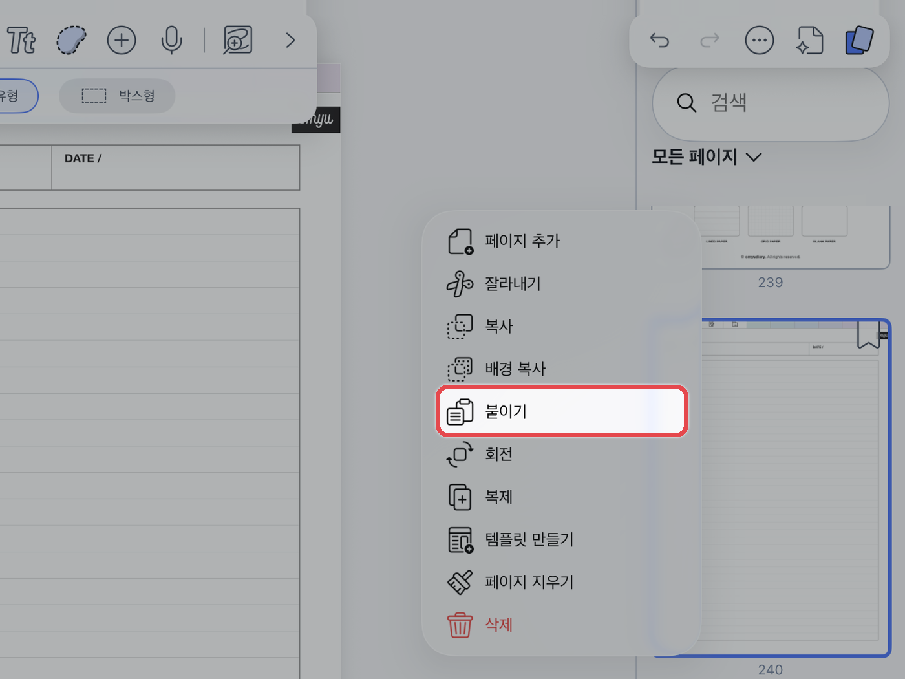

# 속지 추가하는 법



#### 페이지 목록 열기

오른쪽 위 **\[페이지]** 아이콘을 눌러 페이지 목록을 열어주세요.

<figure><figcaption></figcaption></figure>



#### 속지 복사

**\[...]**&#xC744; 누르고 추가할 속지를 선택한 뒤 **\[복사]**&#xB97C; 눌러주세요.

<figure><figcaption></figcaption></figure>



#### 붙여넣기

넣고 싶은 위치에 있는 **\[...]**&#xC744; 누르고 **\[붙이기]**&#xB97C; 눌러주세요.

<figure><figcaption></figcaption></figure>




다른 노트에 추가할 때도 같은 방법으로 **\[복사]**&#xD55C; 뒤, 그 노트의 페이지 목록에서 **\[붙이기]**&#xB97C; 누르면 됩니다.

