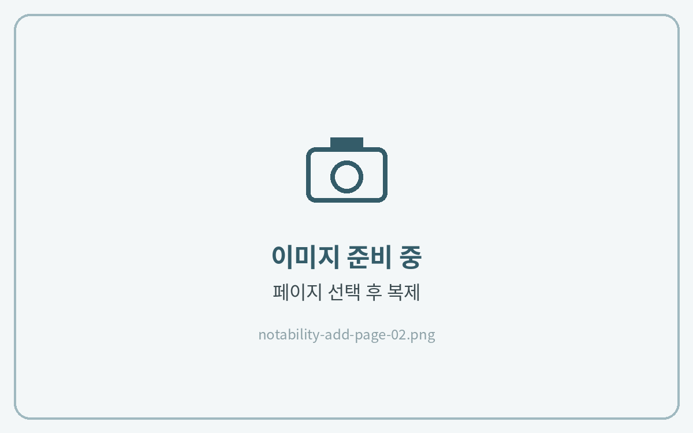
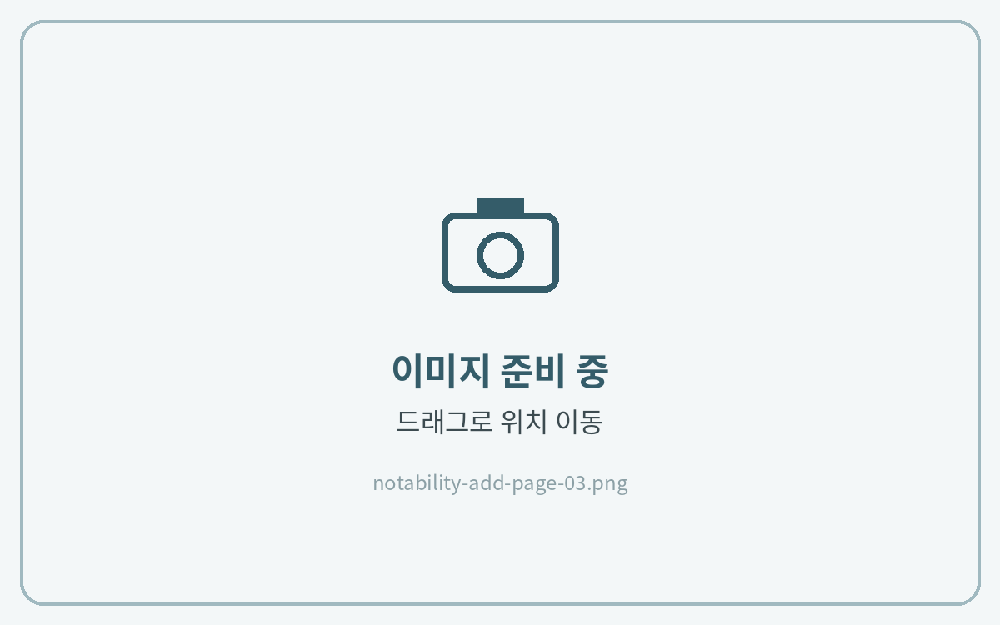

# 페이지 추가하는 법



**페이지 목록 열기**

오른쪽 위 **\[페이지]** 아이콘을 눌러 페이지 목록을 열어주세요.

<figure><figcaption></figcaption></figure>



**페이지 선택 후 복제**

아래쪽 **\[선택]**&#xC744; 누르고 추가할 페이지를 선택한 뒤 **\[복제]** 아이콘을 눌러주세요.\
같은 페이지가 하나 더 추가돼요.

<figure><figcaption></figcaption></figure>



**원하는 위치로 이동**

추가된 페이지를 **길게 누른 채 위아래로 드래그**해 원하는 위치로 옮겨주세요.

<figure><figcaption></figcaption></figure>




다른 노트에 추가하고 싶다면 **\[복제]** 대신 **\[복사]**&#xB97C; 누른 뒤, 다른 노트의 페이지 목록에서 **\[붙이기]**&#xB97C; 누르면 됩니다.

