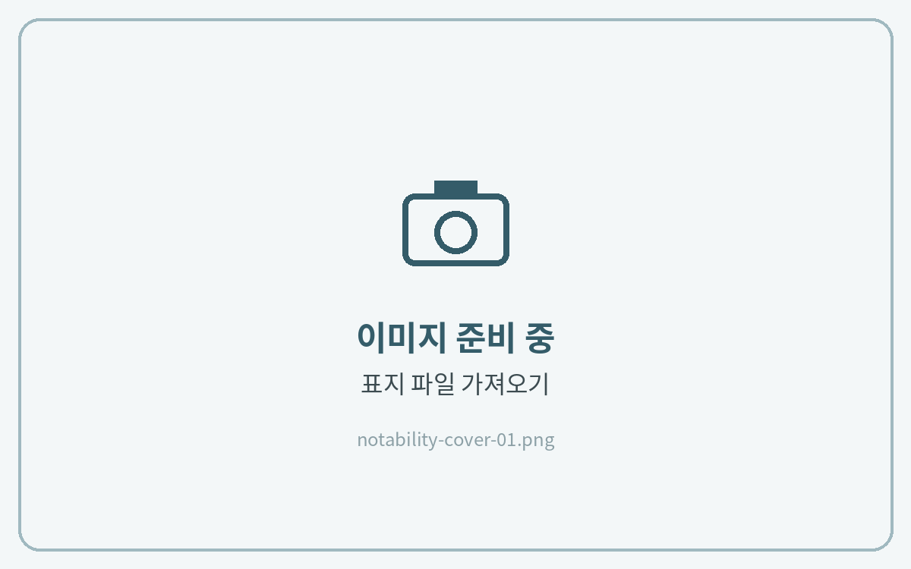
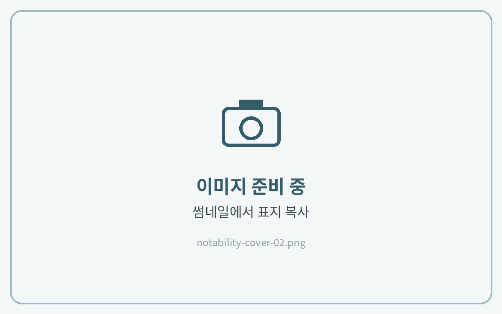
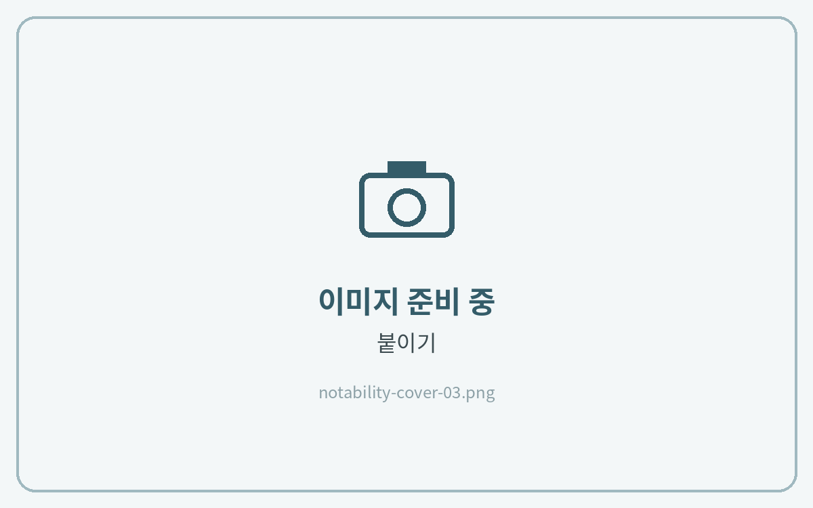
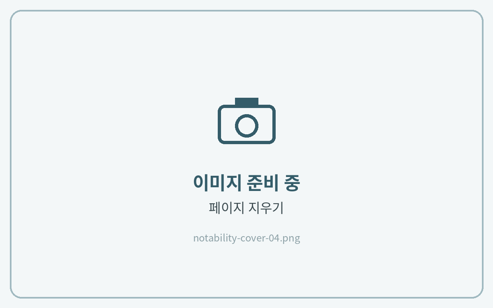

# 표지 변경하는 법



### 표지 파일 불러오기

[PDF 다운로드](../download/pdf.md)와 같은 방법으로 표지 파일을 노타빌리티에 가져와 주세요.



### 표지 복사

표지 노트에서 왼쪽 위 **페이지 보기(썸네일)** 를 열고 표지 페이지를 **복사**해 주세요.



### 바꿀 노트에 붙이기

표지를 바꿀 노트의 썸네일에서 1페이지를 선택하고 **붙이기**를 눌러주세요.



### 기존 표지 삭제

기존 표지는 **페이지 지우기**로 삭제해 주세요.



