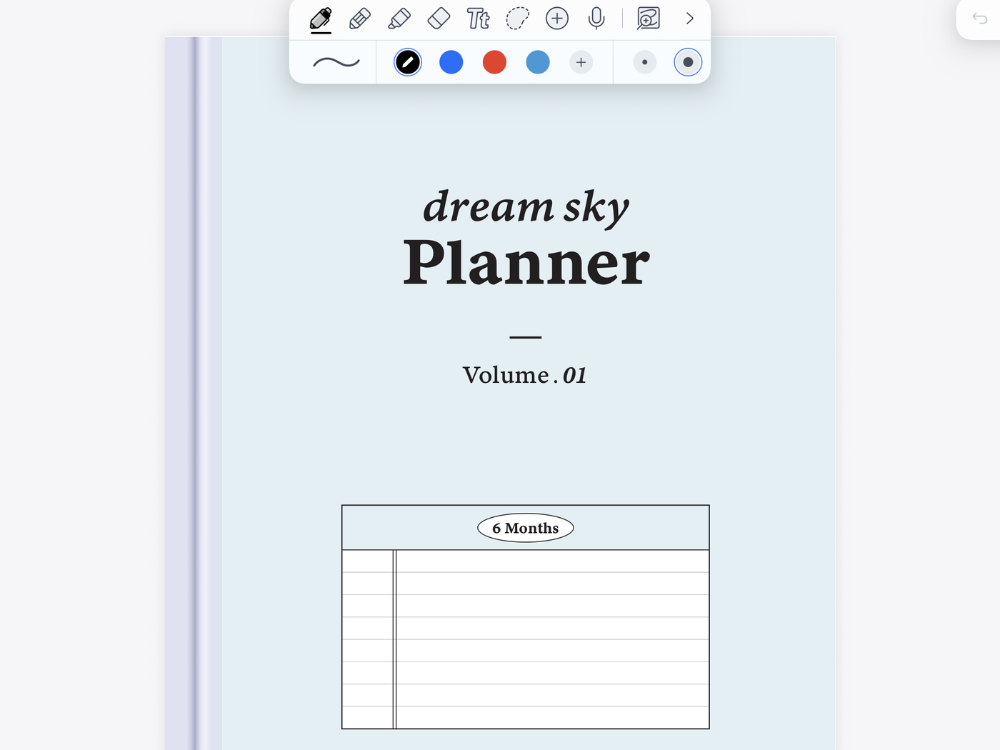
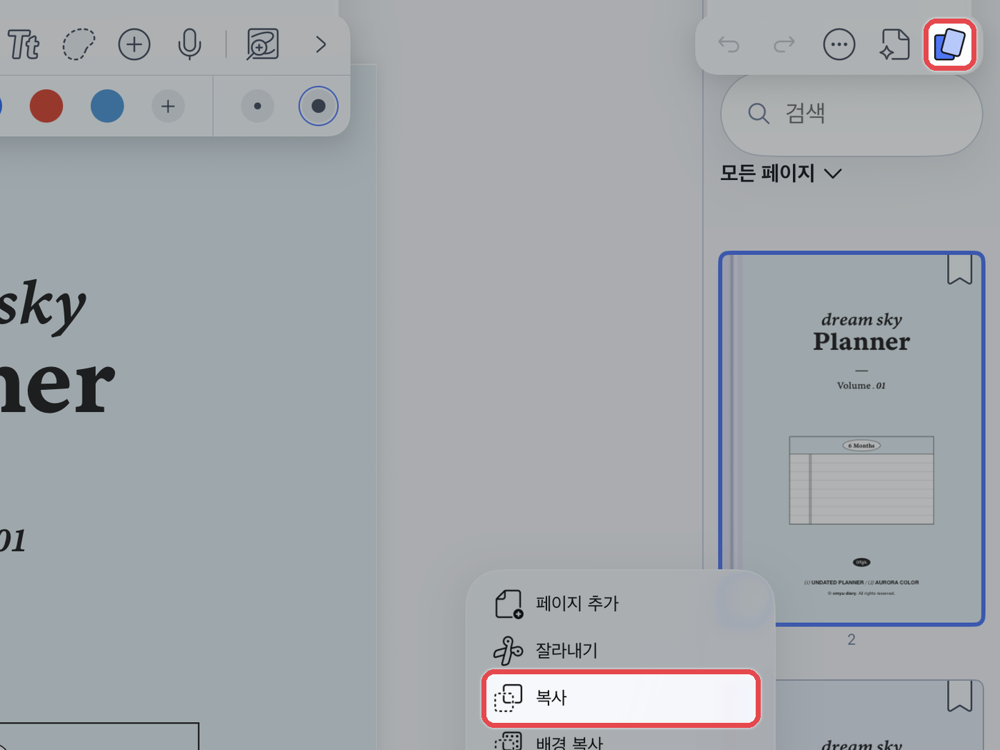
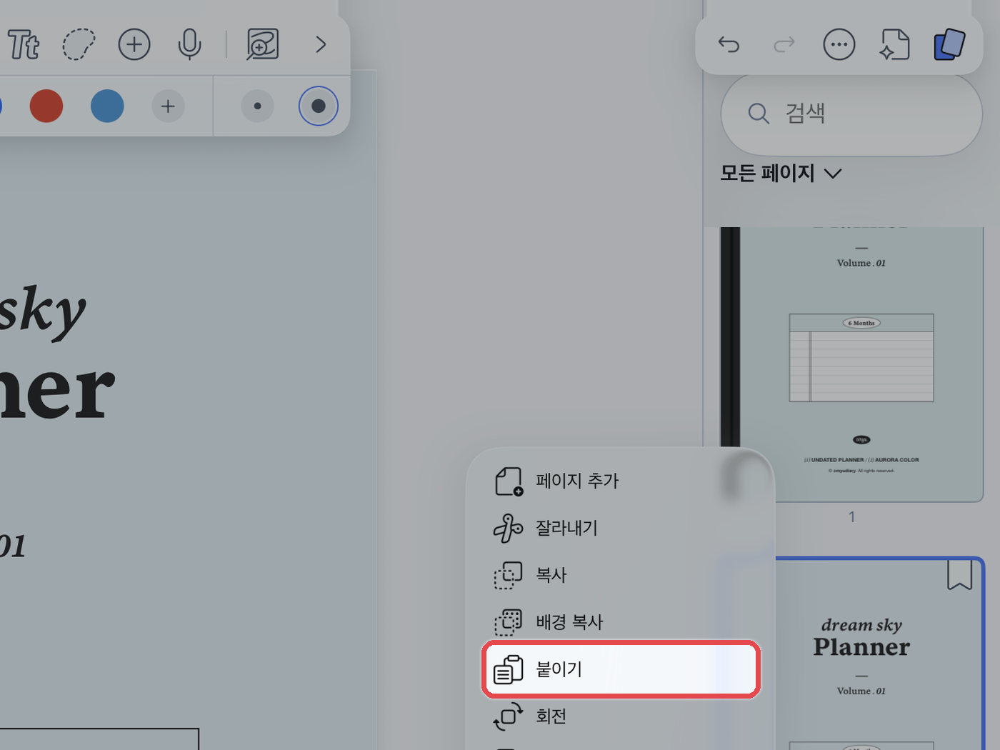
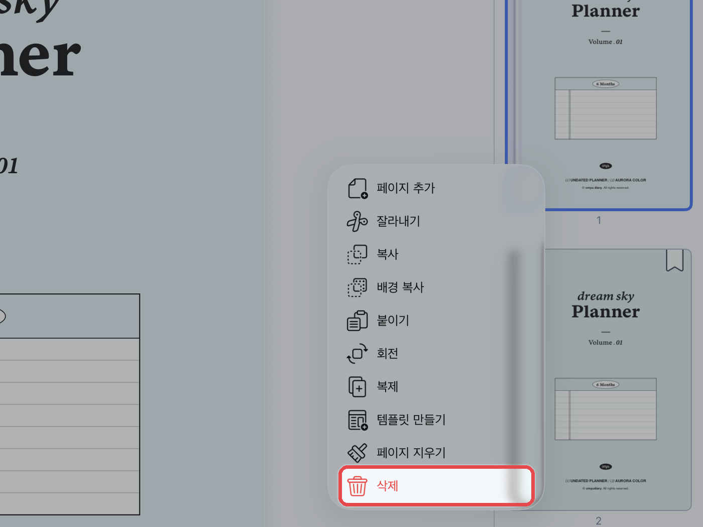

# 표지 변경하는 법

노타빌리티는 **노트의 첫 속지가 표지**가 됩니다.\
표지 파일의 속지를 복사해 맨 앞에 붙인 뒤 기존 표지를 삭제합니다.



#### 표지 파일 불러오기

[파일 다운로드](../download/pdf.md)와 같은 방법으로 표지 파일을 노타빌리티에 가져와 주세요.

<figure><figcaption></figcaption></figure>



#### 표지 복사

표지 노트에서 오른쪽 위 **\[페이지]** 아이콘을 눌러 페이지 목록을 열어주세요.\
**\[...]**&#xC744; 누르고 표지를 선택한 뒤 **\[복사]**&#xB97C; 눌러주세요.

<figure><figcaption></figcaption></figure>



#### 바꿀 노트에 붙이기

표지를 바꿀 노트를 열고 같은 방법으로 페이지 목록을 연 뒤 **\[붙이기]**&#xB97C; 눌러주세요.\
붙인 표지를 **길게 눌러 맨 앞으로 드래그**해 주세요.

<figure><figcaption></figcaption></figure>



#### 기존 표지 삭제

기존 표지를 선택하고 **\[삭제]**&#xB97C; 눌러주세요.

<figure><figcaption></figcaption></figure>


