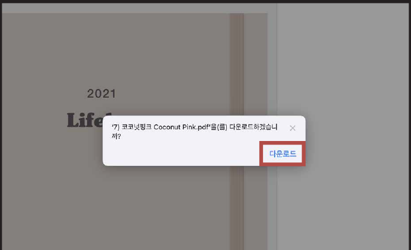
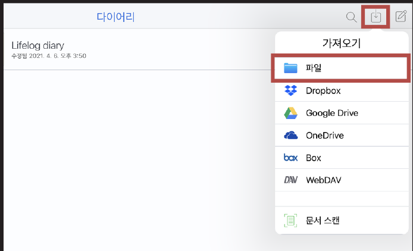
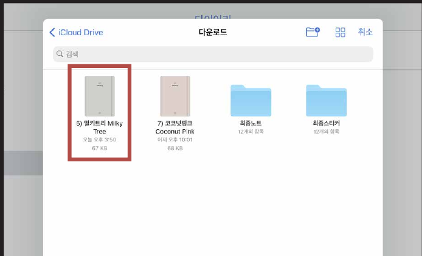
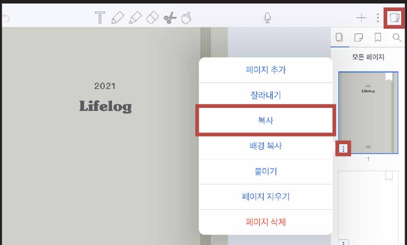
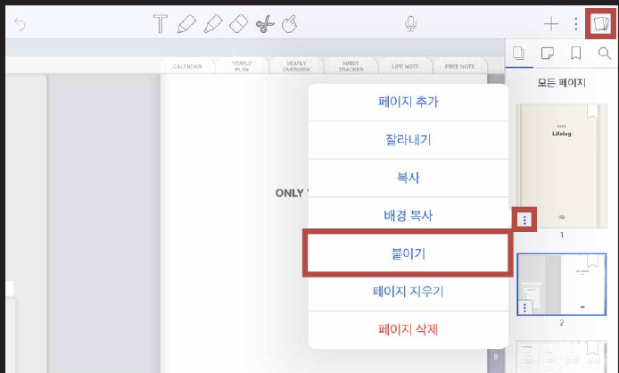
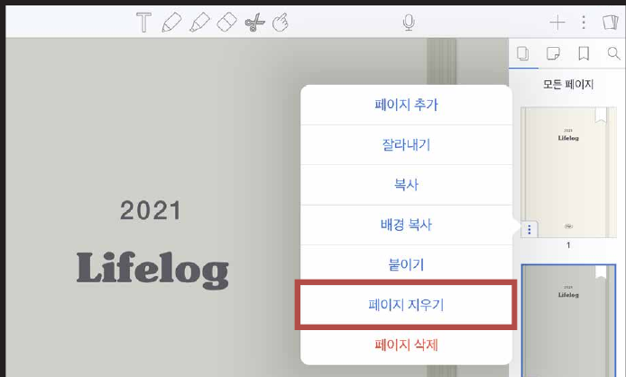

# 표지 변경하는 법

### STEP 01

[제품 다운로드 방법](download.md)과 동일하게 표지를 저장해 주세요.

### STEP 02

노타빌리티를 열고 상단의 화살표를 누른 후 **파일**을 눌러줍니다.

### STEP 03

**다운로드 받아둔 표지 파일**을 열어줍니다.

### STEP 04

좌측 상단의 책 모양 아이콘을 누르고 표지를 **복사**합니다.

### STEP 05

변경하고 싶은 노트를 열고 표지를 선택한 후 **붙이기**를 눌러주세요.

### STEP 06

이전의 표지를 삭제하고 싶을 경우 **페이지 지우기**를 눌러주세요.
