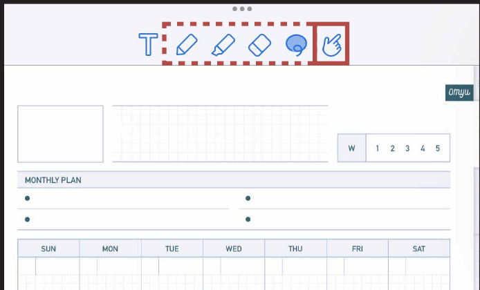
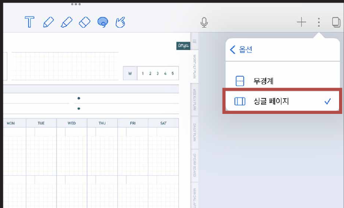

# 하이퍼링크 사용방법


노타빌리티는 하이퍼링크 활성화 버튼이 아니어도 **펜 / 형광펜 / 지우개 / 올가미 버튼**으로도 하이퍼링크 이동이 가능합니다.


### STEP 01

하이퍼링크 **활성화 상태**입니다. 다른 페이지로 이동할 때 사용하세요.

### ⭐ TIP

점 3개를 누르고 [보기]를 누르면 페이지 방향을 설정할 수 있습니다.


**하이퍼링크가 있는 부분에 글을 쓰고 싶을 때**

1. 펜을 떼지 않고 한 번에 길게 쓰면 다른 페이지로 이동하지 않고 한 글자씩 쓸 수 있습니다.
2. 하이퍼링크 버튼이 없는 빈 공간에 글씨를 쓰고 올가미 툴로 이동하는 방법이 있습니다.

