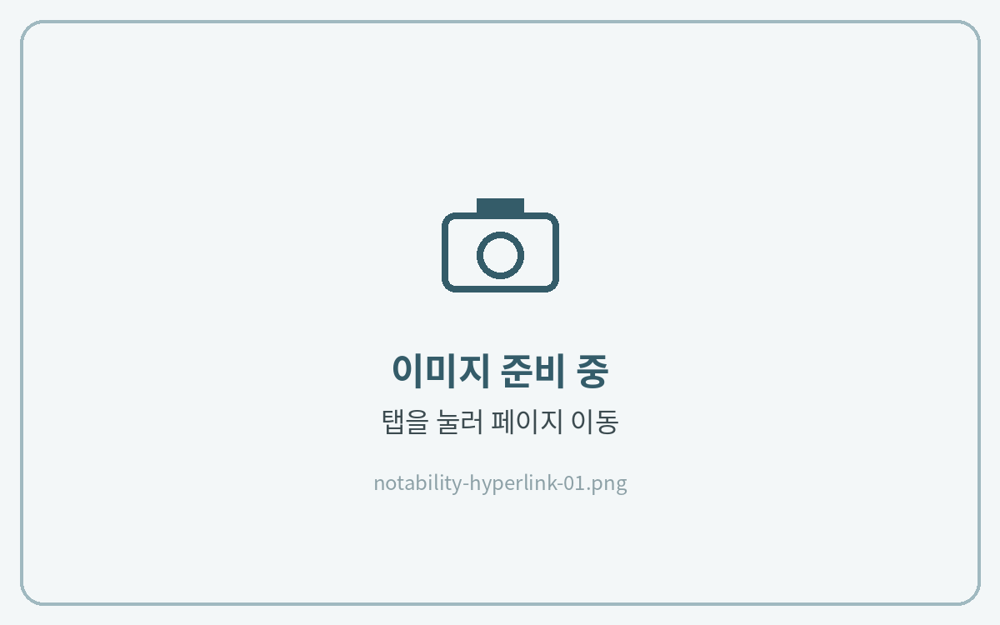
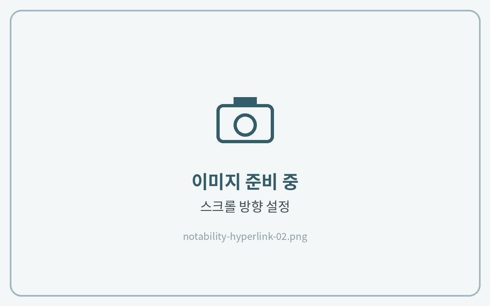

# 하이퍼링크 사용법



**링크를 눌러 이동**

어떤 도구를 선택한 상태에서도 하이퍼링크 버튼을 **짧게 누르면** 해당 페이지로 이동해요.

<figure><figcaption></figcaption></figure>



**페이지 넘김 방향 설정**

오른쪽 위 **\[⋯]** 더보기 → **\[스크롤 방향]**&#xC5D0;서 **\[가로]**&#xB97C; 선택하면 한 장씩 넘겨볼 수 있어요.

<figure><figcaption></figcaption></figure>




**링크가 있는 칸에 글씨를 쓰고 싶을 때**

1. 펜을 떼지 않고 **한 번에 길게** 쓰면 페이지가 이동하지 않고 필기됩니다.
2. 빈 공간에 먼저 쓴 뒤 **올가미 도구로 옮기는** 방법도 있습니다.

