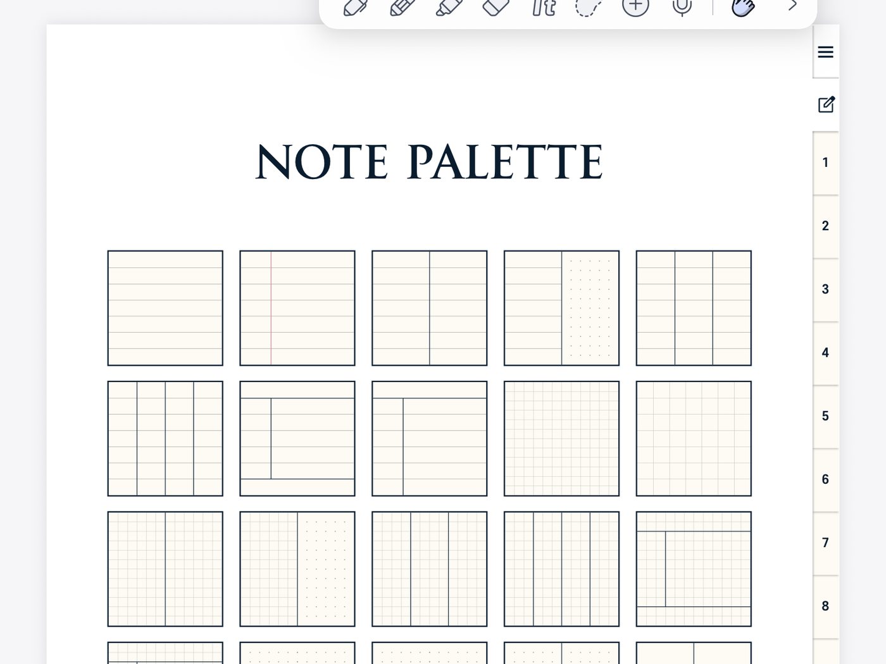
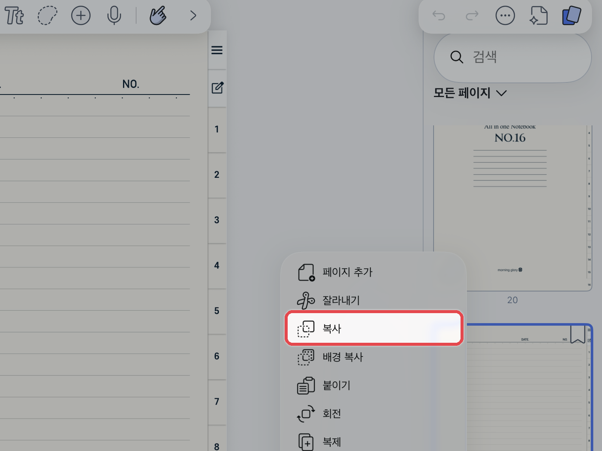
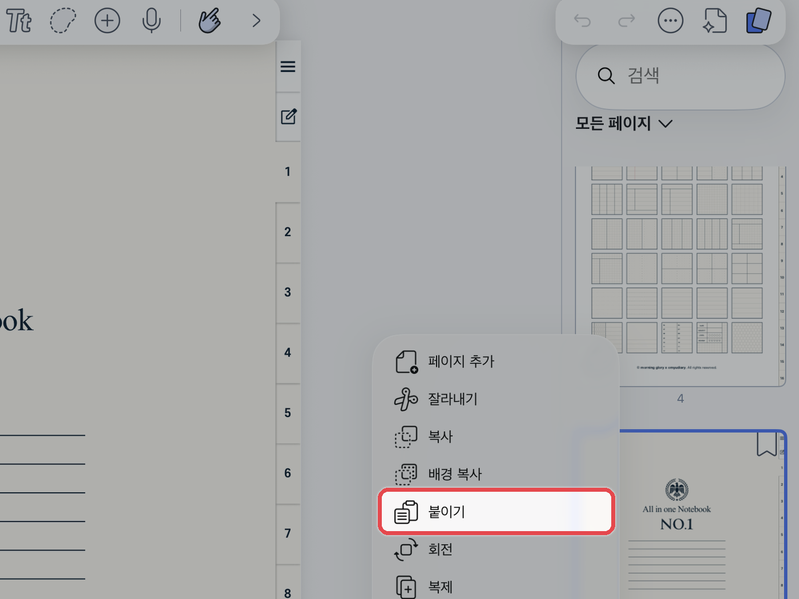

# 노트팔레트 사용법


**노트팔레트(NOTE PALETTE)가 포함된 제품에만 해당됩니다.**\
예) 올라운드 노트 · 올데이 언어노트 · 유어컬러 언어노트 · 워크윗미 노트


**노트팔레트**는 여러 가지 속지를 한곳에 모아 둔 곳입니다.\
필요한 속지를 골라 바인더(노트 본문)에 복사해 사용합니다.



#### 원하는 속지로 이동

노트팔레트에서 원하는 속지를 눌러 이동해 주세요.

<figure><figcaption></figcaption></figure>



#### 속지 복사

**\[...]**&#xC744; 누르고 복사할 속지를 선택한 뒤 **\[복사]**&#xB97C; 눌러주세요.

<figure><figcaption></figcaption></figure>



#### 붙여넣기

원하는 바인더 위치로 이동한 뒤, **\[...]**&#xC744; 누르고 **\[붙이기]**&#xB97C; 눌러주세요.

<figure><figcaption></figcaption></figure>


