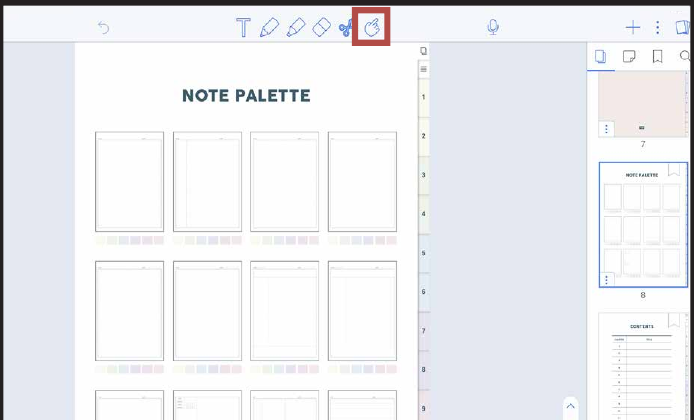
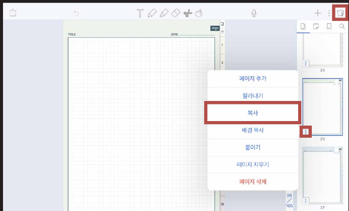
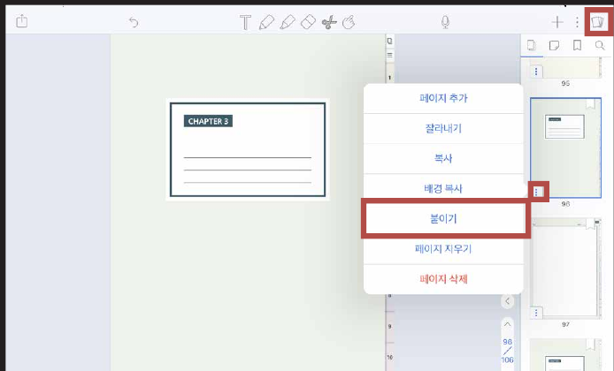

# 노트팔레트 사용방법


노트팔레트(NOTE PALETTE)가 있는 제품에만 해당됩니다!
(예: 올라운드 노트 / 올데이 언어노트 / 유어컬러 언어노트 / 워크윗미 노트)


### STEP 01

**하이퍼링크**를 활성화 시킨 후 **원하는 노트**를 눌러주세요.

### STEP 02

우측 상단의 책 모양 아이콘을 누르고 페이지를 **복사**합니다.

### STEP 03

**바인더로 이동**한 후 **붙이기**를 눌러주세요.
