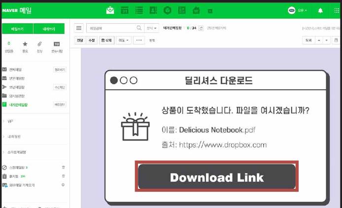
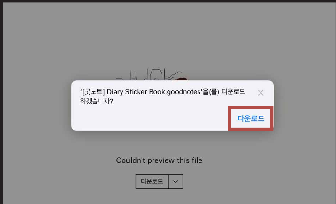
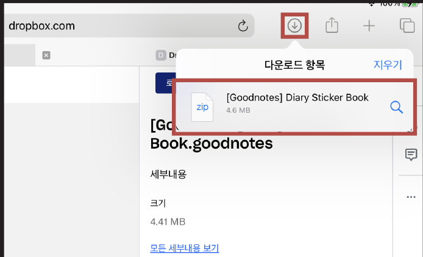
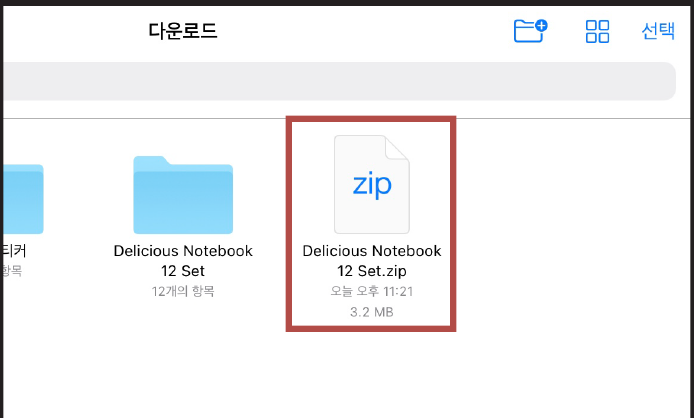
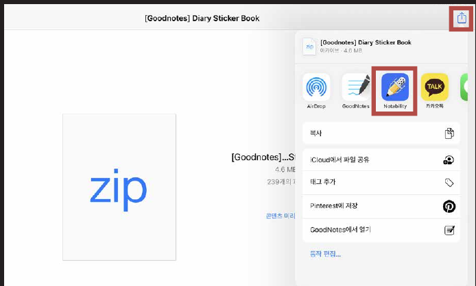
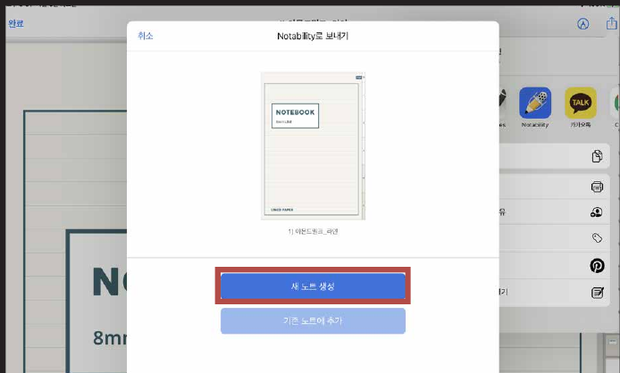

# 스티커북 다운로드 방법

### STEP 01

**사파리(Safari)**에서 받으신 메일의 **다운로드 링크**를 눌러주세요.

### STEP 02

**다운로드**를 눌러주세요.

### STEP 03

상단의 화살표를 누르고 **다운로드 항목 파일**을 누릅니다.

### STEP 04

파일을 클릭해서 **압축을 풀고** [노타빌리티]라고 적힌 **파일을 선택**해 주세요.

### STEP 05

상단의 화살표를 누르고 **노타빌리티 아이콘**을 누릅니다.

### STEP 06

**새 노트 생성 > 불러오기**를 누르면 끝!
