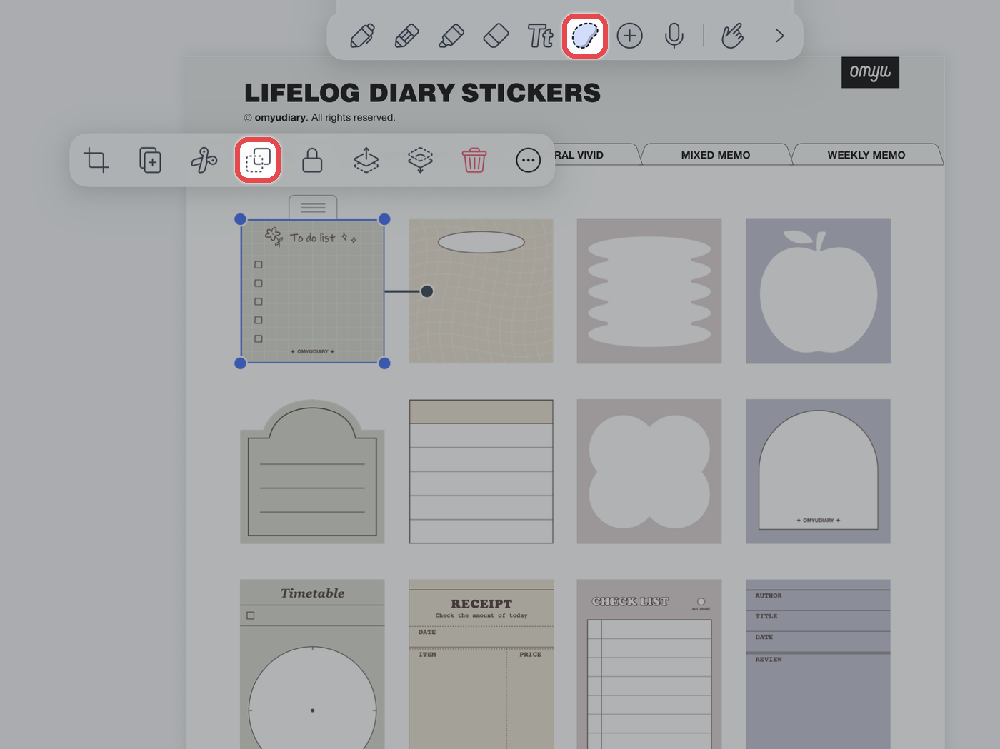
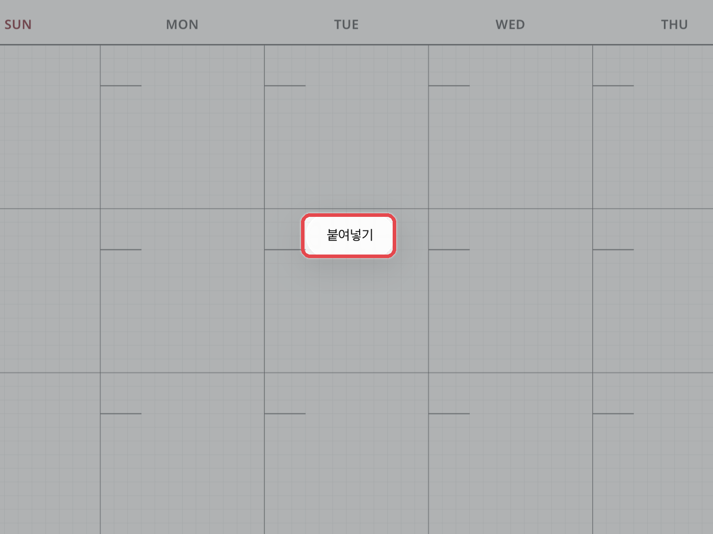
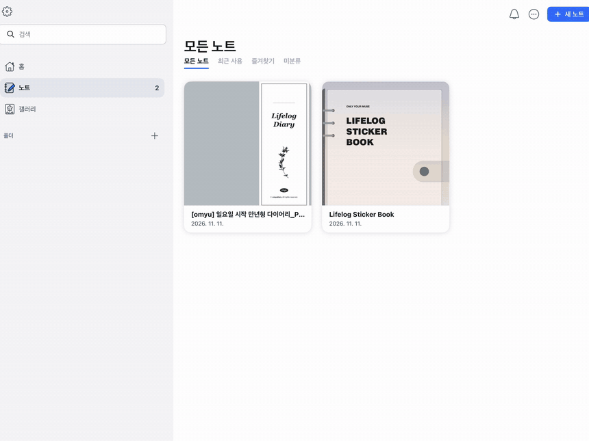
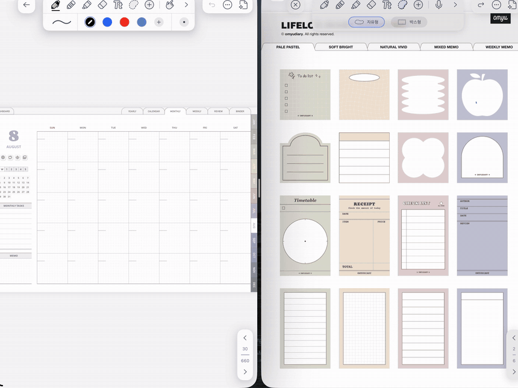
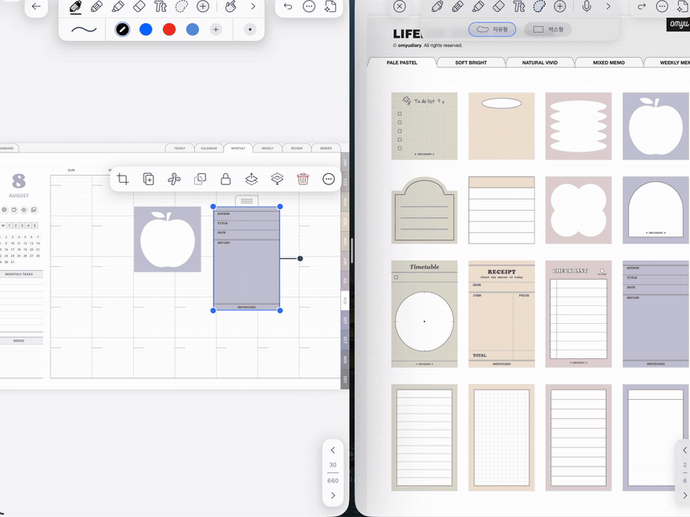
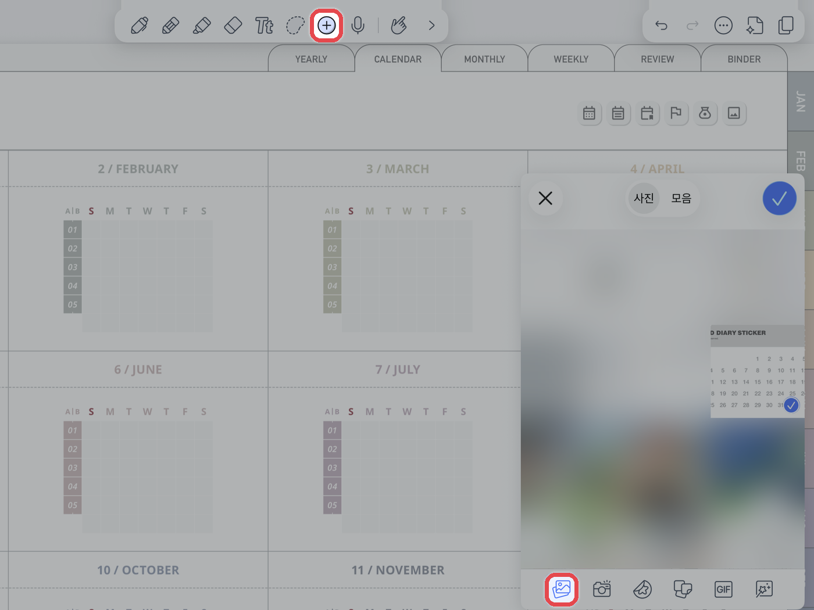
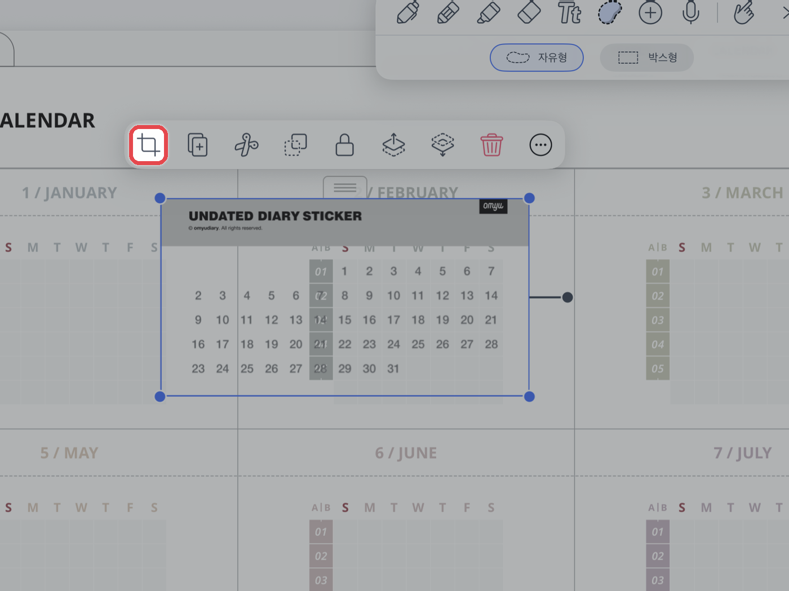
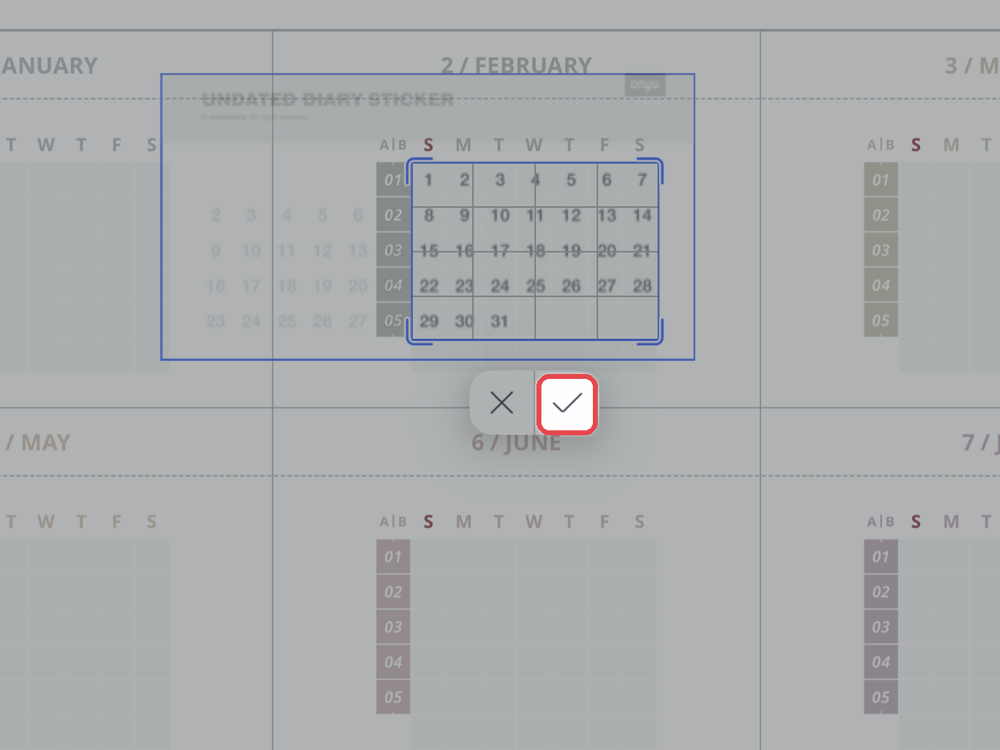

# 스티커 사용법

노타빌리티에서 스티커를 사용하는 방법은 **3가지**입니다.\
아래 버튼을 누르면 원하는 방법으로 바로 이동할 수 있습니다.

<a href="sticker.md#cutting" class="button secondary">① 컷팅 스티커북</a> <a href="sticker.md#split-view" class="button secondary">② 화면 분할로 사용</a> <a href="sticker.md#png-cut" class="button secondary">③ PNG 잘라서 사용</a>

## 컷팅 스티커북 

컷팅 스티커북에서 원하는 스티커를 복사해 노트에 바로 붙일 수 있습니다.



#### 스티커 복사

스티커북에서 **\[올가미 도구]**&#xB85C; 원하는 스티커를 선택하고 **\[복사 아이콘]**&#xC744; 눌러주세요.

<figure><figcaption></figcaption></figure>



#### 노트에 붙이기

노트의 원하는 곳을 길게 누르고 **\[붙여넣기]**&#xB97C; 눌러주세요.

<figure><figcaption></figcaption></figure>



## 화면 분할(Split View) 사용하기 

스티커북과 노트를 한 화면에 나란히 띄우면 복사·붙여넣기 없이 **드래그 한 번**으로 스티커를 옮길 수 있습니다.\
스티커를 여러 개 붙일 때 특히 편리합니다.



#### 스티커북과 노트 준비

노타빌리티에 **스티커북 파일**과 스티커를 붙일 **노트(다이어리)**&#xB97C; 불러와 주세요.



#### 스티커북을 새 창으로 열기

노트 목록에서 **스티커북 파일을 길게 누른 채** 화면 왼쪽이나 오른쪽 끝으로 끌어다 놓아주세요.\
스티커북이 새 창으로 열리면, 다른 쪽 창에서 노트를 열어주세요.

<figure><figcaption></figcaption></figure>



#### 스티커 끌어다 놓기

스티커북 창에서 **\[올가미 도구]**&#xB85C; 원하는 스티커를 선택해 주세요.\
선택된 스티커를 **길게 누른 채** 노트 창으로 끌어다 놓으면 바로 붙어요.\
붙인 뒤에는 크기와 위치를 자유롭게 조절할 수 있어요.

<figure><figcaption></figcaption></figure>



#### 분할 화면 닫기

다 붙였다면 가운데 구분선을 **스티커북 쪽 화면 끝까지** 밀어주세요.\
노트만 전체 화면으로 돌아와요.

<figure><figcaption></figcaption></figure>



## PNG 잘라서 사용하기 

PNG 이미지를 노트에 넣고 필요한 부분만 잘라 스티커처럼 사용할 수 있습니다.



#### 이미지 넣기

상단의 **\[+]** 미디어 버튼 → **\[사진]**&#xC744; 누르고, 저장해 둔 PNG 스티커를 선택해 주세요.

<figure><figcaption></figcaption></figure>



#### 자르기 방식 선택

삽입한 이미지를 누르고 **\[자르기]**&#xB85C; 필요한 부분만 남긴 뒤 **\[✓]**&#xB97C; 눌러주세요.

<figure><figcaption></figcaption></figure>



#### 원하는 크기로 자르기

원하는 크기에 맞게 잘라주세요. 잘라낸 이미지는 크기와 위치를 자유롭게 조절할 수 있어요.

<figure><figcaption></figcaption></figure>


