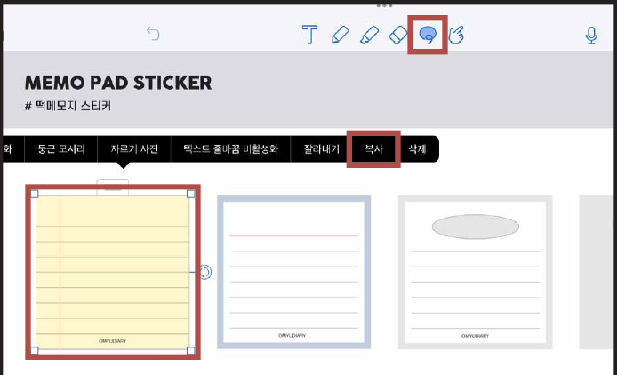
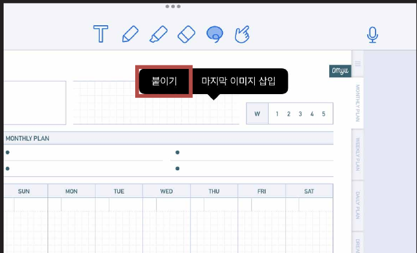
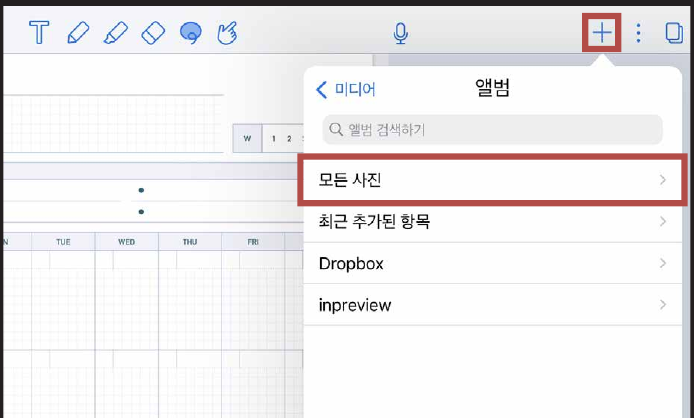
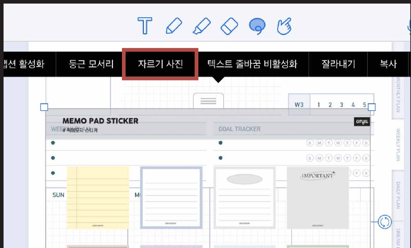
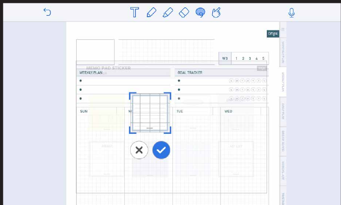

# 스티커 사용방법

## 컷팅 스티커

### STEP 01

스티커 파일을 열고 **올가미 툴**을 누른 후 필요한 스티커를 **복사**해줍니다.

### STEP 02

스티커가 필요한 파일에 **붙이기**를 눌러주세요.

## PNG 스티커

### STEP 01

**[+] 버튼 > 포토 라이브러리 > 모든 사진** > 저장한 스티커를 누르고 **추가**를 눌러주세요.

### STEP 02

스티커 이미지를 누른 후 **자르기 사진**을 눌러주세요.

### STEP 03

필요한 영역을 조절하고 체크를 눌러주세요.
