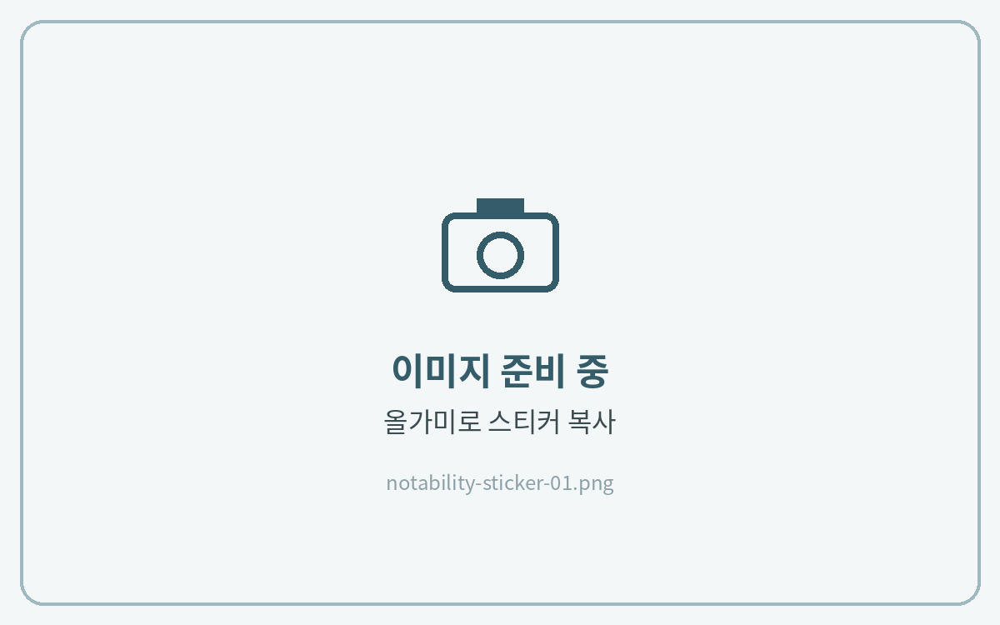
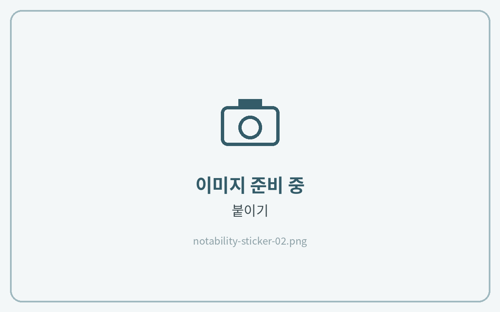
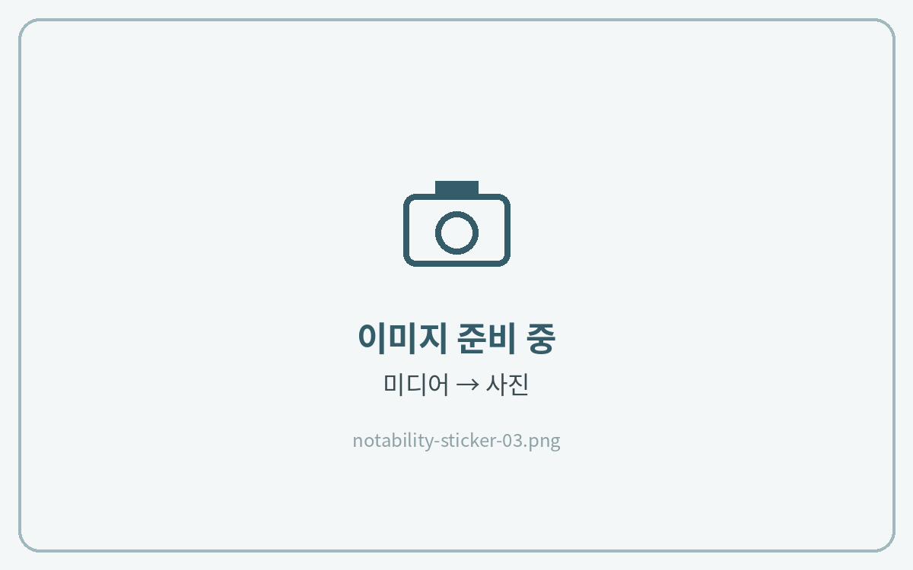
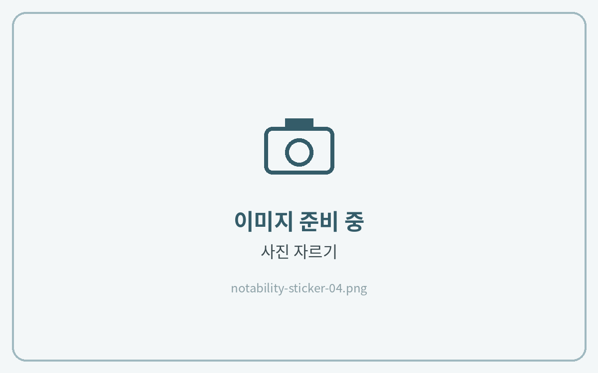
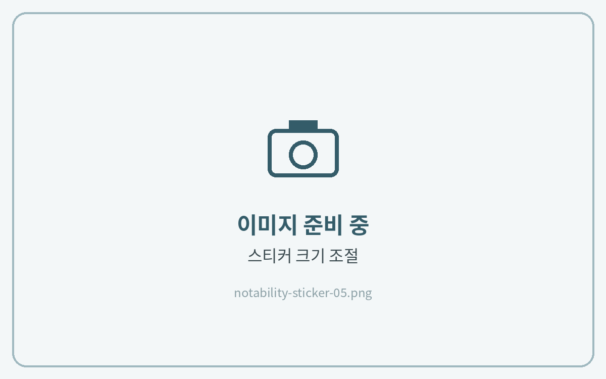

# 스티커 사용법

## 컷팅 스티커



**스티커 복사**

스티커북에서 **올가미 도구**로 스티커를 선택하고 **복사**를 눌러주세요.

<figure><figcaption></figcaption></figure>



**노트에 붙이기**

노트로 돌아가 빈 곳을 길게 누르고 **붙이기**를 눌러주세요.

<figure><figcaption></figcaption></figure>



## PNG 스티커



**사진 삽입**

**+ (미디어) → 사진**에서 저장해 둔 스티커를 선택해 주세요.

<figure><figcaption></figcaption></figure>



**자르기**

이미지를 누르고 **사진 자르기**로 필요한 부분만 남긴 뒤 체크(✓)를 눌러주세요.

<figure><figcaption></figcaption></figure>



**크기 조절**

모서리를 드래그해 크기와 위치를 맞추면 완성이에요.

<figure><figcaption></figcaption></figure>


