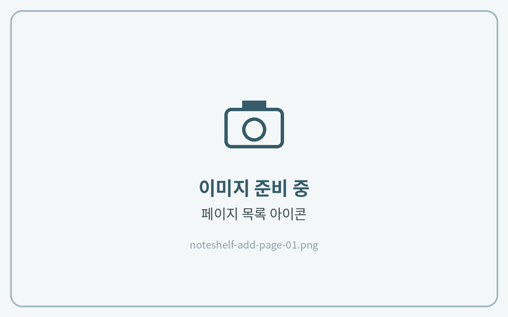
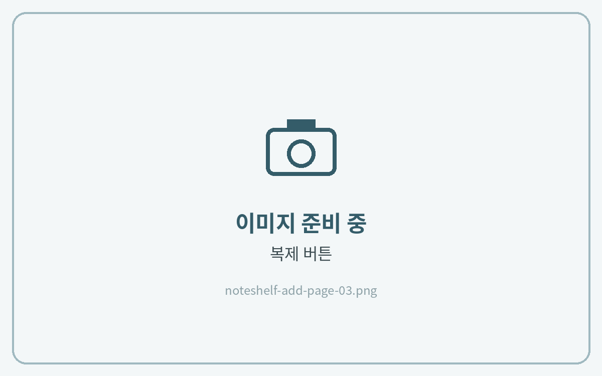

# 페이지 추가하는 법


**노트쉘프 3** 기준 안내입니다.\
노트쉘프 1(이전 버전)은 메뉴 위치와 아이콘 모양이 다를 수 있습니다.




#### 페이지 목록 열기

**\[페이지 목록(사각형 4개 모양)]** 아이콘을 눌러주세요.

<figure><figcaption></figcaption></figure>



#### 페이지 선택

목록 위쪽의 **\[✓]** 체크 아이콘을 누르고, 추가할 페이지를 선택해 주세요.

<figure><figcaption></figcaption></figure>



#### 복제

**\[복제]**&#xB97C; 누르면 바로 뒤에 같은 페이지가 추가돼요.

<figure><figcaption></figcaption></figure>


