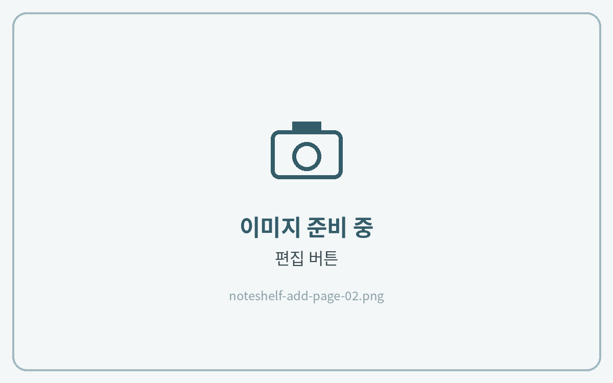

# 페이지 추가하는 법



**페이지 목록 열기**

왼쪽 위 **페이지 목록(책 아이콘)** 을 눌러주세요.

<figure><figcaption></figcaption></figure>



**편집**

목록 위쪽의 **편집**(또는 선택)을 눌러주세요.

<figure><figcaption></figcaption></figure>



**복제**

추가할 페이지를 선택하고 **복제**를 누르면 바로 뒤에 같은 페이지가 생겨요.

<figure><figcaption></figcaption></figure>



